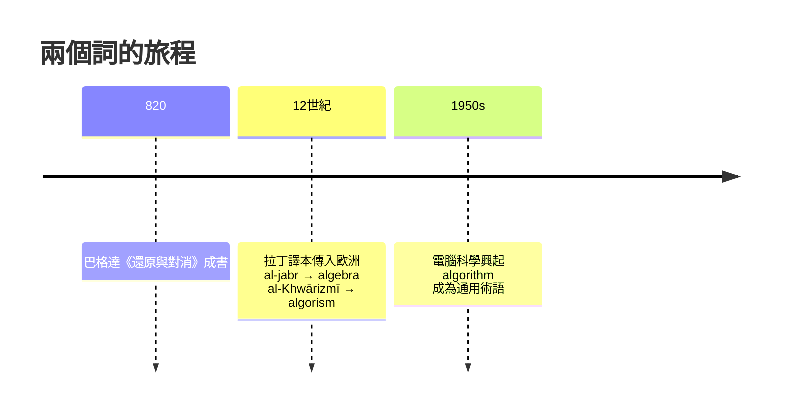

# 1.3 花拉子米與智慧宮：代數這個名字的由來

## 一座帝國供養的圖書館

750 年，阿拔斯王朝推翻倭馬亞王朝，遷都巴格達。新王朝需要治理一個橫跨波斯、中亞與北非的帝國：要收稅、修渠、定曆法、統一長度與貨幣。統治者的解法非常「現代」——花錢蓋國家級研究機構。

九世紀初，哈里發馬蒙設立「智慧宮」（Bayt al-Hikma），組織大規模翻譯運動：歐幾里得、托勒密、丟番圖、印度天文曆法著作，被系統性地譯成阿拉伯文。這不是愛好，是基礎建設——相當於今天的國家科學基金加上標準局。

## al-jabr 的誕生

約 820 年，宮廷學者花拉子米（al-Khwārizmī）寫下《還原與對消計算概要》（al-Kitāb al-mukhtaṣar fī ḥisāb al-jabr wa-l-muqābala）。

書名裡的兩個詞是兩種操作：

- al-jabr（還原）：把方程一邊的減項移到另一邊，例如 $x - 3 = 7$ 變成 $x = 10$
- al-muqābala（對消）：兩邊同減同類項，如 $3x + 5 = x + 9$ 化為 $2x = 4$

這本書傳入歐洲後，書名中的一半 al-jabr 演變成拉丁文 algebra——代數。花拉子米本人的名字則在拉丁文中變成 algorismus，今天英語的 algorithm（演算法）即源於此。一個人的名字與一本書的名字，各自成為現代數學的兩大支柱，這在數學史上絕無僅有。

## 為什麼是伊斯蘭世界？

不是因為「更有天賦」，而是制度與需求疊加：

| 因素 | 具體內容 |
|---|---|
| 經濟需求 | 帝國田賦（kharāj）按土地丈量徵收，遺產法有極細的分配比例 |
| 宗教需求 | 伊斯蘭遺產法與禮拜朝向的計算，逼出算術與幾何的應用傳統 |
| 紙的傳入 | 751 年怛羅斯之戰後造紙術西傳，巴格達設紙坊，知識複製成本驟降 |
| 國家翻譯工程 | 智慧宮把希臘邏輯與印度-波斯計算傳統裝進同一間圖書館 |

關鍵在第三條：紙便宜。希臘人用昂貴的莎草紙與羊皮卷，思想傳播極慢；紙使書記學校與藏書樓平民化，數學得以離開少數學派，變成官僚系統的通用技能。

## 花拉子米的遺產與局限

他把方程按「平方、根、數」分類成六種標準型，逐一給出解法並附幾何證明——實用食譜（兩河傳統）與邏輯證明（希臘傳統）第一次合流。但他仍不認識負數與零的完整概念，三次方程隻字未提。

那道鴻溝要再等六百年、等義大利商業革命把複利與合夥帳目逼到極限，才被一群職業決鬥者跨過。下一章，我們去看文藝復興時代最荒唐也最精彩的一場數學決鬥。
