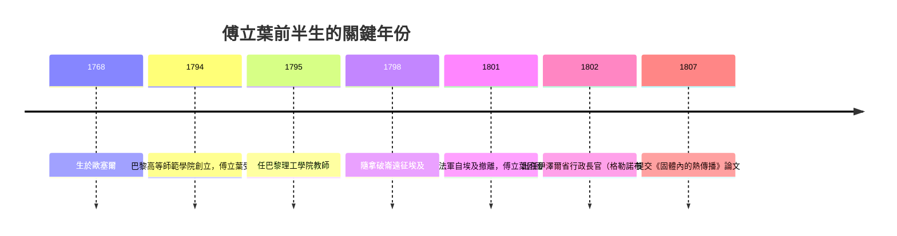

# 1.1 跟著拿破崙去埃及：一位數學家的政治與學術人生

1798 年 5 月，一支龐大的法國艦隊悄悄駛出土倫港。船上有四萬名士兵，以及一百五十餘名學者——數學家、天文學家、化學家、測量師、東方學家。拿破崙把這次遠征包裝成「科學與文明的任務」，但真實目的很清楚：切斷英國與印度的航路，建立法國在東方的殖民帝國。在這批學者之中，有一位三十歲的數學教師，名叫約瑟夫·傅立葉。

## 革命時代的數學家

要理解傅立葉，得先理解他成長的時代。他 1768 年生於歐塞爾，是裁縫的遺腹子，九歲喪母，被本篤會收容教育。他原本極可能成為教士，但 1789 年法國大革命爆發，一切舊秩序崩解。革命政府急需技術人才來支撐戰爭：鑄砲、測量、彈道、軍需。1794 年，革命政府創立巴黎高等師範學院，次年又創立巴黎理工學院（École Polytechnique）——這不是普通的學校，而是為共和國量產工程師與科學家的機器。傅立葉先在師範學院短期受訓，隨後成為理工學院的教師，與拉格朗日、蒙日等人同堂。

這段經歷說明了一個重要事實：近代歐洲的大數學家，很多是革命與戰爭的體制產物。國家需要數學，數學家因此有了職位、薪水與講台。科學的黃金年代，往往與國家的危機年代重疊。

## 埃及：學者軍團與《埃及描述》

傅立葉並非職業軍人，但他在埃及承擔了大量行政與學術工作：管理開羅的科研機構「埃及學院」、參與調查上埃及的文物與地理。遠征在軍事上最終失敗——1801 年法軍投降——但學術上的後果深遠：這批學者後來彙編了巨著《埃及描述》（Description de l'Égypte，1809–1829），成為埃及學的奠基文獻，羅塞塔石碑也是這次遠征的發現。傅立葉正是《埃及描述》總編纂工作的主持人之一。

埃及還留給傅立葉一樣更私人的東西：他相信高溫與乾燥對健康有益，此後常年把自己裹在厚衣、居住在過熱的房間裡。有人戲稱這與他終生研究「熱」不無關係。1802 年，拿破崙任命他為伊澤爾省（首府格勒諾布爾）行政長官——這是一份實打實的公職，負責道路、教育、行政、以及（用當代的話說）安撫剛被併入法國不久的地區。

## 白天當官，晚上算熱

正是在格勒諾布爾的任內，傅立葉開始了熱傳導的研究。據他自己的回憶，研究的起點之一是對熱的長期思考，甚至可以追溯到在埃及對氣候與熱的觀察。他白天治理一個省，晚上研究一根受熱的金屬棒內部溫度如何隨時間與位置變化。1804 年前後，他已寫出初步論文；1807 年，他向巴黎科學院提交了那篇著名的長文《固體內的熱傳播》。

## 為什麼是熱？

今天的讀者也許會問：那個時代最耀眼的題目是天體力學——拉普拉斯正在寫《天體力學》——為什麼傅立葉偏偏選了「熱」？

原因有三。其一，熱是當時工業與日常的核心問題：冶金、釀造、取暖、地質推論（地球冷卻說）都牽涉熱流，但它的數學理論幾乎空白。其二，熱現象是典型的「連續場」問題：溫度不是一個數，而是空間中每個點的函數，這正好呼應了十八世紀末分析學（偏微分方程）的興起。其三，與弦振動研究相關的三角級數技術已經存在——丹尼爾·白努利與歐拉在 1750 年代為了弦振動問題爭論過「三角級數能否表示任意函數」，但那是懸而未決的舊案。傅立葉把這個舊工具帶進了新戰場，並且用得遠比前人徹底。

於是，一個由帝國行政體系供養、由遠征與革命塑造的人生，在阿爾卑斯山腳下的省城裡，孕育出一套改變世界理解方式的數學。下一節，我們走進他的書房，看那道熱流方程如何被寫下。
