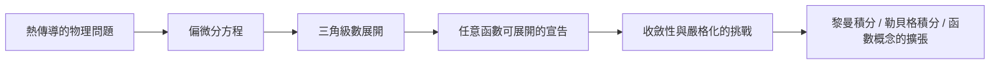

# 1.2 格勒諾布爾的壁爐：熱傳導方程的誕生

1807 年，巴黎科學院收到一篇來自格勒諾布爾的長文。作者的身份有些尷尬：一位省政府高官、前理工學院教師，遠離巴黎的學術圈十餘年。論文題目直白而大膽——《固體內的熱傳播》。這篇論文裡寫下的方程與方法，將在未來兩百年間滲透進物理學、工程學與資訊技術的每個角落。

## 把「溫度」變成函數

在傅立葉之前，人們描述熱多靠定性法則。傅立葉的關鍵一步是觀念性的：溫度是空間座標 $x$ 與時間 $t$ 的函數 $u(x,t)$。接著他提出兩條經驗定律：

1. 熱流率與溫度梯度成正比（後世稱為傅立葉熱傳導定律）；
2. 一小段物體溫度的變化率，等於流入與流出的熱量之差。

把兩條合起來，對一根均勻細棒，就得到

$$\frac{\partial u}{\partial t} = k \frac{\partial^2 u}{\partial x^2}$$

這就是一維熱傳導方程（擴散方程）。它的結構極為優雅：溫度在時間上的變化，由溫度在空間上的「彎曲程度」驅動。哪裡的溫度分布彎得越厲害，那裡的熱流動得越快。這個方程不僅描述熱，後來人們發現它也描述物質擴散、布朗運動的機率密度、乃至金融數學中的選擇權定價方程（布萊克–休斯方程經變數替換後本質上是熱方程）。

## 解方程的兩難

光有方程不夠，還要能解。傅立葉面對的問題是：給定棒的初始溫度分布 $f(x)$，求日後任一時刻的 $u(x,t)$。

他先處理一個理想化情境：棒的兩端保持攝氏零度。他嘗試「分離變數」，設 $u(x,t)=X(x)T(t)$，代入後發現解可以拆成無窮多個「模態」：

$$u(x,t)=\sum_{n=1}^{\infty} b_n \sin(n\pi x/L)\, e^{-k n^2 \pi^2 t/L^2}$$

每一項都是空間上的正弦波形乘上一個隨時間指數衰減的因子。物理圖景非常漂亮：高頻模態（$n$ 大）衰減得快，低頻模態活得久。這正是為什麼隔着厚牆你聽不見高音卻隱約感到悶熱——不，這是為什麼粗糙的溫度起伏會迅速被抹平，只剩最平滑的成分。熱傳導是一台天然的「低頻保留、高頻消除」的濾波器。

剩下的问题是：初始分布 $f(x)$ 如何寫成這些正弦的組合？傅立葉算出了係數（今日所稱的傅立葉係數）：

$$b_n = \frac{2}{L}\int_0^L f(x)\sin(n\pi x/L)\,dx$$

然後，他做出全書最關鍵、也最具爭議的宣告：對幾乎任何初始分布 $f(x)$——甚至包含角點、折線的怪函數——這個三角級數都收斂到 $f(x)$。

## 為什麼這是革命

今天的學生在課堂上學到「傅立葉級數」時，也許只覺得是又一個展開技巧。但在 1807 年，這句宣告撼動了「函數」這個概念本身。

十八世紀的數學家（包括歐拉與拉格朗日）心中理想的「函數」是解析的：由一條式子給出、處處光滑。而他們長期認為：一個三角級數若在一段區間上恆等於零，則它的所有係數必為零，因此三角級數唯一確定的函數必然「處處是它自己的樣子」——不可能是一半直線一半曲線的拼接體。傅立葉卻明確寫出：兩段不同斜率的折線函數，也能用三角級數表示。這意味着

> 「函數」不必是優雅的公式，它可以只是一條任意畫出的曲線。

這個觀念轉變是十九世紀分析學嚴格化運動的起點之一。為了說清「什麼樣的函數可以這樣展開」「級數在哪些點收斂」，數學家被迫重新定義積分（黎曼積分、再後來的勒貝格積分）、重新定義收斂、重新定義「函數」本身。物理問題逼出了現代分析的整座大廈。

## 同時代人看傅立葉

不是所有人都買帳。拉格朗日在審查 1807 年論文時堅持舊日對三角級數的懷疑；拉普拉斯與畢歐則認為傅立葉的熱流推導跳過了他們的分子理論。傅立葉在省城的孤立地位也於事無補。但這篇論文的物理內容實在太強——它給出的解能與實驗對照，能預測冷卻過程——批評者無法否定其力量。下一次正面交鋒，要等到 1811 年巴黎科學院懸賞熱學競賽，那將是本書第二章的故事。

傅立葉在《熱的解析理論》（1822）的序言裡寫過一句常被引用的話：對自然的深入研究，是數學發現最富饒的源泉。這不是客套——他的一生就是這句話的註腳。
