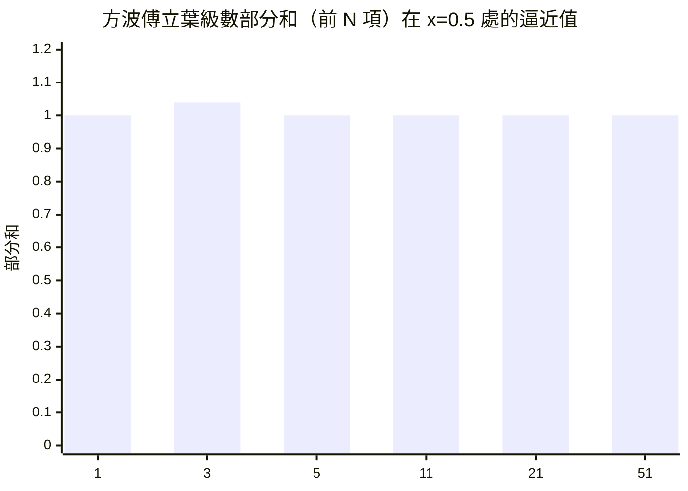

# 1.3 三角級數的狂想：任何函數都能拆成 sin 與 cos？

傅立葉最驚人的主張可以濃縮成一句話：把函數看作「聲音」。一段複雜的聲音可以分解成純音的疊加；同理，一個複雜的函數——無論多麼崎嶇——都可以分解成簡單的正弦與餘弦的疊加。本節我們把這個想法講清楚，並看看它為什麼在當時被視為狂想。

## 正弦波：大自然的基本振動

為什麼偏偏是 sin 與 cos？因為它們是「等速圓周運動的影子」，是自然界最基本的振動形式：琴弦的單一泛音、交流電、光的單色成分。更技術地說，它們是線性系統的「特徵函數」——你把一個正弦波輸入線性電路或線性微分方程，出來的還是同一個頻率的正弦波，只是大小與相位可能改變。這個性質讓 sin/cos 成為分析一切線性現象的天然「字母表」。

傅立葉級數的標準形式（週期 $2\pi$）：

$$f(x) = \frac{a_0}{2} + \sum_{n=1}^{\infty}\left(a_n\cos nx + b_n\sin nx\right)$$

係數由積分給出。直覺上，這像是在問一連串「相關性」問題：$f(x)$ 裡含有多少頻率為 $n$ 的成分？積分 $\int f(x)\cos nx\,dx$ 就是答案。每個係數是一次「配對測量」。

## 一個會讓十八世紀數學家皺眉的例子

傅立葉本人最愛的例子之一，是方波。設

$$f(x)=\begin{cases}1, & 0<x<\pi\\ -1, & \pi<x<2\pi\end{cases}$$

這個函數處處「平」，卻在兩點處斷裂跳躍。傅立葉算出：

$$f(x)=\frac{4}{\pi}\left(\sin x + \frac{\sin 3x}{3} + \frac{\sin 5x}{5} + \cdots\right)$$

檢驗前幾項的部分和，可以看到部分和逐漸「擠」出一個方波的形狀：

用越多的項，折線越貼近方波。但有一個微妙之處：在斷點附近，部分和總會「衝過頭」再回落，出現約 9% 的突起——這就是 1898 年吉布斯（Josiah Willard Gibbs）分析、後以他命名的吉布斯現象。這個突起不會隨項數增加而消失，只是越擠越窄。它提醒我們：無窮級數的收斂，藏著有限和沒有的詭譎。

## 「狂想」狂在哪裡？

在傅立葉之前，這類展開不是沒人想過。丹尼爾·白努利在 1753 年主張弦振動的通解可以由正弦模態疊加而成，遭到歐拉與拉格朗日反對。他們的反對並非無理：如果三角級數收斂到一個在區間內到處為零的函數，直覺上所有係數該是零——那它怎麼可能表示一個「半邊是零、半邊不是」的怪函數？

傅立葉的回應方式是算給你看：把折線函數代入係數公式，具體求出級數，再數值驗證部分和貼合原函數。他沒有（也無法）給出現代意義的收斂證明，但他的計算與物理直覺異常頑強。數學史上不少突破正是如此：先有令人生疑但無法駁倒的計算與例子，嚴格證明在幾十年後才補齊。

這裡要澄清一個常見誤解：傅立葉並沒有說「所有函數」都能展開。他的說法更接近「任意給定的函數（例如由曲線定義者）」。這個範圍到底多大，正是後世一百年研究的核心：狄利克雷給出第一批嚴格條件（第二章），黎曼重構積分，杜布瓦–雷蒙構造出傅立葉級數處處發散的連續函數，勒貝格積分則證明：任何勒貝格可積函數的傅立葉級數在幾乎處處收斂到它（這要到 1966 年才由 Carleson 證明，本身是二十世紀分析的巔峰成就之一）。

## 為什麼值得大驚小怪

拆解觀念的威力在於「轉移戰場」。在原函數的世界裡，熱傳導方程是一個糾纏的偏微分方程；但對每個正弦模態，方程退化成簡單的指數衰減。複雜問題在頻域裡變成一群互不干擾的簡單問題，解完再加回去。

> 傅立葉的思想本質：換一種座標看世界，難題會自己散開。

這個「換座標」的思想後來被推廣到極致：從週期函數到非週期函數（傅立葉轉換，第三章）、從確定訊號到隨機過程（功率譜）、從一維到多維影像（JPEG）、從連續到離散（DFT 與 FFT，第五章）。但這一切的源頭，都定格在格勒諾布爾那間過熱的房間裡——一個省長在深夜攤開的算稿。
