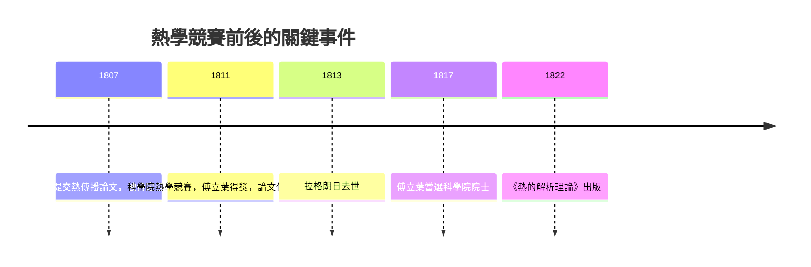

# 2.1 1811 年的熱學競賽：拉格朗日為何反對？

1807 年的論文提交後，巴黎科學院指派了一個委員會審查，成員包括拉格朗日、拉普拉斯、蒙日與拉克魯瓦（拉普拉斯缺席，由畢歐的部分意見補位）。結論是肯定的：論文在原創性與重要性上值得出版——但有「缺陷」：其分析「仍留有想改進的模糊之處」，對無窮級數的運用不夠嚴格。換句話說，結果令人讚嘆，證明令人不安。論文因此被擱置，未即時刊出。

## 競賽：一場精心安排的舞台

1810 年底，科學院宣布以「熱的傳播」為題設置數學物理大獎競賽，截稿 1811 年。從制度上看，這是舊制度的典型運作：科學院以競賽引導研究方向、以委員會把關品質。對傅立葉而言，這是重返巴黎學術圈的機會；對批評者而言，這是再次檢驗那套三角級數的場合。

傅立葉提交了修訂論文，在 1812 年獲得大獎。但委員會的評語依舊嚴苛，據載大意為：論文含有真正的新知，但其分析仍留有待改進之處，其與一般力學的整合也需更多闡述。結果是：得獎，但論文依舊不刊出於科學院刊物。傅立葉憤而認為這是對他個人的打壓。這段齟齬成為科學史上著名的「承認延遲」案例——最終傅立葉自力出版《熱的解析理論》（1822），把 1807 年論文的大部分內容幾乎原封不動印了出來；而批評他最力的拉格朗日已於 1813 年去世。

## 拉格朗日在反對什麼？

把拉格朗日的反對簡化成「老頑固扼殺新思想」是廉價的。他的立場其實有嚴肅的數學基礎，至少有三層。

一、級數的收斂。十八世紀對無窮級數的操作（逐項微分、交換求和順序）經常出錯。傅立葉級數的係數雖然遞減，但級數收斂性在當時沒有可用的判準。拉格朗日對發散級數的警惕終其一生——這份警惕本身是對的，只是傅立葉需要的是一個還不存在的收斂理論。

二、函數的唯一性論證。若一個三角級數在一整段區間上處處為零，能否推出所有係數為零？這對「好的」函數成立（後來證明確實如此），但證明並不顯然。拉格朗日認為傅立葉只是假設了它。

三、物理詮釋的競爭。拉普拉斯與畢歐傾向用「分子間短程作用的熱交換」推導熱傳導，把熱流看作質點系統的推廣，這與拉普拉斯學派的牛頓式綱領一致。傅立葉則直接以宏觀量（溫度、熱流）與經驗定律出發，不問熱的微觀本質。這在方法論上是一次跳躍：不必知道熱是什麼，也能算出熱怎麼流。今天我們視之為場論的先聲，當時卻被視為根基不穩。

## 制度與政治的暗流

除了數學，還有人的因素。傅立葉是拿破崙體制的行政官，與舊學院圈並無深厚私誼；1807 年論文遲遲不刊，令他積怨。1815 年拿破崙百日王朝復辟期間，傅立葉曾短期轉任羅亞爾省行政長官，之後失去官職，靠學術與教學維生，最終於 1817 年當選科學院院士（後來還成為科學院終身秘書）。1822 年《熱的解析理論》出版，翌年他當選法蘭西學院院士。可見他的學術承認並非被全盤封殺，而是在「論文的即時承認」上打了折扣。

## 這場衝突的長期意義

回頭看，這場爭執雙方都有部分正確。傅立葉的數學結果在極廣的範圍內成立，其物理方法開創了宏觀場論的先河；拉格朗日對嚴格性的要求，則催生了十九世紀分析學的整個重建工程。沒有這場衝突，就未必有狄利克雷 1829 年的收斂定理、黎曼 1854 年的積分講義、乃至勒貝格 1902 年的新積分。

> 科學的進步常以「張力」為燃料：一個不肯讓步的結果，與一群不肯讓步的批評者。

這也是制度史的一課：競賽、委員會、期刊審查這些形式，既可能延誤思想，也可能迫使思想被提煉得更精。傅立葉的遭遇提醒我們，承認的時間差可以長達十五年——但只要結果足夠深刻，數學終究會自己找到出路。
