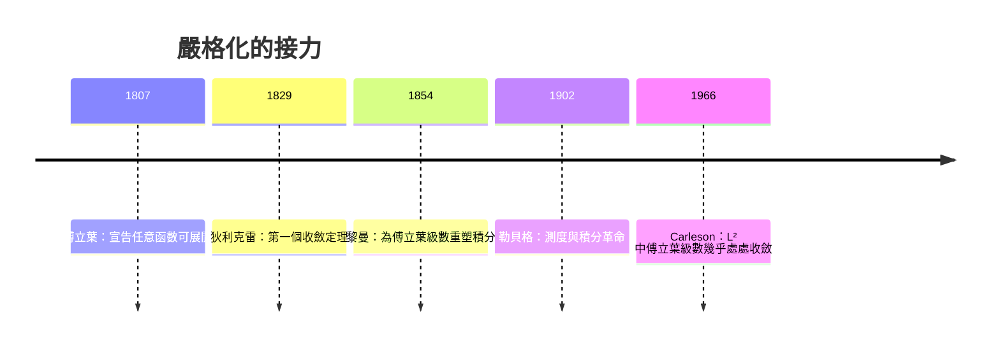

# 2.2 狄利克雷的救贖：收斂性與嚴格化的誕生

傅立葉宣告了「任意函數可展開」，卻沒有說清「任意」的邊界在哪裡、級數「收斂到什麼」。補上這一塊的，是一個年輕的德國人：彼得·古斯塔夫·勒熱納·狄利克雷（Peter Gustav Lejeune Dirichlet）。

## 從巴黎到柏林：一個跨國的學術世代

狄利克雷 1805 年生於德國迪倫，1822 年（十七歲）前往巴黎求學——當時巴黎是世界數學中心，而傅立葉正是他聽課的對象之一，他在傅立葉的課上學到熱理論。他後來成為傅立葉著作的仰慕者與研究者的典範：既被結果的威力征服，也被證明的漏洞困擾。1829 年，他在 Crelle 雜誌發表〈關於收斂於任意給定函數的三角級數〉，給出傅立葉級數收斂的第一個嚴格定理。這是數學分析史上的里程碑。

## 狄利克雷定理說了什麼

粗略地說：若 $f$ 在區間上分段單調且有界（狄利克雷原始條件的現代轉述），則其傅立葉級數在每一點 $x$ 收斂到

$$\frac{f(x^+)+f(x^-)}{2}$$

也就是左右極限的平均。在連續點，級數收斂到 $f(x)$ 本身；在跳躍點，級數「取平均」——這精準解釋了方波在斷點處收斂到 0（跳躍兩側值 +1 與 -1 的平均）的現象。

這個定理值得慢慢品味的三個面向：

一、它明確界定了傅立葉宣言的適用範圍。不是所有函數，但涵蓋了物理中出現的絕大多數訊號——分段光滑足矣。

二、它把「不連續」正當化。級數收斂到左右極限的平均，意味着數學家必須認真研究不連續函數——這在十八世紀幾乎是不可思議的。

三、它逼出了一個更深的概念問題：什麼是「積分」？傅立葉係數公式裡的積分 $\int f(x)\sin nx\,dx$，若 $f$ 只是分段連續還好辦；但數學家很快遇到更野的函數。狄利克雷本人 1829 年就在文中提到著名的狄利克雷函數（有理數取 1、無理數取 0），並指出它無法用當時的積分處理——這直接預告了積分概念的危機。

## 黎曼與勒貝格：兩次積分革命

狄利克雷的學生黎曼（Riemann）在 1854 年的哈勒就職論文中，為了研究傅立葉級數，定義了今天課本上的黎曼積分。他在論文開頭就明說：這項研究源於傅立葉的《熱的解析理論》。換言之，黎曼積分這個數學系學生的第一課，本身就是傅立葉級數的副產品。

積分概念的第二次擴張來自勒貝格（Henri Lebesgue, 1902）：他的測度論積分讓「幾乎處處」成為標準語言，證明了任何勒貝格可積函數的傅立葉係數趨於零（Riemann–Lebesgue 引理的現代形式），並使 $L^2$ 空間的完備性得以建立。傅立葉級數理論至此與希爾伯特空間、量子力學的數學基礎合流。

## 連續函數也可能失敗：壞消息的價值

故事還有陰暗面。1876 年杜布瓦–雷蒙（du Bois-Reymond）構造出一個連續函數，其傅立葉級數在某些點發散；後來人們知道可以處處發散。這粉碎了「連續即足夠」的天真期望，也顯示收斂問題深不見底。直到 1966 年，瑞典數學家 Lennart Carleson 證明了驚人的結果：平方可積函數的傅立葉級數幾乎處處收斂。這被視為二十世紀調和分析的頂點，證明用到的方法（Carleson–Hunt 定理）至今仍是研究生課程的高峰。

## 教育與思想的迴響

這段嚴格化運動深刻改變了數學教育。十九世紀後半，「ε–δ 語言」逐漸成為分析的標準——今天的微積分課本體例，很大程度上是傅立葉級數引發的危機的產物。德國大學（柏林、哥廷根）在這波運動中取代巴黎成為數學中心，而傅立葉的書正是這場學術中心轉移的輸入品之一：一個法國物理問題，經德國學派的嚴格化，成為全歐洲數學系的必修基礎。

> 傅立葉提供了力量，狄利克雷與其後繼者提供了秩序。力量與秩序的辯證，貫穿了整個分析學的十九世紀。

理論既已鞏固，傅立葉的工具便開始向更廣的世界擴張。下一步，是掙脫「週期」的枷鎖——傅立葉轉換的誕生。
