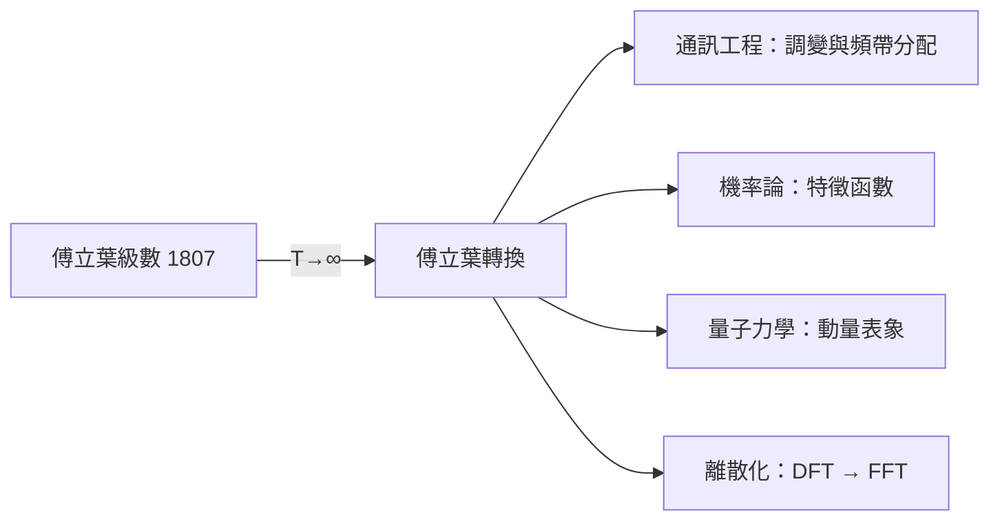

# 3.1 從級數到積分：傅立葉轉換如何跨越「週期」的邊界

傅立葉級數有一個前提：函數必須是週期的（或只定義在有限區間上）。可是現實中的訊號——一聲槍響、一次閃電、一段語音——既不週期也非無限。要分析它們，就得讓週期趨於無窮大。這一步跨出去，傅立葉級數就蛻變成傅立葉轉換。

## 讓週期奔向無窮

把週期 $2T$ 想成一個不斷加寬的窗戶。當 $T\to\infty$，離散的頻率 $n\pi/T$ 間距越擠越密，最終變成連續的頻率變數 $\omega$；求和變成積分。傅立葉轉換與逆轉換於是寫成：

$$\hat{f}(\omega)=\int_{-\infty}^{\infty} f(t)\,e^{-i\omega t}\,dt, \qquad f(t)=\frac{1}{2\pi}\int_{-\infty}^{\infty}\hat{f}(\omega)\,e^{i\omega t}\,d\omega$$

用複數 $e^{i\omega t}=\cos\omega t+i\sin\omega t$ 書寫，是歐拉公式帶來的簡潔。這對公式的意義可以一句話說完：任何訊號都可以看作無窮多個頻率連續分布的純振動的疊加，$\hat f(\omega)$ 就是「每個頻率含量多少」的食譜。

傅立葉本人 1811 年的競賽論文中已經寫下接近這種積分形式的表述（用於無限長的固體），所以說傅立葉轉換是傅立葉的，並不誇張。但把它打造成嚴格理論的，是十九世紀到二十世紀一長串數學家：柯西、普朗歇爾（1910 年證明 $L^2$ 理論的 Plancherel 定理）、以及二十世紀的施瓦茲（Laurent Schwartz，1945 年的分配理論，讓 $\delta$ 函數這類「廣義函數」獲得嚴格身分）。

## 時域與頻域：一場對偶遊戲

傅立葉轉換最迷人的性質，是時間與頻率之間的鏡像關係：

| 時域現象 | 頻域呈現 |
|---|---|
| 訊號拉得越長 | 頻譜越尖銳集中 |
| 訊號越短促（如脈衝） | 頻譜越寬廣 |
| 平移時間 | 頻譜乘上相位因子 |
| 高頻衰減快（如熱方程） | 頻譜高頻端被壓制 |

最後一列直接回應本書起點：熱方程在頻域裡只是「把每個頻率乘上 $e^{-k\omega^2 t}$」——一個簡單的乘法。微分方程變成代數方程，這就是頻域方法的威力所在，也是工程師說「先轉到頻域處理再轉回來」的全部理由。

## 高斯函數：鏡中的自己

傅立葉轉換的一個經典例子是高斯函數 $f(t)=e^{-t^2/2}$，它的轉換還是高斯（形狀不變、寬度倒數）。鐘形曲線在時域越窄，頻域越寬，兩者乘積有下界——這正是量子力學測不準原理的數學骨架（下一章會回到這點）。一個源自熱傳導的積分轉換，最終成為描述微觀世界不確定性的語法，這是傅立葉生前無法預見的迴響。

## 從數學到工程：訊號時代的到來

二十世紀初，傅立葉轉換走出純數學，成為電信工程的日常工具。貝爾實驗室在電話、載波通訊與頻率複用的設計中，以頻譜思維分配語音頻帶（人聲主要能量在 300–3400 Hz 附近）。無線電的調幅（AM）、調頻（FM）本質上都是在頻域裡「搬運」訊號：把聲音譜搬到載波頻率附近。收音機上的刻度盤，就是一條被工程化的頻率軸。

## 未完成的最後一哩：計算

理論與應用都已就位，卻還有一道實務的牆：實際算傅立葉轉換太慢。對 $N$ 個取樣點做離散傅立葉轉換（DFT），樸素算法需要 $N^2$ 次乘加。訊號越長，計算量平方膨脹——在電腦昂貴而稀少的年代，這意味着大多數實際問題根本算不動。

破解這道牆的，是一個受到冷戰軍事需求催生的演算法：快速傅立葉轉換（FFT）。它如何誕生、誰資助了它、又如何釋放整個數位時代——這是第五章的主題。但在那之前，我們先看一個更早的應用故事：大英帝國如何用傅立葉級數計算潮汐，為貿易與海軍服務。
