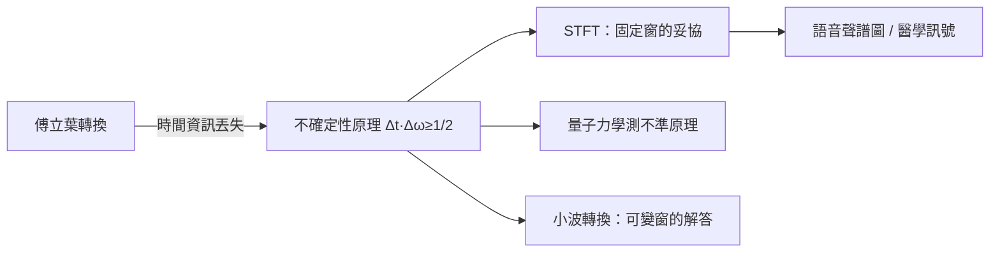

# 4.1 海森堡的對偶與 Gabor 的啟示：時間與頻率不可兼得

傅立葉轉換把訊號從時間語言翻譯成頻率語言，但這個翻譯有內在的代價：你無法同時精確知道「何時」與「何頻」。這條限制起初像技術性的小麻煩，後來卻成為貫穿訊號處理與量子力學的深層原理。本節講它的數學與歷史。

## 為什麼會有取捨

直覺很簡單：要測定一個振動的頻率，你必須觀察它至少一個（嚴格說，數個）完整週期。觀察時間越長，頻率測得越準；觀察時間越短，頻率的歸屬就越含糊。用數學語言：訊號在時間上越集中，其傅立葉轉換在頻率上就越分散，反之亦然。

定量表述即不確定性原理：對訊號 $f$，設時間寬度 $\Delta t$ 與頻率寬度 $\Delta\omega$，則

$$\Delta t \cdot \Delta \omega \geq \frac{1}{2}$$

等號僅由高斯函數達成。證明只需柯西–施瓦茨不等式加上分部積分，是調和分析中最優雅的短證明之一。注意這裡完全沒有「物理」：它是傅立葉轉換的純數學性質，任何適用傅立葉轉換的波動現象都必然服從。

## 量子力學：同一數學，另一個世界

1927 年，海森堡發表測不準原理：粒子的位置 $x$ 與動量 $p$ 滿足 $\Delta x\,\Delta p \geq \hbar/2$。在量子力學的波函數表述中，動量表象正是位置的傅立葉轉換（德布羅意關係 $p=\hbar k$ 把動量對應到波數）。因此海森堡的原理與訊號處理的時間–頻率取捨，是同一條數學定理的兩次登場。

歷史的先聲出現在 1926 年：肯納德（Earl Kennard）已用波函數給出數學證明，而薛丁格波動力學本身——把質點寫成波——就是傅立葉精神的全盤勝利。物理學界接受「波函數」的過程，同時也是接受「頻域觀點」的過程。

## Gabor：在工程與物理之間搭橋

把這個思想帶回訊號世界的關鍵人物，是匈牙利裔英國物理學家丹尼斯·蓋伯（Dennis Gabor）。1946 年，他在《通訊理論》（Theory of Communication）中系統研究「如何同時描述訊號的時間與頻率內容」，提出用高斯型的小窗口展開訊號（Gabor 展開），並明確指出 $\Delta t\,\Delta\omega \geq 1/2$ 對通訊的根本制約——訊號的「資訊單元」在時頻平面上佔有最小面積。他為此引進的名詞「量子」（quantum of information），直接借用了物理學的語彙。

Gabor 還有一項日後獲得 1971 年諾貝爾物理學獎的發明：全像術（holography, 1948）。全像術的核心是記錄光的相位資訊，其數學基礎正是傅立葉光學——透鏡的後焦面上自然形成影像的傅立葉轉換。可見光與電子顯微術的極限問題（電子顯微鏡球面像差難以校正），促使他想出「先記錄干涉條紋、再重構波前」的方法。一個為改善電子顯微鏡的工程提案，成為雷射時代全像貼紙與光學資訊處理的基礎——而 Gabor 對時頻分析的執念，貫穿了他全部工作。

## 短時傅立葉轉換：妥協的藝術

Gabor 展開的實用版本是短時傅立葉轉換（STFT）：用一個固定寬度的窗 $w(t)$ 沿訊號滑動，對每個位置做傅立葉轉換：

$$X(\tau,\omega)=\int x(t)\,w(t-\tau)\,e^{-i\omega t}\,dt$$

得到的不是一條頻譜，而是一張「時頻圖」：縱軸頻率、橫軸時間。語音的聲譜圖（spectrogram）、鳥鳴分析、地震訊號分類，都是這張圖的應用。但它有內在兩難：窗太窄，頻率解析度差；窗太寬，時間定位差。這正是海森堡原理在工程裡的日常面目。

## 通訊、雷達與戰爭

時頻分析在二戰期間獲得巨大推力。雷達需要分辨「目標的距離（回波延遲）」與「目標的速度（都卜勒頻移）」，兩者恰好是時域與頻域的量，其取捨極限（雷達的「模糊函數」理論）在戰時由貝爾實驗室與英國的研究人員系統化。戰後這些軍事技術溢出到民用領域：聲納、地震探勘、語音識別。不確定性原理從物理哲學議題，變成通訊工程師的設計參數。

> 傅立葉教我們換座標，海森堡與 Gabor 教我們：每種座標都有解析度的極限。承認極限，才能聰明地妥協。

而「妥協」的極致之作——把訊號的結構、資訊的度量與頻譜的資源統一起來的理論——來自一個 1948 年的年輕人。下一節，香農登場。
