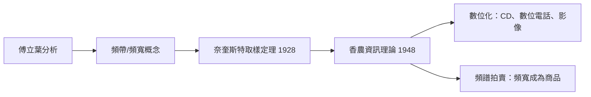

# 4.2 香農與資訊時代：頻譜成為可以買賣的商品

1948 年，貝爾實驗室的克勞德·香農發表〈通訊的數學理論〉（A Mathematical Theory of Communication），資訊理論誕生。這篇論文與傅立葉分析的關係，比表面上深刻得多：它把「頻寬」變成資訊的度量單位，把頻譜從物理現象變成經濟資源，最終成為數位時代的憲法。

## 貝爾實驗室：傅立葉分析的工業重鎮

先看制度背景。美國電話電報公司（AT&T）的貝爾實驗室，是二十世紀最成功的工業研究機構。它的核心業務——電話——本質上就是頻譜工程：一條銅線能載多少路通話，取決於每路語音佔多少頻寬、如何調變、如何分頻複用。因此貝爾實驗室聚集了大批傅立葉分析高手：奈奎斯特（Harry Nyquist，1928 年的取樣定理）、香農的博士論文導師之一就是在貝爾實驗室兼職的經歷、以及後來做出 FFT 的圖基與庫利（見第五章）。軍事需求（二戰的密碼學與火力控制）與電信商業需求，共同餵養了這座機構。

香農 1940 年的博士論文已是傳奇：他用布爾代數分析開關電路，奠定數位邏輯設計的數學基礎。二戰期間他在貝爾實驗室從事密碼學工作，1945 年的機密報告後公開為〈保密系統的通訊理論〉（1949）——密碼學的嚴格數學化。而密碼學、取樣定理與頻譜分析，在 1948 年的那篇論文中匯流。

## 取樣定理：連續與離散的橋樑

香農理論的技術支柱之一是取樣定理（奈奎斯特–香農定理）：若訊號的最高頻率為 $B$，只要以每秒 $2B$ 次以上取樣，就能完全重建原訊號，不損失任何資訊。這個定理宣告：連續的類比世界可以被離散的數字忠實表徵——數位化在數學上合法。

取樣定理的證明本質是傅立葉分析：取樣等於把訊號乘上梳狀函數，頻域中變成頻譜的週期複製；只要複製的頻譜不重疊（即取樣率足夠），用低通濾波就能還原。整個 CD、電話、影像系統的設計，都建立在這個傅立葉式的論證上。

## 頻寬 × 時間 = 資訊

香農的著名公式：在雜訊功率 $N$、訊號功率 $P$、頻寬 $W$ 的通道中，最大無誤傳輸率為

$$C = W \log_2\!\left(1+\frac{P}{N}\right)$$

這條公式把傅立葉的世界觀制度化了：頻寬 $W$（赫茲）是資訊的「面積」，時間 × 頻寬決定能載多少位元。工程師從此可以精確計算：這段頻譜值多少錢、能服務多少人。

其經濟後果在半世紀後全面爆發。行動電話需要頻段，於是各國政府開始拍賣頻譜：美國聯邦通訊委員會（FCC）自 1994 年起以拍賣分配頻譜執照，單次拍賣金額常達數百億美元；頻譜成為國家財政收入與電信業者核心資產。一枚手機通話背後，是香農公式劃定的容量極限、拍賣制度劃定的產權邊界、與傅立葉分析劃定的物理可能。

## 資訊論與傅立葉的互相成就

香農理論反過來也重塑了傅立葉分析的研究議程。資訊理論關心「壓縮極限」與「傳輸極限」，這促使數學家把傅立葉分析與機率論結合：隨機訊號的功率譜、KL 轉換（Karhunen–Loève）與最佳的能量壓縮、以及後來小波理論中「如何以最少係數表徵訊號」的問題。資訊論給傅立葉分析一個新的成功標準：不只問「能不能表徵」，而問「用多少位元表徵」。

## 現實的檢驗：MP3 之前的世界

1990 年代初，把 CD 音樂（每分鐘約 10 MB）壓到十分之一以下、且聽感幾乎不變，被認為近乎魔法。背後的原理——聽覺遮蔽模型加頻域量化編碼——正是傅立葉分析與資訊理論的合體。MP3 標準（1993 年，Fraunhofer 與 MPEG 團隊）、JPEG 影像標準（1992 年）、及後來一切的影音串流，都依賴一個前提：先把訊號變成頻譜，再對人類感知不敏感的成分下手。而這一切演算法得以即時運作，靠的是 1965 年的 FFT。

> 傅立葉提供了地圖（頻譜），香農提供了貨幣（位元）。地圖與貨幣相遇，數位經濟才成為可能。

接下來，我們回到那個決定性的一年：1965，冷戰與演算法的交會點。
