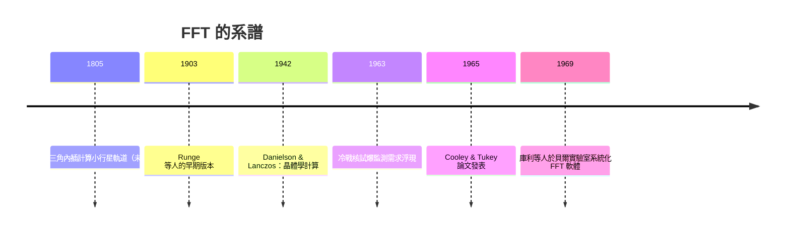

# 5.1 圖基與庫利：冷戰軍方資助下的快速傅立葉轉換

1965 年 4 月，普林斯頓的統計學家約翰·圖基（John W. Tukey）與 IBM 的華森研究中心的詹姆斯·庫利（James W. Cooley）在《Mathematics of Computation》上發表了一篇僅五頁的短文：〈An algorithm for the machine calculation of complex Fourier series〉。這篇論文提出的演算法——快速傅立葉轉換（FFT）——後來被評為二十世紀影響最深遠的演算法之一。它的誕生，交織著統計學、電腦工業與冷戰政治。

## 圖基：統計學家中的訊號獵人

圖基（1915–2000）是二十世紀最有影響力的統計學家之一，貝爾實驗室長期顧問，「位元」（bit）這個詞據稱是他向香農建議的、「軟體」（software）一詞也與他有關。他在二戰期間為軍方從事火砲彈道與雷達工作，戰後長期擔任美國總統科學顧問委員會成員，參與統計方法在軍事與公共政策的應用。

促成 FFT 的直接契機，是一個冷戰議題：1963 年部分禁止核試爆條約（Limited Test Ban Treaty）簽訂後，如何確認蘇聯遵守條約？地下核試爆會引發地震波，但天然地震與核爆的地震訊號難以區分。美國在各地架設地震監測站，需要對長時間序列的地震資料做頻譜分析——這正是傅立葉轉換。問題在於計算量：當時分析一天的資料（數萬個取樣點），用 $N^2$ 的樸素方法要花數小時到數天的電腦時間。圖基在白宮科學顧問委員會的會議上聽聞此需求，意識到一個舊點子可以解決它。

## 庫利：把點子寫成可用的程式

圖基把想法告訴了貝爾實驗室的同事與 IBM 的庫利。庫利（1926–2016）在 IBM 華森研究中心工作，本身的研究主題就包括數值方法與傅立葉計算。他花了約六個月把圖基口述的演算法整理、推廣成一般化的電腦程式，處理任意複合長度的資料。1965 年的論文就此問世。

演算法的核心想法是「分而治之」：長度為 $N$ 的 DFT，把偶數位置的取樣與奇數位置的取樣分開，各做一半長度的 DFT，再巧妙組合。每次折半，計算量大約減半，於是

$$N^2 \quad\longrightarrow\quad N \log_2 N$$

當 $N=10^6$，$N^2=10^{12}$ 而 $N\log_2 N\approx 2\times 10^7$：加速五萬倍。原本要算幾天的頻譜，幾秒鐘完成。這不是更快的電腦，而是更深的數學——同一台機器，量級的躍遷。

## 舊發現的新生：高斯與 1805

FFT 常被稱為「被反覆重新發現的演算法」。歷史學家 Heideman、Johnson 與 Burrus 在 1984 年的考證指出：高斯在 1805 年（傅立葉提交熱論文的兩年前！）為了以三角內插計算小行星穀神星與智神星的軌道，已在手稿中推導出等價於 FFT 的遞迴程序——只是未發表，塵封在他的遺稿中。二十世紀裡，Runge、Danielson 與 Lanczos（1942，英國戰時的 X 光晶體學計算）等都提出過類似方法，但都未引起持續關注。

為什麼 1965 年的版本引爆了革命？因為時代終於配得上這個演算法：電腦已足夠普及、數位訊號處理（DSP）已成型、且庫利寫出的是任何人都能拿去用的通用程式。科學社會學在此有個教訓：一個想法的影響力，等於想法乘上它的傳播制度。

## 軍方資助的陰影與辯護

FFT 的誕生離不開美國軍方的資助鏈：貝爾實驗室承接軍方合約、白宮科學顧問委員會的核監測議題、以及戰後電腦科學整體的國防經費。庫利晚年受訪時明確說過：若非核試爆監測的需求，FFT 不會在那時被開發出來。這是科技史的反覆劇本：戰爭與軍備競賽提供資源與急迫性，民用領域收割成果。冷戰同時製造了需求（監測）與供給（電腦），FFT 是兩者相乘的結晶。

## 釋放

FFT 發表後迅速擴散：地震學、聲學、雷達、晶體學、醫學影像、天文學。IEEE 在 1960 年代末成立數位訊號處理委員會，1969 年起有大會與期刊（IEEE Transactions on Audio and Electroacoustics 特刊）。到 1970 年代，「FFT 晶片」開始出現；今日任何手機的晶片裡，FFT 電路都在即時運作。1980 年代庫利獲 IEEE 榮譽獎章級的肯定，圖基的影響則橫跨統計（探索式資料分析）與資訊科學。

> 一個被高斯遺忘、被圖基喚醒的演算法，是二十世紀「數學—電腦—軍事—產業」四重奏的最佳獨奏曲。

FFT 到底快在哪裡？下一節我們把演算法拆開來看。
