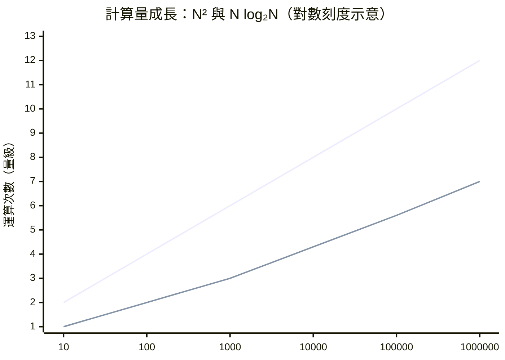

# 5.2 從 O(N²) 到 O(N log N)：FFT 為什麼快，又快在哪裡？

FFT 的神奇常被講成「聰明的程式技巧」，其實它是一次深刻的代數觀察。本節把離散傅立葉轉換（DFT）拆開，看 FFT 如何把平方級的計算壓成對數級。

## 先定義 DFT

把連續訊號取樣成 $N$ 個數 $x_0,\dots,x_{N-1}$，離散傅立葉轉換是：

$$X_k = \sum_{n=0}^{N-1} x_n\, e^{-2\pi i kn/N}, \qquad k=0,\dots,N-1$$

寫成矩陣形式 $X = F_N x$，其中 $F_N$ 是 $N\times N$ 的矩陣，元素 $F_{kn} = \omega_N^{kn}$（$\omega_N = e^{-2\pi i/N}$）。樸素地把矩陣乘向量做完，需要 $N^2$ 次複數乘法。$N=10^6$ 時就是一兆次——1990 年代的電腦要算好幾天。

## 關鍵觀察：偶奇分半

設 $N=2M$。把求和按 $n$ 的奇偶拆開：

$$X_k = \sum_{m=0}^{M-1} x_{2m}\,\omega_N^{2mk} + \sum_{m=0}^{M-1} x_{2m+1}\,\omega_N^{(2m+1)k}$$

注意 $\omega_N^2 = \omega_M$，於是這兩個和分別是長度 $M$ 的 DFT（用偶數取樣與奇數取樣），即 $E_k$ 與 $O_k$（按 $M$ 週期延拓）。再利用 $\omega_N^{M}=-1$，可得：

$$X_k = E_k + \omega_N^k\, O_k, \qquad X_{k+M} = E_k - \omega_N^k\, O_k \quad (0\le k < M)$$

這稱為蝶形運算：由兩個半長 DFT 的輸出，兩次乘法、兩次加減，同時生出一對輸出。原本 $N^2$ 的問題，變成兩個 $M^2=(N/2)^2$ 的問題加 $N$ 次組合：

$$T(N) = 2\,T(N/2) + N \;\Longrightarrow\; T(N) = N\log_2 N$$

遞迴做下去，每一層總工作量是 $N$，共 $\log_2 N$ 層。

$N=10^6$ 時，$N^2$ 的量級是 $10^{12}$，$N\log N$ 約 $2\times10^7$——五萬倍以上的加速。

## 為什麼會有這種巧合

深層原因是單位根 $\omega_N$ 的代數結構：$\omega_N^{2m} = \omega_M^m$，即「平方後頻率結構自我相似」。FFT 本質上是把 DFT 矩陣 $F_N$ 分解成 $\log N$ 個稀疏矩陣的乘積，每個矩陣只需 $O(N)$ 次運算。這是「用結構換計算」的典範：矩陣不是一般的矩陣，它有循環對稱性，你不該傻算。

有趣的是，這個技巧在矩陣理論的語言裡，等價於「酉矩陣的快速分解」。快速矩陣–向量乘法這一研究方向（如快速多極演算法 FMM）在思想上都是 FFT 的後裔。

## 程式文化的勝利：庫利的程式與 Cooley–Tukey 的普及

1965 年論文的成功，一半要歸給「可用性」。庫利在貝爾實驗室寫出通用程式（SACMAS 專案、後來的 FORTRAN 版本），1967–69 年間貝爾實驗室發布了標準化的 FFT 套件，各國實驗室直接取用。1970 年代，DSP 教科書（如 Oppenheim 與 Schafer, 1975）把 FFT 列為標準配備。演算法傳播的歷史再次證明：決定影響力的不只是聰明，還有「複製成本」。

## 演算法的整片森林

FFT 是一個家族：基 2、基 4、混合基、質因數演算法、實數輸入的最佳化、以及處理質數長度的 Rader/Bluestein 演算法。1994 年 Shensa 等人的調查與之後的文獻估計，FFT 相關論文以千計。它的衍生影響更廣：

- 卷積的快速化：兩個長 $N$ 序列的卷積，可用 FFT 在 $O(N\log N)$ 內完成——這是多項式乘法、大整數乘法（Schönhage–Strassen 及其後繼，用於圓周率位元的計算）的基礎。
- 數論與代數：快速 z-轉換、快速多項式求值與內插。
- 資料壓縮：JPEG 的 DCT 是 FFT 的近親（實數版、餘弦基）。
- 硬體：DSP 晶片、GPU 函式庫（cuFFT 等）、5G 的 OFDM 調變——每個子載波的管理本質就是 FFT/IFFT。

## 一個耐人尋味的問題

FFT 也留下一個未解之謎：FFT 是最快的嗎？已有下界證明在某些模型下 DFT 需要 $\Omega(N\log N)$ 次運算（Morgenstern 1973 的線性模型下界），但一般模型下界仍不明確。換言之，這個改變了世界的演算法，是否已達極限，數學上尚未定案。

> 傅立葉教我們看得見頻率，FFT 讓我們算得起頻率。看得見而算不起，等於看不見。

算得起之後，革命才真正開始。下一章：MP3、JPEG、MRI 與星空。
