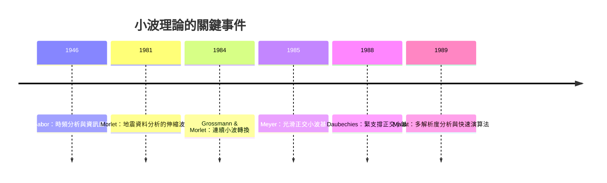

# 6.3 超越傅立葉：小波轉換與局部化的追求

傅立葉分析有一個天生盲點：頻譜告訴你訊號「含有」哪些頻率，卻不告訴你這些頻率「何時出現」。一段小提琴的顫音與一段逐音階的琶音，可能有幾乎相同的整體頻譜，音樂內容卻完全不同。二十世紀後半，數學家與工程師為了彌補這個盲點，發展出小波轉換（wavelet transform）——它不是取代傅立葉，而是傅立葉思想的延續與變形。

## 從窗函數到伸縮平移

第四章已講過短時傅立葉轉換（STFT）：用固定寬度的窗滑動，換取時間資訊。Gabor 指出它的極限：時頻解析度受 $\Delta t\,\Delta\omega\ge 1/2$ 的約束，且固定窗對高頻太寬、對低頻太窄。

小波的突破在於「可變窗」：不用頻率可變的正弦波，而用一個固定形狀的小波形（母小波 $\psi$），靠伸縮與平移生成一族分析函數：

$$\psi_{a,b}(t) = \frac{1}{\sqrt{|a|}}\,\psi\!\left(\frac{t-b}{a}\right)$$

尺度 $a$ 大，窗口寬，看低頻；$a$ 小，窗口窄，看高頻。於是高頻成分獲得精細的時間定位、低頻成分獲得精細的頻率定位——這正好匹配大多數自然訊號的特性（短暫事件高頻、緩慢趨勢低頻），也恰好維持不確定性原理的下界：小波不違反 $\Delta t\,\Delta\omega\ge 1/2$，只是讓每一對解析度的乘積都貼近極限。

## 歷史系譜：從地球物理到數學高峰

小波的思想源頭之一相當意外：1981 年，法國地球物理學家 Jean Morlet 為分析地震反射資料（石油探勘），覺得 STFT 的固定窗不夠用，與理論物理學家 Alex Grossmann 合作，把「伸縮平移的波包」形式化。1984 年 Grossmann–Morlet 的論文正式定義了連續小波轉換。

數學高潮在 1980 年代末。法國數學家 Yves Meyer 證明存在光滑、快速衰減的正交小波基（1985–86）；1988 年，貝爾實驗室的 Ingrid Daubechies 構造出緊支撐正交小波（Daubechies 小波）——兼具光滑性、局部性與正交性的第一族小波，且可用有限長度的濾波器實現。同年，Mallat 提出多解析度分析（MRA）與快速小波轉換演算法，計算量 $O(N)$——比 FFT 的 $O(N\log N)$ 更快。1992 年 Daubechies 的專書《Ten Lectures on Wavelets》成為經典。小波分析的爆發，是純數學（調和分析、巴拿赫空間）、應用數學（壓縮）與產業（探勘、影像）三方在極短時間內合流的罕見案例。

## Mallat 演算法：濾波器組與二進拆解

Mallat 的洞見是：正交小波轉換等價於一組共軛鏡像濾波器的樹狀卷積–下取樣結構。訊號每經一層，被拆成「低頻近似」與「高頻細節」，低頻部分再遞迴拆解。這與電子工程 1970–80 年代的子頻帶編碼（subband coding）理論殊途同歸——又一次，應用工程的智慧與純數學的結構在巧合中相認。事後說明其巧合的，正是傅立葉分析：濾波器組的完美重構條件，就是多相矩陣在頻域的酉性條件。

## JPEG 2000 與指紋：小波的殺手級應用

小波最著名的商業應用是 JPEG 2000（2000 年標準化）：以離散小波轉換取代 DCT，在相同品質下壓縮率更佳，且天生支援多解析度（先傳低解析度再逐步精化——網頁漸進載入的數學基礎）。另一個關鍵應用是美國聯邦調查局（FBI）的指紋資料庫：1993 年，FBI 與 Los Alamos 國家實驗室及各界合作，採用小波壓縮（WSQ 標準，約 15:1）儲存數千萬張指紋卡，節省的儲存成本以億計——政府採購需求直接資助並採納了新數學。此外，小波在去噪（Donoho 的軟門檻法，1995）、地震處理、金融時間序列、以及數值偏微分方程中都有深遠應用。

## 傅立葉會被取代嗎？

不會，也不該。小波與傅立葉的關係是分工而非取代：平穩訊號（整段性質不變）用傅立葉最自然；瞬態、多尺度訊號用小波。更深刻地說，小波理論本身是調和分析的產物——Meyer 與 Coifman 的小波研究語言（多解析度空間鏈、Riesz 基、硬空間分解）全是傅立葉–哈代分析的延伸。傅立葉轉換在小波文獻裡不但沒有退場，反而是定義與證明的基礎工具。

> 傅立葉給了我們「頻率」這面鏡子；小波告訴我們，鏡子可以伸縮。兩者合用，才看得清這個多尺度的世界。

至此，本書從 1807 年的爐火走到了 2000 年的標準。最後一章的後記，讓我們退後一步，看看這兩百年間，「頻率的眼光」如何成為一種文明的思維方式。
