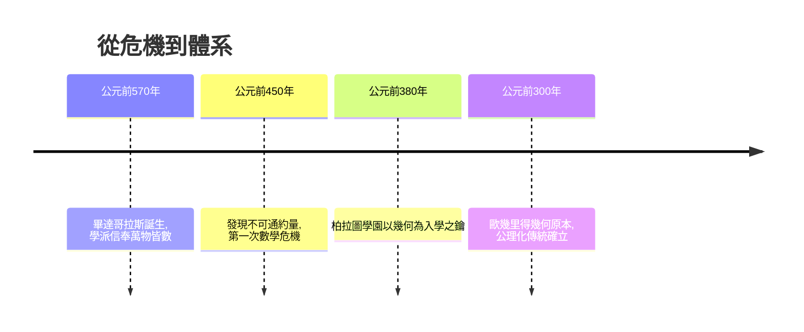

# 1.1 畢達哥拉斯的夢與第一次數學危機

公元前六世紀的地中海世界，商路縱橫。希臘城邦的船隻把小亞細亞的香料、埃及的穀物與腓尼基的染料運往各處，也在港口之間傳播著思想。畢達哥拉斯出生於薩摩斯島，這座島是愛琴海的貿易樞紐，年輕的他據說遊歷過埃及與巴比倫，帶回了埃及人丈量土地的幾何知識，以及巴比倫人傳承千年的計算技術。

巴比倫的祭司早已知道直角三角形三邊的關係，也熟悉 $\sqrt{2}$ 的近似值，精確到小數點後五位的泥板至今仍保存著。但巴比倫人把這些當作實用的計算配方，只有希臘人問出了那個致命的問題： $\sqrt{2}$ 究竟是什麼。

畢達哥拉斯學派信奉一個優美的信念：萬物皆數。他們相信宇宙的秩序可以用整數與整數之比來表達。琴弦長度成簡單整數比時，音色和諧；天體的距離成比例時，運轉便如音樂。這個信念不只關於數學，更是當時這個學派的世界觀，甚至是他們的宗教。傳說中，這個學派既是學術社群，也是政治勢力，在義大利南部的克羅頓城一度掌權，後來在平民暴動中被燒毀據點。

而正是這個學派內部，發現了不可通約量的存在。用今天的語言說，正方形的對角線與邊長之比不是任何兩個整數之比。證明只用歸謬法：若 $\sqrt{2} = \frac{p}{q}$ 且 $\frac{p}{q}$ 已約至最簡，則 $2q^2 = p^2$，推得 $p$ 為偶數，再推得 $q$ 也是偶數，與最簡矛盾。

這個發現在今天只佔教科書一頁，在當時卻是一場思想地震。如果兩條明明白白畫出來的線段，長度之比卻不是數，那麼萬物皆數的信念便動搖了。傳說學派的成員希帕索斯因為洩露這個發現而被扔進大海，故事未必可信，卻反映了希臘人對這件事的認真程度。

危機帶來了深遠的後果。既然數不能可靠地描述長度，希臘數學便轉向了幾何：把連續的量全部交給線段與圖形處理，把離散的量留給算術。柏拉圖學園的大門上刻著不懂幾何者勿入，這不只是教育口號，而是整個學術體制的選擇，歐幾里得的幾何原本正是在這種氛圍下，由公理出發演繹出全部幾何，成為此後兩千年西方知識體系的典範。

但這個選擇也留下了長長的陰影。幾何可以處理連續量，卻無法輕鬆處理運算與代換。當十七世紀的學者想要計算變化率與面積時，他們必須先繞過希臘人築起的這道牆。第一次數學危機逼出來的嚴格，也同時壓抑了計算的傳統，這筆債要到分析學誕生之後，由更深的極限理論來償還。

值得一提的是，第二次危機的種子同樣埋在這裡。芝諾的悖論，阿基里斯永遠追不上烏龜，飛矢不動，提出的正是無限過程的收斂問題。希臘人迴避了它，兩千年後，極限的概念將回頭面對它。

