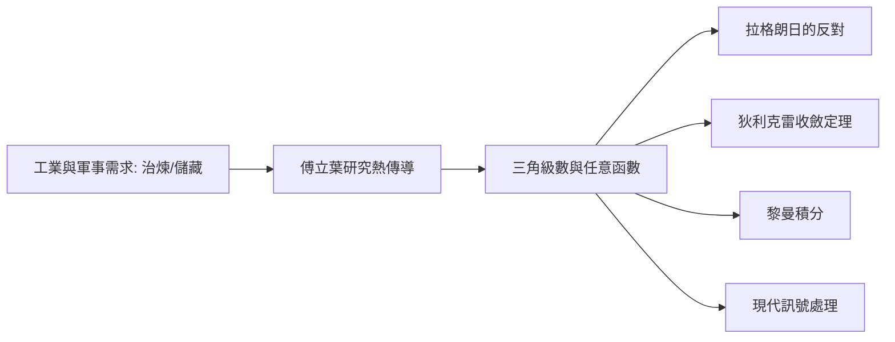

# 4.1 傅立葉與熱方程：物理學家的震撼

1807 年 12 月，法國科學院收到一篇論文，題目是固體中的熱傳導。作者約瑟夫傅立葉當時是伊澤爾省的行政首長，長駐格勒諾勃，白天治理全省政務，晚上研究熱學。這篇論文將震撼歐洲數學界，並最終迫使分析學重新定義自己的基礎。

傅立葉的一生就是法國大革命的縮影。他 1768 年出生於歐塞爾的裁縫家庭，九歲父母雙亡，被教會學校收養，本該成為本篤會修士。大革命爆發時他二十歲，投身地方政治，曾因替受害者辯護而在羅伯斯比爾倒台前夕被捕，差點上斷頭台；之後他又在熱月黨人的清洗中被捕。1794 年他被任命為剛成立的巴黎師範學院的數學講座，次年轉入工藝學院，在拿破崙的時代嶄露頭角。1798 年他隨拿破崙遠征埃及，是科學考察團的核心成員，後來主持撰寫巨著埃及記述，這部書正是拿破崙以科學包裝殖民統治的文化工程。1802 年拿破崙任命他為伊澤爾省長，他在任十四年，修路、治水、辦學，政績出色，研究全部在夜間進行。

熱傳導問題有明確的工程背景：冶煉、製糖、造炮都關心金屬散熱，巴黎地下已被證明適合儲藏酒與食物也是熱學問題。傅立葉研究一根受熱細桿內部溫度如何隨時間與位置變化，列出了 $\frac{\partial u}{\partial t} = k \frac{\partial^2 u}{\partial x^2}$ 這樣的偏微分方程，然後做了一件讓數學家瞠目結舌的事：他宣稱任意函數都可以展開成三角級數的和，$f(x) = a_0 + a_1 \cos x + b_1 \sin x + a_2 \cos 2x + \cdots$。

爭議所在是任意兩個字。十八世紀的函數指的是解析式，最好還要連續可微。而傅立葉的例子中出現了這樣的函數：在 $-1 < x < 1$ 上取 $-1$，在 $1 < x < 3$ 上取 $1$。這種分段的、有跳躍的函數，在當時根本不被認為是函數，但它卻能被無窮多個光滑的正弦波加出來。傅立葉用圖形論證：無論曲線多麼怪異，都可以由正弦波的疊加逼出來。

三位評審拉格朗日、拉普拉斯與勒讓德接受了論文，但拉格朗日對三角級數的普適性強烈反對，他堅持解析函數的傳統立場，這場爭論拖延了論文的正式出版，要到 1822 年傅立葉才以熱的解析理論一書完整發表。這本書成為十九世紀最有影響力的數學著作之一，影響遠超熱學：它讓函數的概念被逼到牆角，逼出了什麼叫一個函數的新定義；狄利克雷讀了它之後寫出嚴格的收斂定理，並定義了著名的狄利克雷函數，有理數處取 $1$、無理數處取 $0$，這種處處不連續的怪物徹底擊碎了十八世紀的函數觀念；黎曼為了給三角級數的研究奠定基礎而重新定義積分；而二十世紀，傅立葉分析更成為量子力學、訊號處理與整個現代科技的數學支柱。

1822 年，傅立葉當選科學院終身秘書，成為法國數學界的掌門人。他生前一直受慢性病折磨，有傳說與他早年埃及之行有關。他晚年扶持年輕學者，其中一位來自貧困家庭、後來把分析嚴格化為今天大學課本的青年，正是他一手提拔的。那個人是奧古斯丁路易柯西。

