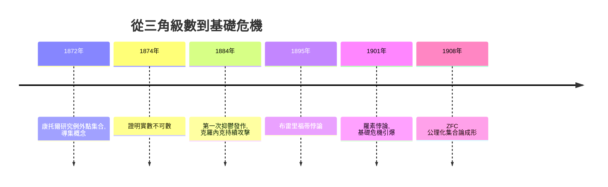

# 4.4 康托爾的集合論：無限的孤獨

1845 年，格奧爾格康托爾出生於聖彼得堡一個丹麥裔商人家庭，父親經營國際貿易，母親出身音樂世家。1856 年全家移居德國，康托爾先後就讀蘇黎世與柏林大學，是魏爾斯特拉斯、庫默爾與克羅內克的學生。1869 年他任教於哈勒大學，一座普魯士的二流大學，比不上柏林與哥廷根，但安靜。命運讓他在這座小城改寫了無限的定義。

起點是傅立葉級數的餘波。康托爾研究三角級數的唯一性問題：兩個三角級數在幾乎所有點上收斂到同一個函數，它們是否恆等。為了回答這個問題，他不得不研究例外點集合的性質，於是發明了導集的概念，一步步走進了點集的深水區。1874 年，他發表了一篇劃時代的論文，證明代數數可以與自然數一一對應，但實數不能：實數是不可數的。對角線論證雖然要到 1891 年才正式寫下，但結果已經在 1874 年誕生。這意味著無限不止一種大小，無限有層級。接著他證明直線上的點與平面上的點一樣多，這個結果連他自己都驚訝，寫信給戴德金說：我看到了，但我不相信。

反應是殘酷的。柏林大學的克羅內克，康托爾從前的老師，公開抨擊集合論是數學的瘟疫，是迷霧中的沙丘，並動用影響力阻止康托爾的論文在克雷勒雜誌發表，阻止他在柏林求職。克羅內克的立場有清楚的哲學根源：他信奉只有能從整數經有限步驟構造出來的對象才存在，無理數集合的整體概念在他看來是形而上學的胡言。這不是個人的恩怨，而是數學哲學的戰爭，只是它以師生決裂的形式上演。康托爾終生未能得到柏林的職位，1884 年他首次陷入嚴重抑鬱，此後在創作與病發之間反覆，晚年在精神醫院去世。他在病中轉而研究但丁神曲與彼得三世的身世之謎，並相信培根是莎士比亞劇作的作者。

公平地說，當時的科學界並非全是敵意。戴德金是最早支持他的人，兩人往來書信成為集合論孕育的搖籃。米塔格萊夫勒在他主編的雜誌上發表了康托爾的重要論文。希爾伯特後來說：沒有人能把我們從康托爾創造的天堂裡趕出去。而在應用一端，集合論很快證明了它的力量：它是實數理論的通用語言，是勒貝格積分的基礎，是拓撲學的起點。到二十世紀，集合論成為全體數學的公共地基，今天每一本分析教科書的第一章都在講它。

康托爾的工作也暴露了地基的裂縫。1895 年，布雷里福蒂指出所有集合的集合會導致矛盾，即所謂的樸素集合論悖論；1901 年，羅素提出更簡單的悖論：由所有不包含自身的集合構成的集合，包含自身嗎。這個悖論只用集合與屬於兩個詞，無法迴避，它引爆了二十世紀初的數學基礎危機，直接導致了公理化集合論的誕生、希爾伯特綱領的提出，以及最終哥德爾不完備定理的出現。邏輯的下一場大戲，在世紀之交的哥廷根拉開帷幕。

