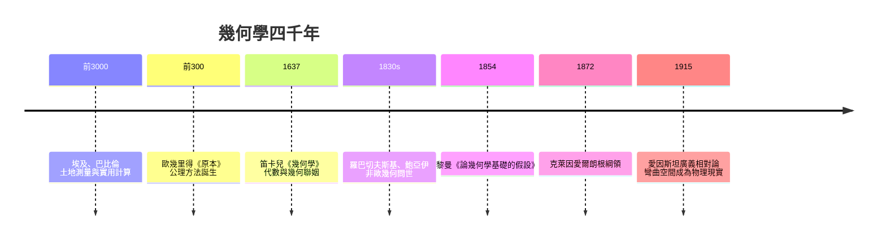

# 自序：幾何是丈量大地，也是丈量思想

「幾何」（geometry）這個詞，在希臘語裡就是「丈量土地」（geo = 地，metron = 量）。

這個詞源洩露了一個常被遺忘的真相：幾何學一開始並不「純粹」。它誕生於尼羅河每年泛濫後重劃地界的迫切需要，誕生於稅吏的繩索與穀倉的容積計算。是人類的經濟生活先需要幾何，然後才有一群希臘人追問：這些法則為什麼成立？能不能從少數幾條顯然成立的出發點，推出全部？

從那個追問開始，幾何學走過了四千年的路：

本書想講的，不是一串定理的清單，而是這些定理背後的因果鏈。為什麼公理方法誕生在希臘殖民地而不是埃及？為什麼第五公設的問題拖了兩千年才解？為什麼非歐幾何同時出現在俄國、匈牙利與德國？為什麼畫法幾何會是法國大革命的產物？為什麼黎曼幾何能在六十年後等來愛因斯坦？

答案幾乎總是：技術、經濟、制度、思想與政治彼此推動。土地私有催生了測量，城邦辯論文化催生了證明，圖書館制度催生了系統化知識，軍事工程催生了畫法幾何，國家考試制度塑造了數學家的養成路徑，而哲學上對「空間是什麼」的爭論，則為非歐幾何準備了被接受的土壤。

歷史上每一代人都以為幾何學已經完成。埃及人以為量地的方法就是幾何的全部；希臘人以為《原本》就是空間的真理；十八世紀的哲學家以為歐氏空間是先驗的、不可動搖的直觀。每一代人都錯了，而每一次的「錯」，都打開了更大的世界。

這本書分五篇。第一篇講大河文明與希臘證明文化的誕生；第二篇講亞歐山大城的黃金時代與公理體系；第三篇講座標革命——笛卡兒如何用一個念頭把代數與幾何接通；第四篇講兩千年圍城之後非歐幾何的破城；第五篇講幾何如何蛻變為研究結構的學問，直抵希爾伯特空間與現代物理。

閱讀時不需要超越高中的數學。需要的，只是像泰勒斯那樣多問一句「為什麼」，像開創非歐幾何的人那樣敢於想像「如果公理可以換」。

空間是人類最早思考的對象，也可能是最後一個被想清楚的對象。

讓我們從尼羅河畔的繩索開始。

---

[回到目錄](README.md)
