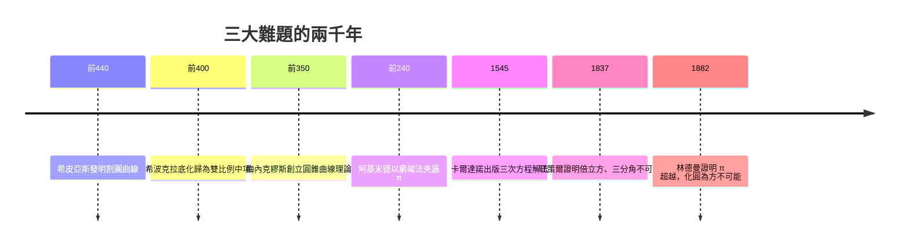

# 2.2 希臘三大難題：化圓為方、三等分角、倍立方

## 三道只有尺規的考題

古希臘幾何設下了極簡而苛刻的工具限制：只用無刻度直尺與圓規。在這個限制下，三個問題折磨了數學界兩千三百年：

| 難題 | 內容 | 等價的代數條件 |
|---|---|---|
| 化圓為方 | 作一正方形，面積等於給定圓 | $\sqrt{\pi}$ 可作圖 |
| 三等分任意角 | 將任意角三等分 | 解三次方程 $\cos\theta = 4x^3 - 3x$ |
| 倍立方 | 作一立方體，體積為給定立方體兩倍 | 解 $x^3 = 2$，即 $\sqrt[3]{2}$ 可作圖 |

可作圖的量有精確的刻畫：從單位長出發，直尺與圓規只能作出經過有限次加、減、乘、除與開平方可得到的數。用現代語言說，可作圖的數必須落在實數域上的一系列二次擴張之中。

## 倍立方：從祭壇瘟疫到軍事工程

倍立方問題有最戲劇性的出身。傳說提洛島爆發瘟疫，德爾斐神諭宣示：必須把阿波羅的立方體祭壇體積加倍。工匠直接把邊長加倍，體積變成八倍，瘟疫依舊。正確答案是把邊長乘以 $\sqrt[3]{2}$——而這個量用尺規作不出來。

這個「提洛問題」在柏拉圖時代廣為流傳，吸引了一大批解法，其中兩個特別重要。埃利斯的希皮亞斯發明了割圓曲線（quadratrix），既能三等分角又能化圓為方；開俄斯的希波克拉底發現倍立方可以化歸為「求兩個比例中項」：若 $a : x = x : y = y : 2a$，則 $x^3 = 2a^3$。而梅內克繆斯（Menaechmus，約前 380–前 320）在求這兩個比例中項時，創造性地用平面截圓錐——

> 圓錐曲線（橢圓、拋物線、雙曲線）就這樣誕生於一道神諭難題。

記住這一點：一千八百年後開普勒用橢圓描述行星軌道（參見《科學背後的數學》1.1 節），而橢圓的祖先是希臘人為解倍立方發明的曲線。純數學的「無用之用」，莫過於此。

## 兩千年的努力與最後的判決

三個難題吸納了古希臘最聰明的頭腦：阿基米德研究過化圓為方（他的《圓的度量》以窮竭法夾逼 $\pi$ 介於 $3\frac{10}{71}$ 與 $3\frac{1}{7}$ 之間）；阿波羅尼奧斯與尼科梅德斯發明了蚌線、蔓葉線等「超越工具」。文藝復興與近代早期，義大利代數學派解出三次方程（塔爾塔利亞、卡爾達諾），看似接近了答案，實則遙遠。

最終判決由十九世紀的抽象代數作出：

- 1837 年，旺策爾（Pierre Wantzel）證明倍立方與三等分任意角不可能。關鍵一步：三次方程若有有理根可降次，若無有理根則其根不在任何二次擴張中——不可作圖。以 60° 為例，三等分要求解 $\cos 20° = 4x^3 - 3x$，即 $8x^3 - 6x - 1 = 0$，無有理根，故 $x = \cos 20°$ 不可作圖。
- 1882 年，林德曼（Ferdinand von Lindemann）證明 $\pi$ 是超越數（不滿足任何整係數多項式方程）。既然可作圖數都是代數數，$\sqrt{\pi}$ 不可能作圖，化圓為方不可能。

三大難題全部判死。但這場「失敗」的遺產驚人地豐厚：圓錐曲線、割圓曲線、窮竭法、三次方程理論、群論與體擴張——限制催生發明，難題塑造工具。

## 難題留下的制度啟示

希臘三大難題還揭示了一種新的知識型態：問題可以被明確表述，然後在幾代人手中傳遞、轉化、最終被以出題者完全想不到的工具解決。化圓為方的人不可能預想伽羅瓦理論；正因為問題被保持「乾淨」（嚴格定義、明確工具限制），它才能跨越兩千年仍然有意義。

這成為現代數學的制度性傳統：希爾伯特在 1900 年提出的 23 個數學難題、千禧年七大數學獎題，都是同一個傳統的後裔。而「只許用尺規」的限制本身，則演變成現代數學的核心方法論——明確你的公理與工具，才明白你的證明在證明什麼。

---

[下一節：2.3 阿基米德與阿波羅尼奧斯](02.3-阿基米德與阿波羅尼奧斯.md)
