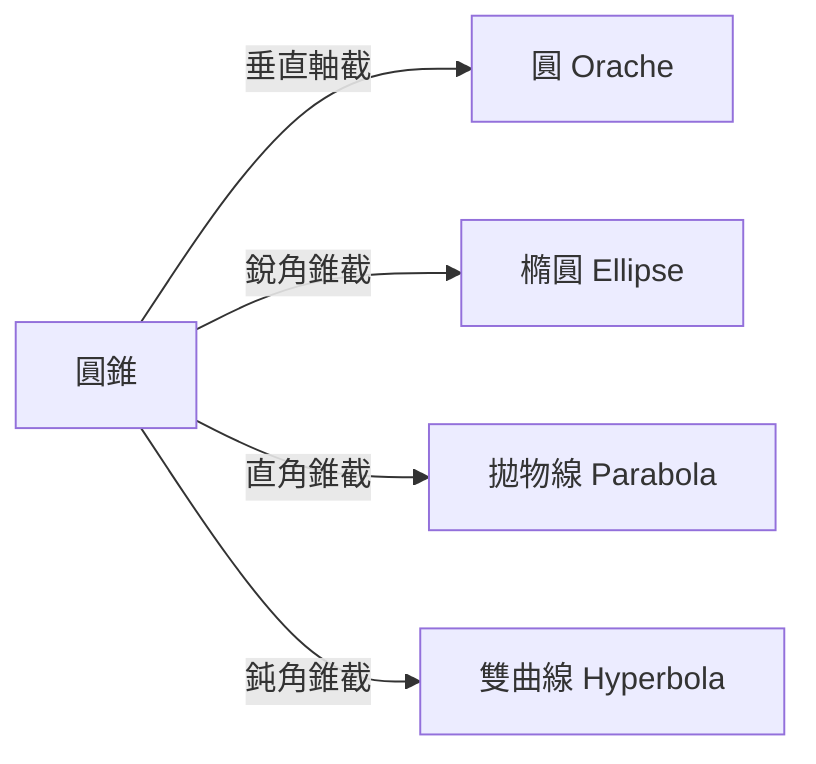

# 2.3 阿基米德與阿波羅尼奧斯：幾何的極限與圓錐曲線

## 敘拉古的工程師—數學家

阿基米德（Archimedes，約前 287–前 212）是亞歷山大學派之外的自成一格者。他出身西西里島敘拉古的貴族家庭，據說與敘拉古僭主希倫二世有親戚關係，並長期為這位統治者提供軍事工程——這個身分決定了他的數學帶有濃厚的應用色彩，也決定了他的結局。

他流傳最廣的事蹟都與工程有關：為希倫二世檢驗王冠是否摻假而發現浮力原理；設計複合滑輪組把大船拉上岸；羅馬圍城時用投石機與（傳說中的）燃鏡守城。西元前 212 年羅馬攻陷敘拉古，主將馬塞勒斯下令保全其性命，一名士兵仍將他殺死——傳說他臨死前正對著沙盤畫幾何圖，說「別踩壞我的圓」。

## 窮竭法：微積分的前夜

阿基米德的數學巅峰是「窮竭法」（method of exhaustion）。在《圓的度量》中，他用圓內接與外切正 96 邊形夾逼，證得

$$3\frac{10}{71} < \pi < 3\frac{1}{7}$$

在《拋物線圖形求積法》中，他把拋物線弓形切成無窮多層三角形，各層面積依次減半，總和為

$$\frac{1}{4}(\text{外接三角形}) + \frac{1}{4}\cdot\frac{1}{4}(\text{外接三角形}) + \cdots = \frac{4}{3}(\text{外接三角形})$$

用幾何級數完成求和——這正是兩千年後微積分「以極限處理曲線圖形」的思想原型。他在《方法書》中甚至用「把圖形切成無窮多片、以槓桿原理秤重」的力學方法猜出球體積公式：

$$V = \frac{4}{3}\pi r^3$$

並要求墓碑刻上這個他最得意的定理（內接圓柱體積恰為球的三分之二）。兩百年後羅馬政治家西塞羅到敘拉古，真的找到了荒煙蔓草中的這座墓。

耐人尋味的是，阿基米德嚴格區分「發現的方法」與「證明的方法」：《方法書》的力學直覺只供發現，正式發表仍須用窮竭法作邏輯證明。這種「啟發式探索＋嚴格證明」的雙軌結構，正是現代數學研究的標準作業流程。

## 阿波羅尼奧斯與《圓錐曲線論》

阿波羅尼奧斯（Apollonius of Perga，約前 262–前 190）年輕時到亞歷山大城師從歐幾里得的弟子，此後在亞歷山大與帕加馬之間活動。他的《圓錐曲線論》八卷（前七卷存世，第八卷失傳）把梅內克繆斯以來的圓錐曲線研究整理成系統科學，並創造了我們至今使用的名稱：

書中給出焦點、準線、離心率的定義與大量命題，實質上用幾何語言寫出了圓錐曲線的「解析幾何」內容——例如拋物線的性質等價於方程 $y^2 = 2px$。開普勒在 1609 年宣布行星走橢圓時，直接倚靠的就是這部兩千年前的著作；牛頓《原理》中處理平方反比力下的軌道，同樣以圓錐曲線理論為骨架。

## 黃金時代之後

亞歷山大幾何學派延續了數百年：埃拉托斯特尼測出地球周長（誤差可能只有百分之幾）、喜帕恰斯奠定三角學、托勒密寫成《至大論》、帕普斯在四世紀集希臘幾何之大成。但整體而言，希臘幾何在阿波羅尼奧斯之後漸趨守成。

原因值得玩味。希臘數學以幾何為唯一合法語言，而幾何方法處理高次與一般數量關係時力不從心；與此同時，羅馬的政治秩序推崇工程與法律，不鼓勵純理論；亞歷山大圖書館在數百年戰亂中屢遭焚毀，知識傳承的制度基礎瓦解。當支撐知識生產的社會制度衰退，數學的黃金時代便一去不返。

希臘幾何要等到兩個外援才再出發：一是印度與阿拉伯世界帶來的位值記數法與代數，二是文藝復興後歐洲對古文的翻譯運動。而下一場真正的革命——用代數重寫幾何——將由一位在戰場上打盹的士兵哲學家引爆。

---

[下一章：3.1 笛卡兒與費馬](03.1-笛卡兒與費馬.md)
