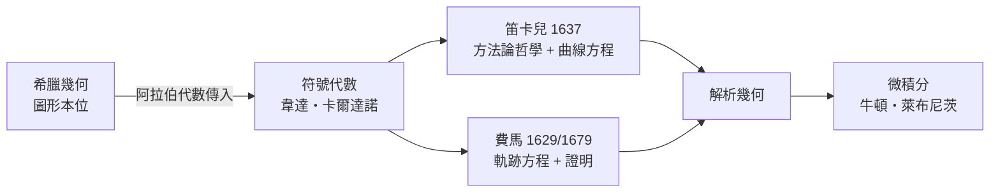

# 3.1 笛卡兒與費馬：兩條通往解析幾何的路

## 笛卡兒：士兵、哲學家與座標

勒內·笛卡兒（René Descartes，1596–1650）的人生像一部流浪小說。他生於法國圖賴訥的議會家庭，耶穌會學校畢業後取得法律學位，卻在 1618 年投入拿騷的毛里茨親王的軍隊當志願兵——當時正值三十年戰爭初期，歐洲是流動的軍人勞務市場，各國軍隊雇傭外籍軍官。正是在軍旅中，他於 1618 年 11 月在荷蘭布雷達的街頭看到一張徵解數學難題的告示，結識了醫生兼數學家以撒·貝克曼，重新點燃了對數學的熱情。

他自己在《方法談》中回憶：1619 年 11 月 10 日夜，在德國烏爾姆附近（多瑙河畔軍營）的暖房裡連做三個夢，醒來認定自己肩負以理性統一一切科學的使命。後世把這一夜稱為笛卡兒的「烏爾姆之夜」——傳說座標幾何的靈感與這三夢有關。

此後他遊歷歐洲數年，1628 年定居以思想寬容聞名的荷蘭共和國——那裡有萊頓大學、活躍的印刷業、以及剛經歷獨立戰爭而缺少傳統教會權威的社會氛圍。1637 年，他出版《更好地指導推理與尋求科學真理的方法談》，附上三篇科學論文，其中第三篇題為《幾何學》（La Géométrie），篇幅百餘頁，就是座標幾何的出生證明。

## 《幾何學》的核心觀念

笛卡兒的做法用今天的語言說：把平面上的點對應到一組數對 $(x, y)$，曲線對應到方程。例如圓錐曲線的統一形式（笛卡兒書中的「三次曲線」範圍內）：

$$y^2 = 2px - qx^2 \quad \text{（橢圓：} q > 0 \text{，拋物線：} q = 0 \text{，雙曲線：} q < 0\text{）}$$

一個方程，同時編碼了古希臘用三種圓錐分開研究的曲線。幾何問題從此可以化為代數計算，代數方程可以化為圖形直觀。《幾何學》全書沒有現代意義的座標軸圖——笛卡兒用的是從一條基線出發的斜量法，縱座標軸是後人（特別是牛頓與萊布尼茨時代）逐步標準化的。概念革命先於圖式革命。

## 費馬：圖盧茲律師的平行發明

幾乎同一時期，法國圖盧茲的議會律師皮埃爾·德·費馬（Pierre de Fermat，1607–1665）從另一條路走進了同一座殿堂。費馬是業餘數學家——本業是司法官，白天審案，晚間研究。他在 1629 年前後寫成《平面與立體軌跡引論》，明確提出：「給定一條曲線，可以寫出其方程；給定方程，可以作出曲線。」這比笛卡兒的《幾何學》更接近現代教科書的表述。

費馬的手稿私下流傳、未及時出版，等到 1679 年問世時，笛卡兒的名聲已定。兩人還曾捲入優先權爭議：笛卡兒風格是哲學式的綱領加機械作圖，費馬風格是簡潔的代數命題加證明。歷史的公允說法是：解析幾何由兩人獨立發明，笛卡兒給了它哲學與方法論的地位，費馬給了它教科書式的技術形態。費馬同時還是機率論的奠基者（與帕斯卡通訊解決賭金分配問題）與近代數論之父，一個職業法官的業餘產出勝過大多數專業學者——這本身就是十七世紀知識生態的註腳：大學與宮廷之外，書信網路與印刷出版已足以支撐頂級科學。

## 經濟與社會的推力

座標幾何並非純思想的火花，它有現實需求在背後推動。十七世紀的歐洲：航海擴張需要精確的天文與地理計算，彈道學需要拋體軌道，光學研磨需要曲線理論，荷蘭與英國的測繪業需要土地幾何。笛卡兒本人就撰寫過折射定律（斯涅爾—笛卡兒定律）與透鏡設計的論文。當「曲線」從古希臘的靜態圖形變成工程與貿易中的計算對象，就需要一種能把圖形算出來的數學——解析幾何應運而生。

更深一層，座標方法改變了「什麼是曲線」的哲學：曲線不再由幾何條件（如「到兩定點距離和為常數」）定義，而可由任何代數方程定義。空間被算術化了——這一步是通往微積分與現代分析的必經之路。萊布尼茨說笛卡兒的工作「把幾何從圖形的奴役中解放出來」；反過來說，它也把代數安置進了空間的直觀。

---

[下一節：3.2 畫法幾何與工程國家](03.2-畫法幾何與工程國家.md)
