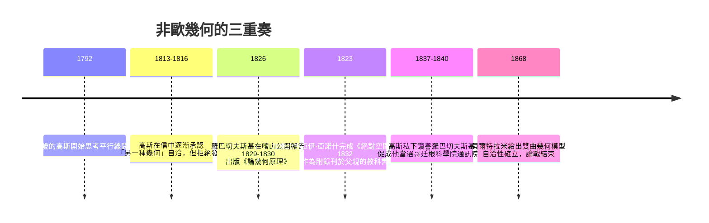

# 4.2 羅巴切夫斯基、鮑亞伊與高斯：異端空間的降生

## 三個人，同一扇門

## 高斯：看見了，但沉默

高斯（Carl Friedrich Gauss, 1777–1855）早在少年時代就被平行線問題纏住。他留下的私人信件顯示，最遲在 1810 年代，他已經確信：否定第五公設可以得到一種邏輯上同樣自洽的幾何，而且「我們的空間」未必是歐氏的——他甚至設想用巨大三角形的實測角度和檢驗空間曲率。1817 年他寫給天文學家歐伯斯的信中說：「我們需要幾何學與力學並列，幾何學不能先驗於力學。」

但他一生拒絕發表。他對貝塞爾說過一句著名的話：「我怕愚昧者的叫囂（Geschrei der Böotier，意指庸眾的鼓噪）。」這不只是膽怯：高斯身處的德意志學術界，康德哲學如日中天，公開否定先驗空間等於自找論戰。他的沉默是一個精確的社會學標本——連當時最強的數學家，也感受得到觀念制度施加的壓力。

## 羅巴切夫斯基：在邊疆公開宣講

尼古拉·伊萬諾維奇·羅巴切夫斯基（Nikolai Ivanovich Lobachevsky, 1792–1856）的一生與高斯恰成對照。他生於下諾夫哥羅德的窮公務員家庭，靠獎學金進入新建的喀山大學，畢業留校，一路升到校長（1827–1846），在邊疆把一所新大學辦成了俄國東部的學術重鎮。

1826 年 2 月，他在喀山大學物理數學系公開報告「平行線理論的扼要敘述」；1829–1830 年在《喀山通報》發表《論幾何原理》——人類第一次公開出版一種非歐幾何。他後來陸續發表《平行線理論的幾何研究》（1840，德文，高斯讀後私下讚譽「以真正的幾何精神寫成」）與遺作《泛幾何學》（Pangeometry, 1855）。他的策略清晰而勇敢：新幾何不是邏輯遊戲，而是「可能適用於廣大空間尺度」的物理假說，最終由天文觀測裁決。

國內的反應是嘲笑與冷落。聖彼得堡科學院拒絕討論，批評者稱之為荒謬。他晚年失明、被免去校長職務，1856 年在相對貧困中去世，不知自己的思想即將改變世界。

## 鮑亞伊：被父親警告的孩子

匈牙利軍官鮑亞伊·亞諾什（János Bolyai, 1802–1860）的父親鮑亞伊·法爾考什（Farkas Bolyai）是高斯的終身好友，自己耗費一生於第五公設而無所獲，寫信給兒子時近乎哀求：

> 「看在上帝的分上，我懇求你，放下這個問題。它比整段荒淫的歲月更能奪走人生的歡樂與時間……毫無希望的黑暗能吞噬一千座牛頓塔，它在其中永遠找不到底。」

亞諾什不聽，反而以現役軍官的假期衝破了這座兩千年的圍城。1823 年他寫信給父親：「我從虛無中創造出了一個新的、不同的世界。」1832 年，父親把兒子的 26 頁論文《絕對空間的科學》作為自己《給好學青年的純粹數學原理引論》第一卷的附錄寄給高斯。高斯回信說：「稱讚它等於稱讚我自己，因為這與我三十年來的想法完全一致。」亞諾什深受打擊——既非首次發現者，也未獲承認——此後幾乎停止發表，晚年貧病而終。

高斯的回信按史實並無抄襲之嫌（他在 1816 年給友人施馬爾茨的信中確已私下發展此理），但對一個渴望承認的年輕人而言，這句話無異於宣判。

## 雙曲幾何長什麼樣

羅巴切夫斯基幾何（後稱雙曲幾何）中，過線外一點有無窮多條平行線；三角形內角和小於 180°，差額與面積成正比（蘭伯特已猜到）；不存在相似而不全等的圖形——放大一個三角形，角度會變。以高斯曲率 $K$ 表述，這是 $K < 0$ 的常曲率空間；球面（$K > 0$）則是「無平行線」的另一種非歐幾何。

1868 年，義大利數學家貝爾特拉米給出雙曲幾何在偽球面上的局部模型；其後克萊因與龐加萊給出完整模型（克萊因模型中「直線」是圓盤內的弦，龐加萊圓盤模型中「直線」是與邊界正交的圓弧）。非歐幾何的自洽性從此與歐氏幾何綁定：若一者有矛盾，另一者也有。邏輯的判決書下達了——兩千年的圍城，原來守的不是真理，只是一種選擇。

## 制度與思想的餘震

三人命運的差異，幾乎是一場關於知識傳播的天然實驗。高斯有最高的聲望與最安全的位置，卻選擇沉默；羅巴切夫斯基在帝國邊疆的年輕大學裡，反而擁有「發表—教學—再發表」的完整渠道；鮑亞伊依附於父親的教科書附錄，傳播渠道最窄，命運也最苦。思想的誕生依靠個人天才，思想的存續依靠出版、教職與學術共同體——這在非歐幾何的故事裡呈現得再清楚不過。

哲學界的反應同樣深刻：當黎曼 1854 年把幾何推廣到任意維彎曲空間、當 1860 年代起高斯—黎曼的觀念經赫姆霍茲等科學家傳播，康德的先驗空間論漸被「空間的幾何是可經驗檢驗的問題」取代。1905 年前後，龐加萊主張「幾何是約定」；十年後愛因斯坦給出終極答案：空間的幾何由物質分布決定，且真的不一定是歐氏的。異端空間，等來了它的物理加冕。

---

[下一節：4.3 黎曼幾何](04.3-黎曼幾何.md)
