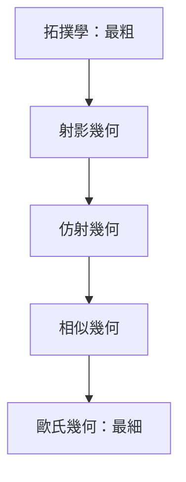

# 5.1 克萊因的愛爾朗根綱領：幾何就是研究變換下的不變量

## 1872 年：一位 23 歲教授的就職綱領

到十九世紀中葉，幾何學已成為一片雨林：歐氏幾何、雙曲幾何、球面幾何、射影幾何、仿射幾何、畫法幾何，各自為政、術語混亂。什麼是「幾何」？這個問題需要一個總綱。

克萊因（Felix Klein, 1849–1925）23 歲時受聘埃爾朗根大學教授，按德國慣例須提交一份就職綱領。他交出的《新近幾何學研究的比較考察》（1872）——世稱愛爾朗根綱領（Erlangen Programm）——給出了驚人簡潔的答案：

> 給定一個空間與這個空間的一個變換群，研究圖形在該群作用下保持不變的性質——這就是一種幾何。

換言之，幾何不由「研究的圖形」定義，而由「容許的變換」定義。變換群越大，不變性質越少，幾何越粗；變換群越小，幾何越細。

## 一張表統一雨林

| 幾何 | 變換群 | 保不變的量 |
|---|---|---|
| 歐氏幾何 | 剛體運動（平移＋旋轉＋反射） | 長度、角度、面積 |
| 相似幾何 | 相似變換 | 角度、比例 |
| 仿射幾何 | 仿射變換 | 平行性、共線性、比例 |
| 射影幾何 | 射影變換 | 交比、共線性 |
| 拓撲學 | 同胚（任意連續雙向變換） | 連通性、洞的個數 |

群越大，不變量越少。射影幾何中圓與橢圓無區別（可互相投影），拓撲學中茶杯與甜甜圈無區別（可連續變形）。克萊因以群論（伽羅瓦去世三十年後終於成熟的代數工具）為經緯，把所有幾何納入同一框架，並預言：新幾何＝新變換群。這個預言在相對論中應驗——洛倫茲變換群定義了閔可夫斯基時空的幾何。

## 綱領的身世：競爭、戰俘與流亡的合流

愛爾朗根綱領的每個思想源頭背後都有一段歷史。克萊因的群論素養來自巴黎之行：1870 年他與挪威青年李（Sophus Lie, 1842–1899）同在巴黎，從若爾當那裡接受群論洗禮，並與李結為摯友——李後來創立連續變換群（李群）理論，正是綱領最深刻的延伸。

普法戰爭（1870–71）打斷了這一切。克萊因回國從軍；李身為外國人試圖徒步出走，在楓丹白露被當作普魯士間諜逮捕，獄中繼續寫數學，靠達布等法國學者營救出獄。戰後兩人分別在德國與挪威發展連續群論。沒有這場戰爭與這段牢獄，連續群與幾何的這條姻緣線或許會晚生十年。

綱領發表之初反響寥寥——太抽象，超前於時代。真正發酵要到 1880 年代：龐加萊創立自守函數論時自覺使用了「變換群定義幾何」的觀念，並與克萊因展開著名競爭（克萊因因過度勞累在競爭中病倒，此後轉向教育與學術組織）。1886 年克萊因轉任哥廷根，開始了他一生更大的事業——把哥廷根建成世界數學中心。

## 制度建造者：另一種偉大

克萊因對數學的影響，一半靠思想，一半靠制度。在哥廷根，他系統性地做三件事：延聘天才（1895 年請來希爾伯特，1902 年又為其設置同事席位，請來閔可夫斯基）、接通產學（與化工、電機企業合作，創立應用數學與力學講席，培養出普朗特、龍格、柯朗等）、創辦機構（數學研究所、應用數學與力學學院、數學科學百科全書）。哥廷根從一所省立大學躍升為二十世紀前三十年的世界數學之都，其制度設計——講席制、研討班、出版社、基金募集——是現代研究型大學的範本。

克萊因還重構了數學教育。1900 年前後，他發動「函數思維」教育改革運動，主張中學數學應以函數概念為核心、以微積分入門為目標，教師必須受大學水準訓練。1908 年國際數學聯盟前身（國際數學教育委員會）成立，克萊因任主席。今天各國課綱中的「函數主線」，遠源在此。

值得一提的是克萊因的「德國精神」立場：他拒絕在綱領中追隨英國代數學派與義大利學派的術語，力主以群論為綱的統一德式綜合，這種「學派式」的學術民族主義在十九世紀後期並不罕見，也提醒我們：即便最抽象的數學綱領，也是特定學術政治的產物。

愛爾朗根綱領留下的最深遠的遺產是一種眼光：數學對象的本質，在於它們之間的變換。下一節的主角——拓撲學——正是把這個眼光推到極致的學科。

---

[下一節：5.2 拓撲學](05.2-拓撲學.md)
