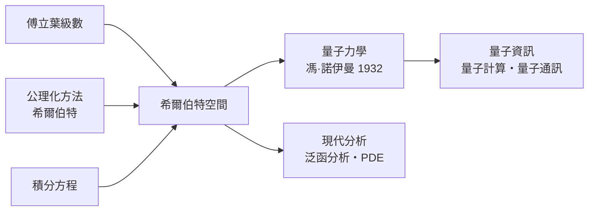

# 5.3 希爾伯特空間：無窮維幾何與現代物理的語言

## 從積分方程到「空間」

二十世紀初，哥廷根的大衛·希爾伯特（David Hilbert, 1862–1943）在研究積分方程時做了一個今天看來改變一切的動作：把一列數 $(a_1, a_2, a_3, \ldots)$ 看成一個「點」，把積分方程的解看成點的集合，於是分析問題變成幾何問題。1906 年前後，他與施密特（Erhard Schmidt）把歐氏幾何的語言系統地搬到這個無窮維的世界。

無窮維空間的「座標」是可數無窮多個數，內積定義為

$$\langle a, b \rangle = \sum_{n=1}^{\infty} a_n \overline{b_n}$$

要求 $\sum |a_n|^2 < \infty$（平方可和）——這個條件使空間完備（極限不跑出空間外），成為今日所稱的 $l^2$ 空間。馮·諾伊曼 1929 年命名為「希爾伯特空間」（Hilbert space），並在其上加上完備內積空間的現代定義。核心思想一句話：

> 只要一個集合上有內積（能談長度、距離與夾角）並且完備，幾何的全部直觀——投影、正交、勾股定理——就自動適用，無論它是不是「看得見的空間」。

## 分析、幾何與物理的三方合流

希爾伯特空間不是憑空發明，而是三股水流的匯合口。

第一股：十九世紀的函數展開。傅立葉 1807 年宣稱任何函數可展開為三角級數，半個世紀的爭論（收斂性、可積性）逼出黎曼積分與勒貝格積分（1902）。在 $L^2[0, 2\pi]$ 中，傅立葉級數恰好是「函數點在正交基 $\{1, \cos nx, \sin nx\}$ 上的座標展開」——三角函數是無窮維空間的一組正交基，帕塞瓦爾恆等式就是無窮維勾股定理。

第二股：數學基礎運動。希爾伯特本人是二十世紀數學的總設計師。他 1900 年提出的 23 個問題主導了整個世紀的數學議程；他的公理化方法（1899 年《幾何基礎》重建歐氏幾何，明確「點、線、面可以是任何滿足公理的東西」）把歐幾里得的傳統推到完全形式化的程度。希爾伯特空間是這種方法論在幾何上的化身：幾何＝公理系統＋具體模型。

第三股：量子力學。1925 年海森堡的矩陣力學與薛丁格的波動力學同年出現，看似兩種理論。1927 年馮·諾伊曼在希爾伯特的研討班上指出：兩者都是同一個希爾伯特空間上自伴算符理論的特例——矩陣力學是無窮矩陣的代數面，波動力學是微分算符的分析面。1932 年馮·諾伊曼出版《量子力學的數學基礎》，把量子力學的完整框架安放在希爾伯特空間之上：

| 物理概念 | 數學對象 |
|---|---|
| 量子態 | 希爾伯特空間中的向量（單位長） |
| 可觀測量 | 自伴算符 |
| 測量值機率 | 內積的模方 $\|⟨\psi|\phi⟩\|^2$ |
| 機率守恆 | 幺正變換（保內積） |

量子力學因此可以說是「希爾伯特空間中的幾何學」。費曼曾說，理解量子力學的關鍵在於忘掉「粒子走某一條路」，改用「態向量的旋轉與投影」——這正是把幾何直觀搬進無窮維。

## 幾何觀念的四千年旅程

把這本書的弧線收攏來看：幾何從尼羅河畔的拉繩測地，到希臘的證明藝術；從亞歷山大城的公理大典，到軍事工程學校的保密投影法；從笛卡兒座標把圖形算術化，到黎曼把空間度量參數化；從克萊因用變換群定義幾何，到拓撲學把幾何壓縮為連接結構，最後抵達希爾伯特空間——幾何徹底抽象為「任何具有結構的集合上的關係學」。

每一步擴張都伴隨同樣的社會劇本：先有實用需求（測地、築城、航海、積分方程、量子光譜），再有人把需求形式化；先有保守勢力的抵抗（埃及官吏手冊、康德先驗哲學、軍事保密、機構冷遇），再有制度變革（圖書館、理工學院、研討班、期刊）把新數學固化為文明資產。數學的偉大不在於遠離塵世，而在於它總能把塵世的問題沉澱為宇宙級的結構。

而希爾伯特空間的故事還在續寫：量子計算把態向量操縱變成工程，量子通訊把內積機率變成密碼學，宇宙學把希爾伯特空間與彎曲時空嫁接為量子引力。哥尼斯堡散步者的後裔們，正在無窮維的空間裡，丈量比尼羅河大得多的領土。

---

[下一節：後記](99-後記-空間是被發現的還是被發明的.md)
