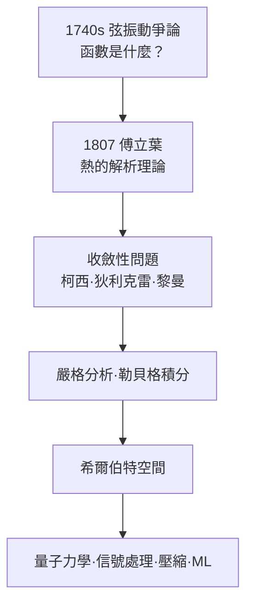

# 2.3 傅立葉與熱：一個囚犯的方程改寫了分析學

## 革命者與埃及學家

讓·巴蒂斯特·約瑟夫·傅立葉的一生與法國大革命緊緊纏繞。他出身裁縫家庭，靠教會教育爬上數學之路，差點成為本篤會修士；大革命爆發後他投身政治，出任家鄉歐塞爾的縣長職務，在恐怖統治時期兩度被捕，差一點上了斷頭台（羅伯斯庇爾倒台才倖免）。1798 年他隨拿破崙遠征埃及，成為埃及研究院的秘書，回國後奉命撰寫宏偉的《埃及記述》——他同時是埃及學的先驅，商博良破譯羅塞塔石碑正是受他的支持與啟發。

在這些政治與外交事務之間，傅立葉始終惦記著一個「低調」的物理問題：熱如何在一個物體內部流動。1807 年，他在格勒諾布爾（他此時是伊澤爾省省長）完成了《熱的解析理論》的核心手稿。

## 熱方程

一根均勻細桿上的溫度 $u(x,t)$ 滿足

$$\frac{\partial u}{\partial t} = k \frac{\partial^2 u}{\partial x^2}$$

熱方程與波動方程結構相似但性格迥異：它不可逆（把時間倒轉，熱方程的解會「反物理」地從混亂走向有序），它天然把一切初始分佈推向光滑的極限——這正是熱力學第二定律的一個縮影。傅立葉由此建立了「穩態問題用拉普拉斯方程、瞬態問題用熱方程」的分析框架；今天半導體散熱設計、地熱勘測、食品冷鏈模擬，用的仍是這條方程。

## 任意函數皆可展開：爭論的終局

傅立葉的真正炸彈是他的解法。他斷言：任何初始溫度分佈 $f(x)$，都可以寫成無窮三角級數——

$$f(x) = \frac{a_0}{2} + \sum_{n=1}^{\infty}\left(a_n\cos\frac{n\pi x}{L} + b_n\sin\frac{n\pi x}{L}\right)$$

並給出了係數的積分公式。這正是當年丹尼爾·伯努利被歐拉與達朗貝爾否定的主張。傅立葉用大量計算證據迫使數學界重新面對 2.1 節的爭論：如果把一個鋸齒狀的、處處有折角的函數展開成光滑正弦的和，那麼「函數」與「級數」的關係必須被重新定義。

繼承法國天體力學傳統的拉格朗日起初反對這份手稿（他至死懷疑三角級數），但年輕一代——柯西、狄利克雷、黎曼——沿著傅立葉的問題把分析學徹底嚴格化：狄利克雷 1829 年證出了第一批收斂定理；黎曼 1854 年為研究傅立葉級數而創立黎曼積分；二十世紀勒貝格積分與希爾伯特空間理論，最初動機仍是傅立葉展開。一位省長的工程式論文，意外成為現代分析學的助產士。

## 應用的雪崩

傅立葉分析一旦確立，應用以超出任何人想像的速度擴張：

| 領域 | 使用方式 | 出現時代 |
|------|---------|---------|
| 電信 | 信號的頻譜分解、濾波 | 十九世紀末至今 |
| 石油探勘 | 地震波頻譜分析 | 二十世紀 |
| 醫學成像 | MRI 與 CT 的重建核心 | 1970 年代起 |
| 媒體技術 | MP3、JPEG 壓縮 | 1990 年代起 |
| 深度學習 | 卷積與頻譜方法 | 2010 年代起 |

一條描述「熱」的方程的解法，最終變成了數位文明的通用拆解工具——這是「理論的應用範圍遠超其誕生動機」最壯觀的例子。

## 小結

傅立葉的故事裡，政治（革命與斷頭台）、帝國（埃及遠征）、行政（省長職務）、教育（綜合理工學院背景）與數學（熱方程）交織成同一張網。歷史沒有把「純數學」與「現實世界」分開保存的抽屜：傅立葉在公務與科研之間切換，而兩者互相餵養。

接下來，鏡頭東移。當法國人還在用分析方法追逐公式時，俄國與中歐的數學家開始問一個更狡猾的問題：如果方程根本解不出來，我們還能知道什麼？

---
[下一節：3.1 李雅普諾夫與俄國學派](03.1-李雅普諾夫與俄國學派.md)
