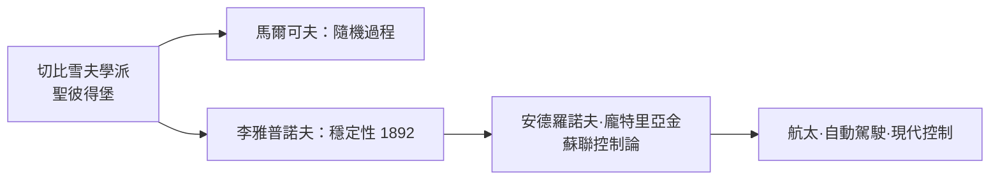

# 3.1 李雅普諾夫與俄國學派：穩定性的科學

## 俄國科學的崛起

十九世紀末，數學的重心東移。聖彼得堡科學院繼承了歐拉與丹尼爾·伯努利的傳統，切比雪夫在聖彼得堡大學建立起俄國第一個真正意義上的數學學派，把機械工程中的實際問題（連桿機構、摩擦、插值逼近）轉化為數學研究。他的兩位高足馬爾可夫（隨機過程的馬爾可夫鏈）與李亞普諾夫，把這個學派的影響推向二十世紀。

亞歷山大·李雅普諾夫 1857 年生於雅羅斯拉夫爾，在切比雪夫指導下完成博士論文《論旋轉液體平衡面的穩定性》。他一生沉默寡言，1893 年起任哈爾科夫大學教授，寫下了二十世紀控制論的奠基之作：1892 年的《運動穩定性的一般問題》。

## 換一個問題：不解方程，只問穩定

李雅普諾夫的洞見是方法論上的革命。既然大多數非線性方程（天體力學、流體、旋轉液體）解不出來，不如放棄「求出解」，改問「解的性質」：

> 給系統一個小擾動，它會回到原狀（穩定），還是越偏越遠（不穩定），還是繞著原狀附近打轉（李雅普諾夫穩定但不漸近穩定）？

他把問題幾何化：方程 $\dot{x} = f(x)$ 的解是相空間中的一條軌線，穩定性就是軌線在小擾動下的行為。他給出了兩大武器：

1. 第一方法（線性化方法）：在平衡點附近把方程線性化，用特徵值的實部符號判斷穩定性。
2. 第二方法（李雅普諾夫函數）：直接構造一個類似「能量」的函數 $V(x)$，證明它沿軌線遞減 $\dot{V} \le 0$，則系統穩定——完全不需要解方程。

第二方法的哲學衝擊力極大：它證明關於未來的確定性結論，可以在完全不求解的情況下獲得。分析學從「計算」轉向「定性」，這正是本章的主題。

## 為什麼俄國：教育制度與國家需求

俄國學派的興起同樣是制度與需求的產物。十九世紀的沙俄急於工業化：鐵路網、機械製造、火炮與艦船設計都需要力學家。切比雪夫本人長期擔任炮兵部門的顧問，研究鉸鏈機構是為了把旋轉運動變成直線運動。俄國的大學與技術學校體系（聖彼得堡、莫斯科、哈爾科夫）在亞歷山大二世改革後快速擴張，數學家獲得穩定的教職與接班人培養管道。李雅普諾夫的穩定性理論，直接回應了「機器與船舶的運動是否可靠」這種工程問題。

這條線索在蘇聯時代繼續發酵：安德羅諾夫在高爾基城建立振動論學派，龐特里亞金發展最優控制的極大值原理，科爾莫哥洛夫把機率論與動力系統接通。李雅普諾夫穩定性成為蘇聯自動控制、飛彈與航太工程的數學骨架——史普尼克號的姿態控制背後，就有這套理論。冷戰的太空競賽，某種意義上是兩個國家各自的微分方程傳統在比賽。

## 今日的迴響

今天，李雅普諾夫方法滲透在工程處處：電力網的暫態穩定分析、自動駕駛控制器的穩定性證明、機器人與無人機的姿態控制、深度學習訓練動力學的研究，甚至流行病模型中「群體免疫閾值是否穩定」的判定。一個 1892 年的俄語論文，成為二十一世紀「安全工程」的通用語法。

## 小結

| 貢獻 | 內容 | 現代應用 |
|------|------|---------|
| 穩定性定義 | 小擾動下的行為分類 | 一切控制系統的規範語言 |
| 線性化方法 | 特徵值判穩 | 飛控、電網、化學反應器 |
| 李雅普諾夫函數 | 不解方程證穩定 | 安全關鍵系統的形式化驗證 |

李雅普諾夫教人類不求解也能知道未來的輪廓。而在同一時代的西歐，龐加萊把這種「定性思維」推到極致，並在三體問題中撞出了讓所有決定論者心碎的發現。

---
[下一節：3.2 龐加萊與三體問題：混沌的第一次現身](03.2-龐加萊與三體問題.md)
