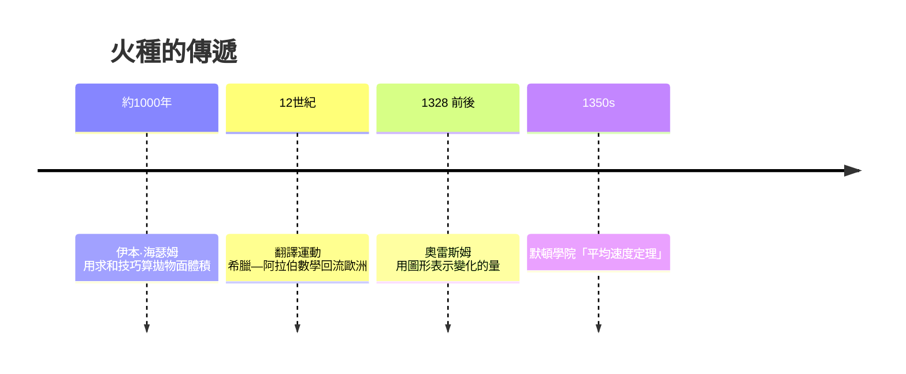

# 1.2 中世紀的火種：奧雷斯姆與圖形語言

## 從沉寂到轉譯

羅馬帝國崩解後，希臘數學的精華多經阿拉伯世界保存：花拉子米的代數、伊本·海瑟姆（Alhazen, 約 1000 年）計算拋物面旋轉體體積——他實際上重新發明了類似窮竭法的求和技巧，用於光學問題。這些火種隨十二世紀的翻譯運動回流歐洲：托萊多與薩勒諾的譯者把亞里斯多德、歐幾里得、托勒密從阿拉伯文譯成拉丁文，大學（波隆那、巴黎、牛津）随之誕生。

## 奧雷斯姆：畫出「量」的形狀

十四世紀，巴黎學者奧雷斯姆（Nicole Oresme, 約 1320–1382）做了一件看似簡單、實則革命的事：把「變化的量」畫成圖形。

亞里斯多德只討論定性運動；經院哲學家爭論「質」的強度如何變化。奧雷斯姆提出用橫線代表時間，縱線的高度代表速度——勻速運動是一個矩形，勻加速運動是一個直角三角形。於是他用幾何面積證明了一個命題：勻加速運動物體走過的距離，等於以中間時刻的速度勻速走過的距離。

這正是後世伽利略落體定律的圖形版，也是「積分＝面積」觀念的萌芽。以今天的眼光看，奧雷斯姆畫出了史上第一批「函數圖像」——儘管函數的概念要到兩百多年後才出現。

## 為什麼是牛津與巴黎

默頓學院的學者（海特斯伯里、斯溫斯黑德）在十四世紀三〇年代證出了「默頓平均速度定理」。這不是巧合：大學是歐洲中世紀最重要的制度發明之一——法團式的自治、授予學位的壟斷權、辯論的教學法（disputatio），創造了一個以智識競爭為職業的階層。邏輯學的訓練使他們對「量」「變化」「極限」這些詞異常敏感。

當然，這個時代的限制同樣明顯：他們沒有代數工具（符號代數要到十六世紀才成熟），論證全靠文字與圖形；宗教框架也讓「實無窮」依然不可觸碰。奧雷斯姆本人最終當上利雪主教，還寫了《論天體的簡單性》質疑占星術——中世紀晚期，理性與信仰的邊界正在悄悄移動。

> 火種微小，卻從未熄滅。等下一個世紀的印刷術、地理大發現與文藝復興的風一吹，火就燒起來了。
