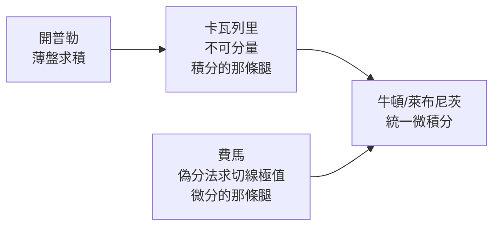

# 2.2 卡瓦列里與費馬：微積分的兩條腿

## 不可分量：卡瓦列里的賭博

1635 年，伽利略的學生卡瓦列里（Bonaventura Cavalieri）出版《幾何學的不可分量連續體新幾何》。他的原理驚人地簡單：把面積看成無數條沒有寬度的「線段」並排而成，體積看成無數張沒有厚度的「面」疊加而成。若兩個圖形在每個高度上的不可分量長度都相等，則面積（體積）相等——這就是「卡瓦列里原理」，中國數學家祖沖之父子早在一千多年前就提出了等價的「祖暅原理」。

用它一眼就能看出：底半徑與高相同的圓錐、半球、圓柱，截面關係是 $x^2 : (R^2 - x^2) : R^2$，於是半球體積等於圓柱減圓錐，得 $V = \frac{2}{3}\pi R^3$。這類計算以前要動用整套窮竭證明，現在變成一行比較。

哲學家與幾何學家立刻攻擊：沒有寬度的線，無論多少條疊起來也不會有面積！卡瓦列里招架乏力。但他賭對了——方法有效、結果可靠，十七世紀的數學家寧可用，回頭再補證明。這種「先斬後奏」的實用主義，正是微積分誕生期的時代精神。

## 費馬：切線與極值的先驅

在圖盧茲做律師的費馬（Pierre de Fermat, 1607–1665），數學只是業餘嗜好，卻貢獻了微積分的另一條腿——**微分**。

1630 年代他發明「偽分法」（adequality，近似相等）求極值：要找函數的最大值，先讓 $f(x)$ 與 $f(x+E)$ 近似相等，兩式相減、除以 $E$、再令 $E=0$。用現代話說，他算出了 $f'(x)=0$。這幾乎就是導數，只是邏輯上「先除以 E 再令 E 為零」站不住腳——這個邏輯缺口要等兩百年後的極限定義才補上。

他還用同樣的技巧求曲線在任一點的切線斜率，計算了旋輪線下的面積，並給出冪函數 $x^n$ 的積分公式（相當於 $\int x^n dx = \frac{x^{n+1}}{n+1}$，$n \neq -1$）。

## 通訊共和國

有趣的是，費馬一生幾乎不出版著作，成果全靠書信在馬梅林·梅森神父主持的「通訊網」中流傳。梅森每週在巴黎的修道院聚攏學者、轉寄信件，堪稱十七世紀的學術伺服器。這種「共和國」（Republic of Letters）制度讓成果得以快速傳播、優先權得以被記錄——也為後來的優先權爭吵搭好了舞台。

> 到 1660 年代，求積（積分）與求切線（微分）的所有零件都已造好。缺的只是有人看出：這兩件事互為逆運算。
