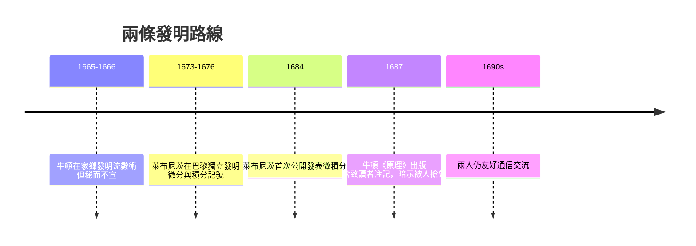

# 3.1 萊布尼茨的符號革命

## 一位外交官的數學之旅

戈特弗里德·萊布尼茨（Gottfried Wilhelm Leibniz, 1646–1716）的正式職業是漢諾威宮廷的法律顧問與圖書館員。1672 年他奉命出使巴黎，遇到了物理學家惠更斯，被引入當時最先進的數學圈。1673 年他訪問倫敦，經皇家學會展示了他的計算器，並被選為會員——但他當時尚不懂微積分。

1675 年 10 月末，在巴黎的手稿裡，萊布尼茨寫下了那個影響至今的記號：

$$\int f(x)\, dx$$

他把積分看作無窮多個極小量 $dx$ 的求和（summa，故用拉長的 S），把微分 $dx$、$dy$ 視為「最後的比」。1684 年他在《教師學報》（Acta Eruditorum）發表〈求極大極小的新方法〉，這是微積分**最早的公開出版物**；1686 年再發表積分學論文。此後他以 $\frac{dy}{dx}$、$\int$、$d$ 建立了一套近乎完美的符號系統。

## 符號即思維

萊布尼茨對符號有一種近乎哲學的執念。他相信好的記號能讓思考自動化——這也是他畢生推動「普遍文字」（characteristica universalis）與邏輯演算的動機。事實證明他對了：$\frac{dy}{dx}$ 天然提示「微商」與鏈鎖律 $\frac{dy}{du}\cdot\frac{du}{dx}$；$\int$ 提示「求和」；$\frac{d^2y}{dx^2}$ 提示高階導數。相比之下，牛頓的點記號 $\dot{x}$、$\ddot{x}$ 只適合以時間為自變數的力學問題。

## 伯努利家族與歐陸學派

萊布尼茨最大的本錢是**教育了下一代**。他與雅各布、約翰·伯努利兄弟通信十餘年，把新方法當教材逐題切磋；伯努利兄弟則回報以最速降線問題（1696）等難題，把變分法的種子埋進微積分。萊布尼茨還創辦柏林科學院（1700 年）並任首任院長，倡議在聖彼得堡、維也納建立同類機構。

萊布尼茨把微積分寫成可傳授、可考試、可擴充的「課程」，而牛頓把它鎖在幾何與手稿裡。一個是體系建設者，一個是孤峰攀登者——這場對比，很快就要用整個英國數學的命運來付帳。
