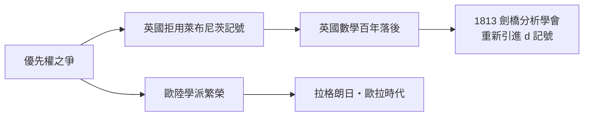

# 3.2 一場曠日持久的官司與英國數學的百年停滯

## 從友誼到宣戰

1690 年代，牛頓與萊布尼茨還在通信中互致敬意，牛頓甚至承認萊布尼茨的求和方法與自己的流數術「殊途同歸」。裂痕出現在 1699 年：瑞士數學家法蒂奧·德·迪利耶（Nicolas Fatio de Duillier）——牛頓的親密追隨者——公開指控萊布尼茨剽竊。萊布尼茨 1704 年抗議時語帶保留，1711 年正式向皇家學會申訴。

此時牛頓已是皇家學會會長。他指定的「公正調查委員會」寫出《通報》（Commercium Epistolicum, 1712），結論自然是牛頓優先。諷刺的是，調查報告的匿名審稿人之一就是牛頓本人；他甚至替委員會起草了結論。歐陸方面，萊布尼茨向他的保護人、漢諾威選帝侯夫人索菲申辯無門——1714 年選帝侯繼位為英王喬治一世，萊布尼茨留在漢諾威整理家史至死（1716），倫敦方面無人悼念。

## 判決與代價

誰先發明？現代史家的共識：兩人**各自獨立發明**，牛頓較早（1665–1666）但未發表，萊布尼茨較晚（1675）但**先公開**（1684），且符號體系優越。真正的悲劇不在誰對誰錯，而在判決的後果：

英國數學界出於「忠誠」，全面採用牛頓記號，拒絕萊布尼茨記號，並切斷了與歐陸的學術往來。整個十八世紀，歐陸的歐拉、拉格朗日、拉普拉斯用萊布尼茨體系把分析學推向天體力學、流體力學、彈性力學的深處；英國卻在 $\dot{x}$ 記號裡反覆消化《原理》，成就乏善可陳。史家稱這一百年為「英國數學的荒漠期」，直到 1810 年代劍橋的「分析學會」（巴貝奇、赫歇爾、皮科克等人）以「肯定要堅持 $d$ 記號的原則」自嘲式宣言引進歐陸符號，才重新接軌。

## 制度的教訓

這場爭端是一堂制度課：

- 發表即優先：萊布尼茨勝在公開，學術制度獎勵傳播而非保密；
- 國家學術機構的裁判權：皇家學會用權力代替同儕審查，損害了自身公信力；
- 民族主義是科學之敵：微積分明明是全歐洲合作的產物（義大利的不可分量、法國的極值技巧、英國的流數、德國的符號），卻被國界切割。

> 數學是全人類的公地，但每個時代都會有人試圖用圍牆圈占它——而圍牆圈住的，往往是自己。
