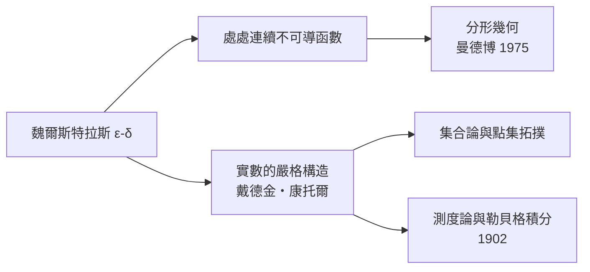

# 4.3 魏爾斯特拉斯：把直覺關進 ε-δ 的牢籠

## 從中學教師到「現代分析之父」

卡爾·魏爾斯特拉斯（Karl Weierstrass, 1815–1897）的路徑與柯西完全相反：父親安排他學財政與法律，他卻在大學期間打架、讀數學、拿不到文憑，最後到西普魯士的小鎮當了十幾年中學教師——教數學、體育，甚至書法。1841 年他開始在業餘時間研究阿貝爾函數，論文發表在鮮為人知的校刊上，無人理會。

轉機出現在 1854 年：他關於阿貝爾函數的論文在《克雷爾雜誌》發表，震動學界，哥尼斯堡大學直接授予他榮譽博士學位；兩年後柏林大學聘他為教授。一個沒有大學文憑的中學老師，靠論文登頂普魯士最高學府——這在等級森嚴的德意志，既是個人傳奇，也反映了 1810 年柏林大學創建以來「研究與教學統一」新大學理念的成熟：學術等級終於開始讓位於學術成果。

## ε-δ：消滅動態的語言

柯西的極限仍是動態的——「變量無限接近」。魏爾斯特拉斯把它翻譯成**純靜態的邏輯**：

$$\lim_{x\to a} f(x) = L \iff \forall \varepsilon > 0,\ \exists \delta > 0:\ 0 < |x-a| < \delta \Rightarrow |f(x)-L| < \varepsilon$$

沒有運動、沒有「接近的過程」，只有量詞與不等式。無窮小從此不需要存在：它只是「對每個 ε 都能辦到」的縮寫。貝克萊的幽靈被徹底驅逐。

## 反直覺的怪物

嚴格化的第一個戰利品是發現**直覺不可靠**。1872 年魏爾斯特拉斯公布了一個「處處連續、處處不可導」的函數——一個用無窮餘弦級數搭成的、處處有稜角的怪物。龐加萊驚呼這是「踐踏直覺的函数」。它的訊息很明確：連續不等於光滑，分析學的定義必須逐字檢驗，不能靠畫圖。

同一時期，戴德金以「切割」定義實數，康托爾以基本列構造實數，連 ε-δ 所依賴的實數完備性也被夯實——這場運動史稱**分析的算術化**：數學的根基從幾何直覺全面轉向整數與邏輯。克羅內克說「上帝創造了整數，其餘皆為人造」，戴德金與魏爾斯特拉斯把這句話付諸工程。

## 連鎖反應

嚴格化看似「鑽牛角尖」，卻打開了後續一切的閘門：

沒有 ε-δ，就沒有勒貝格積分、沒有泛函分析、沒有機率論的公理化——也就沒有現代的金融數學與資訊理論。而這一切起點之一，是一位普魯士中學教師對「字字有據」的執念。

> 直覺是好嚮導，卻是壞法官。魏爾斯特拉斯用一生證明：文明的數學，最終要靠不可辯駁的不等式來結案。
