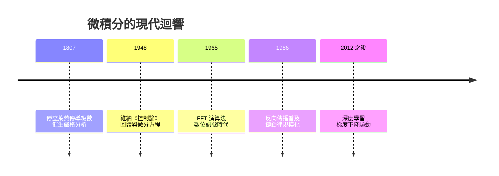

# 5.2 傅立葉以降：從訊號到神經網路的梯度

## 傅立葉：熱的數學

1807 年，綜合工科學院出身的傅立葉（Joseph Fourier, 1768–1830）向巴黎科學院提交研究熱傳導的論文，宣稱任何函數都可以展開為三角級數：

$$f(x) = a_0 + \sum_{n=1}^{\infty}\left(a_n \cos nx + b_n \sin nx\right)$$

這個「任意函數」引發了拉格朗日等人的長期質疑，卻意外成為十九世紀分析學的催化劑：什麼樣的函數可以積分？什麼叫收斂？狄利克雷給出函數的現代定義，黎曼 1854 年的積分定義正是為研究傅立葉級數而生，勒貝格 1902 年的測度積分亦然。實用問題（金屬散熱）兩度把數學基礎逼到重建——這是「應用驅動基礎」最壯觀的案例。

傅立葉分析後來成為電氣時代的通用語言：交流電、無線電、音訊壓縮（MP3）、醫學 CT 與 MRI，本質上都在做「把訊號分解成頻率」這件事。快速傅立葉演算法（FFT, 1965）更被稱為二十世紀最重要的演算法之一。

## 控制論與太空時代

二十世紀，微積分化身為「動態系統」的理論。二戰期間，維納（Norbert Wiener）為解決防空炮火預測問題發展了濾波理論，戰後出版《控制論》（1948），用微分方程與回饋概念統一機器與生物的調節行為。1957 年史普尼克升空後，航天軌道設計、導航與姿態控制全靠微分方程的數值積分——阿波羅登月的電腦裡，跑的正是牛頓二百年前寫下的方程。

## 梯度下降：牛頓的流數術回到舞台中央

今天最熱門的應用則是人工智慧。神經網路的訓練靠的是梯度下降法：

$$w_{t+1} = w_t - \eta\, \nabla L(w_t)$$

$\nabla L$ 是損失函數的梯度——用萊布尼茨的符號說，就是一個高維版本的 $\frac{dy}{dx}$。反向傳播演算法本質上是鏈鎖律（萊布尼茨 1676 年寫下的 $\frac{dz}{dx} = \frac{dz}{dy}\cdot\frac{dy}{dx}$）在大規模計算圖上的系統性應用。每一次 AI 模型訓練，都是微積分基本定理與鏈鎖律的數十億次重複。

## 迴路閉合

從阿基米德測拋物線弓形，到演算法在矽晶片上計算梯度，微積分走過兩千三百年。它的每一次躍遷都遵循同一規律：抽象理論與具體需求互為燃料——天文學餵養了它，酒稅、瘟疫、革命、蒸汽與戰爭各自在不同的世紀推了它一把。而它回報世界的方式，是成為描述一切「變化」的通用語法。

> 梯度下降的每一步都極小，積分起來卻能抵達任何地方——這句話對微積分成立，對人類的知識史也成立。
