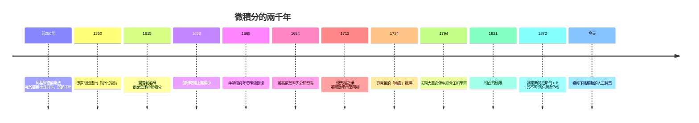

# 後記：一門學科，一個文明的縮影

合上這本書，不妨回頭看看這兩千三百年走過的路：

這條時間線上，純粹的思想閃光從來不是唯一主角。技術（望遠鏡、印刷術、蒸汽機、電腦）、經濟（酒稅、航海、工業、市場）、制度（大學、科學院、綜合工科學院、同儕審查）、政治（瘟疫、戰爭、革命、民族主義）、思想（對無窮的恐懼與馴服）——它們像多條支流，在一個個關鍵的世紀匯聚，才把這門學科推到我們今天手中。

幾個教訓值得帶走：

第一，**基礎研究需要被保護**。阿基米德的拋物線弓形、圓錐曲線、非歐幾何，在誕生時都是「無用之學」。文明若只以短期效用為尺度，就會在無意中殺死未來的阿基米德。

第二，**開放勝於壟斷**。萊布尼茨的公開發表與符號傳播，讓歐陸成為十八世紀數學的中心；牛頓的保密與英國的門戶之見，讓一個島嶼自我邊緣化百年。知識的公地一旦被圍牆圈占，最先困住的是自己。

第三，**嚴格化不是潔癖，是擴張的前提**。貝克萊的批評看似搗亂，實則是饋贈：正是被逼出的 ε-δ，才容得下勒貝格積分、泛函分析、機率公理化，乃至今天以數兆次梯度計算運轉的 AI。能被批評的學科才有機會變得更強。

第四，**教育制度是數學的容器**。綜合工科學院證明：一個設計良好的考試、課程與師資制度，能在一代人之內把革命廢墟變成數學強國。今天我們如何教微積分——只教計算，還是也講它的來路——決定了下一代如何對待知識本身。

牛頓說自己是海邊拾貝殼的孩子，面對真理的大海尚未發現。兩千年的故事告訴我們：那片海不屬於任何一個人、任何一個民族、任何一個時代。它屬於所有願意蹲下來、在沙上認真畫圖的人——包括畫圖前說「別踩壞我的圓」的那一位。

> 願你也找到自己要畫的那個圓。
