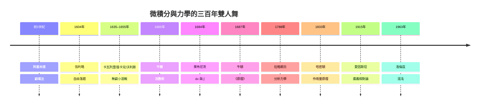

# 前言：自然界寫在微積分裏的密碼——運動、極限與宇宙的連續變化

> 運動的微積分

宇宙中沒有什麼是靜止的：行星滑過橢圓，蘋果墜向地面，光在彎曲的時空中折行。要描述「不斷變化」，人類需要的不是更多數字，而是一種全新的語言——一種能談論「瞬間」與「無限」的語言。這門語言，就是微積分。

本書講述微積分與經典力學這對「雙子星」如何互相成就的三百年交響：

- **力學逼迫數學**：開普勒要算行星掃過的面積、伽利略要描述越來越快的落體、牛頓要證明橢圓軌道——這些問題在古典幾何與代數面前束手無策，於是「流數術」與 $\frac{dx}{dt}$ 被逼了出來。
- **數學反哺力學**：一旦擁有微分方程，力學便從「描述」升級為「預測」。歐拉與拉格朗日把它鑄成分析力學，哈密頓提煉出作用量原理，愛因斯坦則以張量微積分讓重力成為幾何本身。
- **歷史塑造兩者**：沒有羅馬圍城的敘拉古就沒有阿基米德的窮竭法；沒有大瘟疫關閉劍橋，就沒有牛頓的奇蹟之年；沒有君主科學院的贊助經濟，就沒有歐拉與拉格朗日；沒有冷戰的氣象預算與電腦，就沒有混沌理論。思想從不在真空中誕生。

閱讀時請留意每一章的「前因後果」與「延伸思考」：數學公式是主角，但舞台永遠是歷史——戰爭、貿易、教會、學院、出版與政治鬥爭，共同譜寫了這場時空交響。

自然界的密碼用微積分書寫；而破解密碼的人，活在他們的時代之中。
