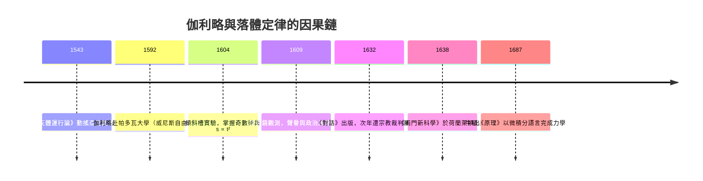

> 第一篇 · 第1章

# 第1.2節 1604 年：伽利略的自由落體實驗——用奇數比例定律描述落體距離與時間的平方關係

## 一、歷史背景：從比薩到帕多瓦的科學轉身

1604 年的伽利略（Galileo Galilei, 1564–1642）已年逾不惑，正處於人生的關鍵轉折。他早年因父親反對而放棄醫學，改習數學，在比薩大學擔任講座時因收入微薄、待遇受到歧視，於 1592 年轉往威尼斯共和國管轄的帕多瓦大學。這個選擇意義重大：威尼斯共和國是天主教歐洲最自由的學術環境之一，宗教裁判所的陰影在此淡薄，而威尼斯的造船廠（Arsenale）——當時歐洲最大的工業綜合體——為他提供了真實的力學問題：如何增大槓桿效率、如何量測船速、如何設計機械。

1604 年前後，伽利略還未成為「望遠鏡的伽利略」。但同年一顆超新星爆發（克卜勒新星），他當眾講授天文新知，聲望日隆；1609 年他將荷蘭人的「遠望鏡」改造成望遠鏡指向天空，1610 年出版《星際信使》，為他贏得佛羅倫斯的美第奇宮廷首席哲學家與數學家職位——這是典型的「贊助制度」科學：學者依附宮廷換取研究自由，但也要承擔政治風險。這條路最終把他帶向 1633 年的宗教裁判所審判與終身軟禁。

## 二、數學與物理原理：奇數律與 $s \propto t^2$

伽利略晚年在《兩門新科學》（1638）中完整鋪陳落體理論，但手稿顯示早在 1604 年他就已掌握核心。他面臨的難題是：自由落體太快，當時沒有精確計時器能直接量測。他的解法是「沖淡重力」——讓青銅球沿傾斜長槽滾下，並以水鐘（量筒秤重計時）量度時間。

他在推導中用了一個天才式的假設：速度與時間成正比（$v \propto t$，均勻加速）。接著運用「平均速度定理」：在時間 $t$ 內，一個以平均速度 $\frac{v}{2}$ 勻速前進的物體，與均勻加速的物體走過相同距離。由此：

$$s = \bar{v}\, t = \frac{1}{2} v t = \frac{1}{2}(at)t = \frac{1}{2}at^2$$

即距離與時間平方成正比：

$$s \propto t^2$$

但伽利略的表述方式極為獨特：他從連續時間出發，說明速度以正比於時間的方式增長，則在相繼的相等時間區間內走過的距離，恰成 $1:3:5:7:\cdots$ 的奇數比。因為第 $n$ 個區間內的距離增量為

$$\Delta s_n \propto (2n-1)$$

而累積起來正是平方數：

$$1,\quad 1+3=4,\quad 1+3+5=9,\quad 1+3+5+7=16,\ \cdots$$

| 時間區間 | 速度（末速比例） | 該區間距離（奇數律） | 累積距離（平方律） |
|:---:|:---:|:---:|:---:|
| 0 → 1 | 1 | 1 | $1 = 1^2$ |
| 1 → 2 | 2 | 3 | $4 = 2^2$ |
| 2 → 3 | 3 | 5 | $9 = 3^2$ |
| 3 → 4 | 4 | 7 | $16 = 4^2$ |

奇數律與平方律互為表裡：累積奇數得平方，恰如「逐時距離之和」構成 $s \propto t^2$。他更證明了斜面上的運動是自由落體的縮影，加速度比例於傾角的正弦，因此兩種實驗共享同一數學結構。

## 三、前因後果：經濟、制度、思想如何催生這場實驗

- **軍事與工程經濟**：威尼斯的造船、砲兵彈道問題（當時依經驗公式估算射程）讓「運動如何量化」成為有報酬的問題。伽利略在帕多瓦開設軍事工程課，向貴族子弟收費授課，計時與量測儀器是他的商品。
- **大學制度改革**：宗教改革之後，歐洲大學體系分化——天主教地區大學受耶穌會主導、教義保守；荷蘭與威尼斯等地的大學則相對開放。帕多瓦由威尼斯議會管理，教授不必宣誓特定的哲學正統，亞里斯多德主義雖是教科書，卻可用實驗對抗。
- **思想氣候**：15–16 世紀人文主義者重新校訂阿基米德與古希臘數學文本，哥白尼 1543 年《天體運行論》動搖了「天界不變」的世界觀。伽利略本人深受阿基米德影響，把「自然之書以數學語言寫成」奉為信條。
- **與教會的衝突**：望遠鏡發現（木星衛星、金星相位）支持日心說，與《聖經》字面詮釋衝突；1616 年與 1633 年兩次審判，使伽利略被定為「異端嫌疑」。諷刺的是，審判迫使他退隱，反而促成《兩門新科學》在荷蘭萊頓出版——荷蘭作為新教共和國，成了受壓迫知識的出版避風港。

這條因果鏈直通牛頓：伽利略確立了 $s \propto t^2$ 與慣性思想的雛形，等加速度即常數的「變化率」——這正是導數概念的原型；而由速度累積出距離，正是積分思想的物理原型。牛頓第二定律 $F=ma$ 把「加速度作為力學核心量」制度化，可以視為伽利略實驗的數學完成。微積分的兩個面向——變化率與累積——在伽利略的斜面槽上，已經攜手現身。

## 延伸思考

1. 伽利略的「奇數律」表述比直接寫 $s=\frac{1}{2}at^2$ 更接近幾何直覺。為什麼 17 世紀學者偏好用比例與幾何關係，而遲遲不肯使用代數函數？
2. 若伽利略待在天主教勢力強大的比薩而非帕多瓦，實驗方法的制度化會推遲多久？制度性自由對科學的邊際貢獻如何估量？
3. 沒有精確時鐘的時代，伽利略用「水鐘+斜面+脈搏」拼湊出時間量測。今日科學中還有哪些「以巧妙設計替代先進儀器」的例子？
