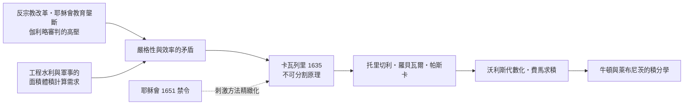

> 第一篇 · 第2章

# 第2.1節 1635 年：卡瓦列里（Bonaventura Cavalieri）的「不可分割原理」（Indivisibles）

## 一、歷史背景：耶穌會體制外的幾何革命者

17 世紀 30 年代的義大利，處於反宗教改革的高壓氛圍之中。伽利略 1633 年受審的陰影籠罩半島，耶穌會大學牢牢掌控天主教地區的高等教育，亞里斯多德主義是官方哲學，任何觸及「無窮」「連續」本質的議論都可能被視為教義威脅。正是在這樣的環境裡，米蘭人卡瓦列里（Bonaventura Cavalieri, 1598–1647）以耶穌會平民修士（jesuate，非耶穌會，屬另一修會）的身分，在博洛尼亞大學謀得數學教授之職，並於 1635 年出版《用連續不可分割新法幾何學》（Geometria indivisibilibus continuorum nova quadam ratione promota），把一種危險而強大的方法帶入公眾視野。

卡瓦列里早年入修道院，卻痴迷幾何，與伽利略保持長期通信。伽利略稱讚他是「自阿基米德以來幾何學的新曙光」，同時也因自己正受審判而無法公開支持這種「不嚴格」的方法。這對師友的處境，象徵了那個時代方法論的分裂：伽利略被迫轉入地下式的隱喻寫作，卡瓦列里則以「我們只是求面積，不談無窮的形上學」的防禦姿態，為新方法爭取合法性。書名刻意標榜「新法」，並附上致讀者的辯護——他深知這本書會引來耶穌會幾何學家（如古爾丁）的猛烈批評：你的「不可分割」是什麼寬度的線？無窮多條線怎麼能疊出面積？——卡瓦列里的回應是：這只是比較面積的實用工具，如同比較兩堆書的高度只需比書的堆疊，不必追究每本書的厚度。

## 二、數學原理：把面積看成線的總和

**卡瓦列里原理**（中國古籍稱「祖暅原理」，劉徽與祖沖之父子在 5 世紀已有同樣思想）表述為：

> 若兩平面圖形夾在兩條平行線之間，且任一平行於兩線的直線所截兩圖形的弦長相等，則兩圖形面積相等。

類似地，等高的兩立體若被任一水平面截得的截面積相等，則體積相等：

$$A_1(y) = A_2(y)\ \forall y \quad\Longrightarrow\quad V_1 = V_2$$

用現代語言，這就是「若 $\int A_1 = \int A_2$ 的被積函數逐點相等，則積分相等」——它是積分比較定理的幾何前身。

更激進的是卡瓦列里計算面積的方法：把圖形視為無窮多條「不可分割」的平行線段之和。若一條動線段 $EF$ 的長度隨位置 $x$ 按規律變化，則圖形面積就是所有這些線段的總和。他由此得到拋物線面積公式：

$$\int_0^1 x^2\, dx = \frac{1}{3}$$

以及著名的「平方和」結果——前 $n$ 個自然數的平方和與 $n^3$ 之比趨於 $\frac{1}{3}$：

$$\lim_{n\to\infty}\frac{1^2+2^2+\cdots+n^2}{n^3} = \frac{1}{3}$$

由此可推出高階曲線 $y=x^m$ 下的面積 $\dfrac{1}{m+1}$。後來他與托里切利（Torricelli）進一步處理三次方冪；托里切利 1643 年更算出無窮長號角（Gabriel's Horn）體積有限而表面積無窮的悖論，震動了整個學界。卡瓦列里還求出：把一個立體繞軸旋轉，用不可分割法可得類似古爾丁定理（Pappus–Guldin）的結果。這些都是標準積分運算的曙光。

## 三、前因後果：為何偏偏是 1635 年的義大利？

- **反宗教改革的教育體制**：耶穌會學校以歐幾里得與亞里斯多德為綱，數學被壓縮為「嚴格演繹」。卡瓦列里在體制內謀職，就必須以體制的語言寫作——這解釋了《幾何學》為何附帶冗長的證明與辯護，「不可分割」只是包在嚴格外殼裡的計算引擎。
- **伽利略學派的地下網絡**：伽利略的學生（維維安尼、托里切利）組成了私人通信圈，繞過大學與教會，讓不可分割法持續傳播。學術出版與審查制度之間的博弈，塑造了方法論的表達形式。
- **商業城市的實務需求**：博洛尼亞、佛羅倫斯、米蘭的工程、水利、軍事建築（如排水渠與要塞計算）需要快速估算體積與面積，窮竭法那種「一題一證」的方式太慢，通用演算法成為剛需。
- **與古爾丁的論戰**：瑞士耶穌會士古爾丁以「不嚴格」痛斥不可分割法。這場論戰看似阻礙傳播，實則迫使卡瓦列里與追隨者把方法修得更精確、更接近現代積分的表述——批評者意外成為方法精緻化的推手。

不可分割法經托里切利、羅貝瓦爾（Roberval）、帕斯卡、費馬傳入法國，再由沃利斯在英國代數化，最終成為牛頓與萊布尼茨的積分學的直接前身。萊布尼茨明言他的思想淵源可上溯至卡瓦列里；牛頓求面積的語言雖更嚴格，精神上仍是「無窮多無窮小部分之和」。耶穌會官方在 1651 年下令禁止在學校教授不可分割法，然而禁令無法阻止一個已成剛需的演算法——微積分的第一縷曙光，正是從審查制度的縫隙中漏出來的。

## 延伸思考

1. 卡瓦列里說「不必追究每本書的厚度」——一個明顯邏輯有漏洞的方法，為何能在五十年間產出大量正確結果？「可證偽的正確性」在科學中扮演什麼角色？
2. 祖沖之父子的祖暅原理早於卡瓦列里一千一百年，兩者卻在不同的制度土壤中開出不同的花。方法相同而命運迥異，制度的角色何在？
3. 耶穌會的禁令未能阻止不可分割法傳播。思想審查對科學的實際效果，是延遲、轉向，還是反而加速？
