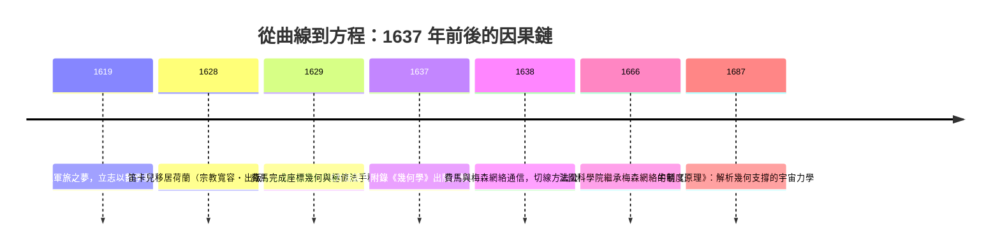

> 第一篇 · 第2章

# 第2.2節 1637 年：笛卡兒與費馬的解析幾何與極值尋找法——將曲線代數化的開端

## 一、歷史背景：士兵、律師與同一個革命

1637 年是數學史上的奇蹟之年。兩位素未謀面、彼此幾乎不了解的法國人，各自獨立地完成了同一場革命：把曲線變成方程，把幾何變成代數。

一位是勒內·笛卡兒（René Descartes, 1596–1650）。他出身都蘭的法官家庭，就讀耶穌會的拉弗萊什學院，接受過當時歐洲最完善的邏輯與經院哲學訓練，卻對書本知識深感懷疑。1618 年起他投筆從戎，在荷蘭、德意志的軍旅中漫遊——傳說 1619 年 11 月 10 日夜，他在多瑙河畔的暖房中連做三個夢，醒來立志以數學方法重建一切知識。1628 年他永久移居荷蘭聯省共和國：那裡沒有宗教裁判所，有萊頓大學與烏特勒支的自由學風、繁榮的出版業（阿姆斯特丹的 Elzevir 曷社），以及一個能容納「隱居思想家」的市民社會。1637 年，他匿名附錄於哲學巨著《方法論》之後的《幾何學》（La Géométrie），就是解析幾何的誕生證書。

另一位是皮埃爾·德·費馬（Pierre de Fermat, 1601–1665），圖盧茲的律師與地方議會參事。他的職業與數學毫不相干——審理案件、調解糾紛——卻讓他有穩定收入與大量閒暇。他從未出版專著，只透過書信與巴黎的梅森（Marin Mersenne）神父交流。梅森的修道院客廳是當時歐洲的「科學交換所」：學者寄信給梅森，他再抄送給笛卡兒、羅貝瓦爾等人。這張以一位修士為樞紐的信件網絡，是期刊問世前的學術基礎設施。費馬約在 1629 年完成的《平面與立體軌跡引論》中，已寫出完整的座標幾何，卻遲至 1679 年才刊行——所以 1637 年的桂冠屬於率先出版的笛卡兒。

## 二、數學原理：方程即曲線，導數的胚胎

**解析幾何**的核心洞見是：在平面上取一條參考直線，令動點到該線的距離為 $y$、沿線的投影距離為 $x$，則幾何條件可化為 $x, y$ 的方程；反之，方程的解集就是曲線。例如半徑為 $a$ 的圓變成

$$x^2 + y^2 = a^2$$

二次方程 $y^2 = ax$ 對應拋物線。笛卡兒更提出「曲線的分類」：以方程次數分類曲線（一次、二次、……），取代古希臘用「構造工具」分類的舊法——這是從幾何直覺到代數運算的典範轉移。

**費馬的極值法**則直指微積分的核心。設 $f(x)$ 在某點取極值，費馬的辦法是：令自變量增加一個小量 $E$，寫出 $f(x+E)$ 與 $f(x)$，令兩者相等（極值處增量不引起變化），除以 $E$，再令 $E=0$。以拋物線 $f(x)=x^2$ 為例：

$$\frac{(x+E)^2 - x^2}{E} = 2x + E = 0 \quad\Rightarrow\quad x = 0$$

這正是今天的 $f'(x)=0$。費馬用此法求出函數極值、曲線切線，甚至求出拋物線 $y=x^2$ 下的面積（透過級數 $\sum i^2$）。笛卡兒的切線法（「圓法」）則較繁瑣，但在收到費馬方法的樣本後，他不得不承認其優越。此外，費馬還給出透過比例關係求 $\int x^m dx = \frac{x^{m+1}}{m+1}$ 的初步形式，以及著名的「費馬小定理」與「費馬大定理」的筆記——數論與分析學在他身上分頭生長。

## 三、前因後果：思想、制度與網絡如何驅動這場代數化

- **笛卡兒的理性主義哲學**：《方法論》的核心是「普遍懷疑」與「以明晰明晰的觀念重建知識」。對笛卡兒而言，《幾何學》是方法論的示範品：複雜的幾何直覺應被還原為機械式的符號運算。這種「機械論世界觀」——宇宙是按數學規律運轉的機器——正是牛頓力學的哲學溫床。
- **荷蘭的出版自由與大學**：笛卡兒的書能在荷蘭刊行，在法國則可能被查禁；他與烏特勒支、萊頓學者的論戰，也藉助荷蘭的學術期刊與信件網絡傳播。宗教寬容成了知識生產的比較優勢。
- **費馬的律師職業與數論信件網絡**：地方司法職位的世襲與穩定（他在圖盧茲議會的位子近乎終身制）提供了「業餘科學」的物質基礎；梅森網絡則把孤獨的法官變成歐洲數學共同體的節點。他與帕斯卡的賭博通信（1654）催生機率論，與英國數學家（沃利斯等）的數論挑戰信件，建立了「以難題比賽促進研究」的文化。
- **巴黎的梅森學院與皇家科學院前身**：1666 年法國科學院成立，直接繼承梅森網絡的人脈；而費馬的極值法經由牛頓閱讀沃利斯的轉述而傳入英國。

解析幾何是微積分不可或缺的舞台：沒有「曲線即函數、函數即方程」的觀念，就無從談論「對函數求導」「對函數積分」。笛卡兒與費馬把曲線交給代數之後，牛頓與萊布尼茨才能把「切線的斜率」與「面積的累積」寫成普遍符號法則。費馬的 $E$-法幾乎就是導數定義；笛卡兒的座標就是函數圖像的骨骼。1687 年《原理》雖以幾何語言寫成，內裡卻處處是解析幾何的座標思考。可以說：1637 年把曲線代數化，1687 年才有可能把宇宙代數化。

## 延伸思考

1. 笛卡兒以出版優先享有命名權，費馬以書信慢工孕育更完整的導數思想。「先發表」與「做完整」之間的科學競賽規則，是如何在 17 世紀形成的？
2. 笛卡兒認為「方程次數」是曲線的本質分類，這是真洞見還是代數沙文主義？今日的函數論視角會如何修正它？
3. 梅森網絡是人工的中介者（broker）。今日的科學還需要「梅森」嗎，還是網路已使中介者多餘？
