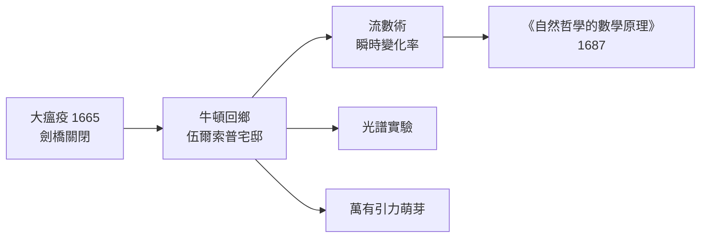

> 第二篇 · 第3章

# 第3.1節 1665 年：牛頓在瘟疫宅邸（伍爾索普，annus mirabilis）中的「流數術」（Fluxions）發明與瞬時變化率概念

## 一、大瘟疫關閉了劍橋，卻打開了宇宙

1665 年夏天，倫敦大瘟疫（Great Plague）蔓延至劍橋，三一學院被迫關閉。二十三歲的牛頓（Isaac Newton, 1642–1727）返回故鄉林肯郡的伍爾索普莊園。這段被史家稱為 **annus mirabilis**（奇蹟之年，實為 1665–1666 兩年）的時間，牛頓在孤獨中完成了三件大事：發明微積分（他稱為「流數術」）、分解白光以研究光學、並醞釀萬有引力的思想。

這件事的社會結構值得深思：**大學是特權知識共同體**，其關閉反而把一名未滿秩的青年學者拋回鄉村，使他能不受經院課程表束縛地自由思考。瘟疫是災難，卻意外成了思想自由的催化劑。

## 二、流數術：把「運動」寫進數學

牛頓的核心洞見是：**數量不是靜態的，而是隨時間「流動」的**。他把變化的量稱為 fluent（流量），把其生成速率稱為 fluxion（流數），記作 $\dot{x}$——即現代的 $\frac{dx}{dt}$。

例如，若 $x = t^2$，則流數為

$$\dot{x} = 2t\,\dot{t}_0$$

牛頓先用「無窮小時間增量 $o$」計算：$x$ 增至 $x + \dot{x}\,o$，代入 $x=t^2$ 得

$$(t+o)^2 - t^2 = 2to + o^2$$

除以 $o$ 得 $2t + o$，再令 $o$ 消失（「把它們拋棄」），得 $\dot{x}=2t$。這正是瞬時變化率的概念：**不是平均速度，而是某瞬間的速度**。這一步哲學上極其大膽——亞里斯多德以來，「瞬時」被視為不可定義；牛頓讓「此刻的變化率」成為可計算的對象。

他也得到了反問題：若已知變化率如何求原量。這就是今日的微積分基本定理：

$$\int_a^b f'(t)\,dt = f(b)-f(a)$$

微分與積分原是兩個問題（切線 vs. 面積），牛頓首次系統地指出它們**互為逆運算**，從而把兩千年來分散的技巧（阿基米德的窮竭法、費馬的極值法、巴羅的老師傳承）鎔鑄成一部通用演算法。

## 三、前因後果

- **經濟與制度**：瘟疫迫使劍橋停課，但牛頓仍有學院獎學金支撐，無需謀生——說明微積分的誕生部分依賴「有閒」的學術津貼制度。
- **思想**：伽利略已證明落體 $s \propto t^2$，笛卡兒給出解析幾何，巴羅（牛頓的老師）已接近面積—切線關係。牛頓是站在巨人的肩上，但他把巨人們的腳手架合成了一座塔。
- **文化**：牛頓性格孤僻、多疑，長年不發表。流數術遲至 1693 年才在信中透露、1711 年才正式出版——這個「藏起來的發明」日後直接引爆了與萊布尼茨的優先權之爭。

## 四、小結

1665 年的牛頓證明了一件深刻的事：**宇宙的語言是變化的語言**。一旦「瞬時變化率」可以計算，行星、砲彈、鐘擺就都成了同一套方程的解。

## 延伸思考

1. 若沒有大瘟疫，劍橋課程表下的牛頓還會發明流數術嗎？制度性中斷對創新是阻礙還是機遇？
2. 牛頓「令 $o$ 消失」在邏輯上並不嚴格（先除以 $o$ 又說 $o=0$），貝克萊主教後來譏之為「消失量的幽靈」——實用計算與邏輯嚴格性的張力該如何調和？
3. 為什麼牛頓選擇把發明保密二十年？學術優先權制度（誰先公開誰得榮耀）對科學傳播是激勵還是扭曲？
