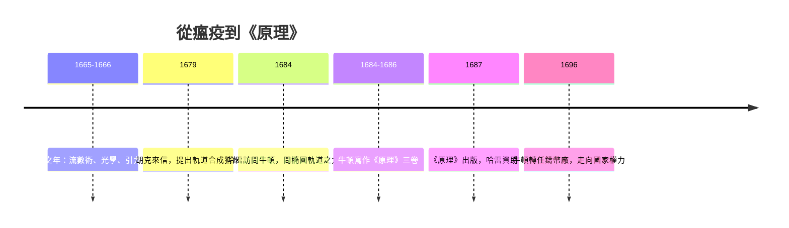

> 第二篇 · 第3章

# 第3.2節 1687 年：劃時代巨著《自然哲學的數學原理》（Principia）發表——三大運動定律的誕生

## 一、一本改變世界的書

1687 年 7 月 5 日，牛頓的《自然哲學的數學原理》（*Philosophiæ Naturalis Principia Mathematica*）問世。它不是一本數學教科書，而是一次對宇宙的總清算：天上（行星、彗星、月球）與地上（潮汐、砲彈、落體）的運動，被統攝在同一套公理—定理—推論的幾何證明體系之下。書中用拉丁文寫成，全書以歐幾里得式的命題結構鋪陳，讀者被要求「用幾何讀宇宙」。

## 二、三大運動定律

《原理》第一卷開篇即立公理，這就是著名的牛頓三大運動定律：

| 定律 | 內容 | 數學形式 | 意義 |
|---|---|---|---|
| 第一定律（慣性） | 物體不受力時保持靜止或等速直線運動 | $\sum \vec{F}=0 \Rightarrow \vec{v}=\text{常數}$ | 打破亞里斯多德「力維持運動」的千年誤解 |
| 第二定律 | 動量變化率正比於作用力 | $\sum \vec{F}=\dfrac{d\vec{p}}{dt}=m\vec{a}$ | 把「力」定義為質量乘以加速度，力學的引擎 |
| 第三定律 | 作用力與反作用力大小相等、方向相反 | $\vec{F}_{AB}=-\vec{F}_{BA}$ | 保證動量守恆，使天體間相互作用可解 |

第二定律正是微積分登場之處：加速度是速度的變化率，速度是位置的變化率，

$$\vec{a}=\frac{d\vec{v}}{dt}=\frac{d^2\vec{r}}{dt^2}$$

於是力學問題化為**微分方程**：給定初始位置與速度，未來的一切運動都由方程決定。這是「決定論宇宙觀」的數學根源。

## 三、公理體系與國家權力

《原理》能誕生，背後有一整套前因後果：

- **制度**：皇家學會提供了通信網絡、同行與出版管道；哈雷不僅說服牛頓寫書，還自費支付印刷費（學會財政當時已被《魚類志》拖垮）。
- **經濟**：十七世紀後期的英國是航海與殖民帝國，精確的月亮位置與經度測定是商業命脈——天體力學有直接的國家利益。
- **政治**：牛頓 1696 年出任鑄幣廠監督、後任廠長，主持大鑄幣重鑄、打擊偽幣（甚至把偽幣犯送上絞架）。他晚年成為議員與皇家學會會長——數學理性與國家權力在他身上合流，顯示「自然哲學家」已是英國統治階層的一員。
- **思想**：《原理》書名刻意呼應笛卡兒的《哲學原理》，但牛頓以「實證的數學結構」取代笛卡兒的「渦旋假說」——「我不杜撰假說」成為新科學的宣言。

## 四、小結

《原理》三大定律把「力」從神秘原因變成可計算的量，把宇宙變成一台可預測的鐘錶。此後兩百年，物理學的任務被定義為：列出微分方程，然後解出它。

## 延伸思考

1. 第二定律 $\sum \vec{F}=m\vec{a}$ 中「質量」與「重量」的分離，為何是概念上的革命？
2. 決定論宇宙觀（拉普拉斯妖）由《原理》開啟，它對自由意志與宗教觀念造成什麼長期衝擊？
3. 牛頓以幾何證明而不用流數術表述《原理》，是為嚴謹、為可讀，還是為迴避批評？
