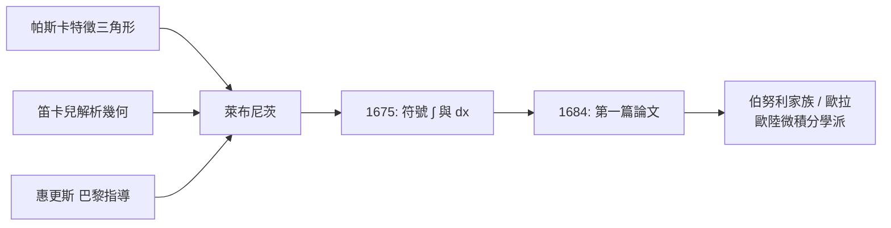

> 第二篇 · 第4章

# 第4.1節 1674–1676 年：萊布尼茨獨立發明微分與積分，並創造出優美的 $\int$ 與 $dx$ 符號（萊布尼茨轉換、微積分基本定理的積分-微分互逆觀點、巴黎與惠更斯的相遇）

## 一、外交官走進巴黎的數學沙龍

1672 年，二十六歲的萊布尼茨（Gottfried Wilhelm Leibniz, 1646–1716）以美因茨選帝侯外交使節身分來到巴黎，任務是遊說路易十四把注意力轉向埃及（而非日耳曼）。外交任務失敗了，但萊布尼茨遇見了荷蘭大師惠更斯（Christiaan Huygens）——當時歐洲最偉大的數學物理學家，也是法國科學院的核心人物。惠更斯出題考他（求級數 $\sum \frac{1}{n(n+1)}$ 之和），萊布尼茨的解答令其驚豔，遂收他為入門弟子。巴黎四年（1672–1676），在惠更斯、笛沙格遺產與帕斯卡著作的滋養下，萊布尼茨獨立於牛頓，發明了自己的微積分。

## 二、特徵三角形與「轉換定理」

萊布尼茨的起點是帕斯卡的「特徵三角形」：在曲線下的小段中，以 $dx$、$dy$ 與切線段構成無窮小直角三角形。他看出：**切線問題（微分）與求積問題（積分）是同一枚硬幣的兩面**。他的「轉換定理」（transmutation theorem）把曲線下的面積問題轉換為切線的縱標問題，進而得到積分與微分互逆：

$$\frac{d}{dx}\int_a^x f(t)\,dt = f(x), \qquad \int_a^b f'(t)\,dt = f(b)-f(a)$$

這正是**微積分基本定理**的萊布尼茨形式。與牛頓以「時間—流動」為基底不同，萊布尼茨的視角是**幾何與形式操作**：把曲線視為無窮多邊形，把和 $\int$（拉丁文 summa 的長 s）與差 $d$ 視為一對互逆算子：

$$\int d\big(f(x)\big) = f(x), \qquad d\left(\int f(x)\,dx\right) = f(x)\,dx$$

## 三、符號的發明：能操作的記號

1675 年 10 月底，萊布尼茨在手稿中首次寫下 $\int$ 與 $dx$。他的天才在於：記號不是縮寫，而是**「特徵算術」——讓符號本身攜帶演算法**。他陸續建立一整套可機械操作的規則，例如乘積法則：

$$d(uv) = u\,dv + v\,du$$

商法則 $d\left(\frac{u}{v}\right)=\frac{v\,du-u\,dv}{v^2}$、冪法則 $d(x^n)=nx^{n-1}\,dx$ 等。任何人只要照規則操作，就能算出導數——微積分第一次變成**可傳授、可驗證、可公開的演算法**，不依賴大師的個人洞見。1682 年他與門克創辦《教師學報》（*Acta Eruditorum*），為日後發表建立了舞台。

## 四、前因後果：宮廷、外交與德意志的處境

- **政治**：三十年戰爭後德意志分裂為數百邦國，萊布尼茨終身服務於漢諾威宮廷（先後任圖書館長、宮廷顧問、史官，被令撰寫韋爾夫家族史）。他是歐洲最後一位「通才」：法典、二進位、中文、《易經》、礦山抽水機，無所不包——微積分只是他「普遍文字」（characteristica universalis）夢想的一環。
- **制度與經濟**：與英國靠皇家學會集中資源不同，德意志無統一學術中心，萊布尼茨必須以書信網絡維繫學術生活；他促成柏林科學院（1700 年成立）並任首任院長，正是對這種分散局面的制度回應。
- **宗教與文化**：身為新教徒的他卻長期穿梭於天主教宮廷（巴黎、羅馬、維也納），推動教會重新合一——這種跨越新教/天主教世界的能力，使他的學術網絡比牛頓更「歐陸」，也埋下了日後英歐兩大陣營對峙的伏線。

## 五、小結

萊布尼茨的微積分是**符號的勝利**：$\int$ 與 $dx$ 把無窮小變成可寫、可算、可教的對象。今日全世界的微積分課本用的是萊布尼茨的記號——歷史已投了票。

## 延伸思考

1. 為何萊布尼茨記號（$\frac{dy}{dx}$、$\int f\,dx$）最終戰勝牛頓記號？「記號的設計品質」對科學發展的影響有多大？
2. 萊布尼茨的「普遍文字」夢想與今日程式語言、符號計算機（Mathematica、SymPy）有何血緣關係？
3. 外交官身分讓萊布尼茨擁有跨國網絡卻缺乏穩定大學職位——學術生產需要怎樣的制度土壤？
