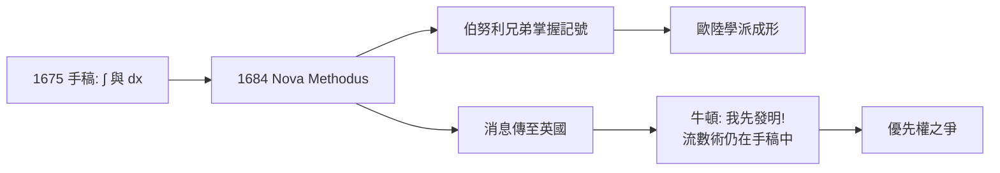

> 第二篇 · 第4章

# 第4.2節 1684 年：萊布尼茨發表第一篇微積分公開論文《Nova Methodus pro Maximis et Minimis》（新方法求極大與極小）——符號化、可公開傳播的演算法

## 一、六頁紙掀起一場革命

1684 年 10 月，萊布尼茨在萊比錫的《教師學報》（*Acta Eruditorum*）上發表了題為《Nova Methodus pro Maximis et Minimis, itemque Tangentibus, quae nec fractas nec irrationales quantitates moratur, et singulare pro illis calculi genus》的論文——「求極大與極小以及切線的新方法，此法不受分式與無理量的困擾，並有一種特殊的演算法」。全文僅六頁，卻是人類歷史上第一篇公開發表的微積分論文。此時距牛頓在伍爾索普發明流數術已近二十年——但牛頓尚未公開。

## 二、論文內容：一套演算法的誕生

論文開宗明義定義了微分：若 $x$ 取增量 $dx$，則 $y$ 的對應增量為 $dy$。接著給出一整套**運算規則**，其中最重要的即是乘積法則與商法則：

$$d(uv) = u\,dv + v\,du \qquad\qquad d\left(\frac{u}{v}\right)=\frac{v\,du-u\,dv}{v^2}$$

以及冪法則 $d(x^n)=n x^{n-1} dx$（對任意有理數 $n$ 皆成立——這正是「不受分式與無理量困擾」之處）。演算法的威力立即展現：

1. **極值問題**：令 $dy=0$ 即得極大極小的條件；
2. **切線問題**：切線斜率即 $\frac{dy}{dx}$；
3. **反問題**：以 $\int$ 符號表示由切線回復曲線的「求和」運算。

文末萊布尼茨以一道挑戰題收尾：求 $n$ 次方根表達式的極值——用他的演算法幾行即解。這是**以演算法示人**的公開邀請：讀者不需要天賦，只需照規則操作。

## 三、可公開傳播的科學

《Nova Methodus》的革命性不在數學深度（其無窮小邏輯其實比牛頓的流數更不嚴謹），而在**傳播形式**：

- **符號公開、規則明確**：$\frac{dy}{dx}$、$dy=0$、$\int$ 都是印在紙上就能學的記號，不依賴通信密碼或私人手稿；
- **期刊制度**：《教師學報》是當時德語區最主要的學術評論期刊，讀者遍及歐陸——數學第一次以「期刊論文＋演算法」的模式傳播，這正是今日學術出版的原型；
- **培養門徒**：伯努利兄弟（雅各布與約翰）迅速掌握記號並開始通信請教，萊布尼茨慷慨回信授課——一個以萊布尼茨為中心的歐陸學派就此成形，最終經約翰的學生歐拉推向全盛。

對照牛頓：流數術長期以密碼式字謎（anagram）形式隱藏優先權（1676 年致萊布尼茨的二進位信件即附有字謎），等於「登記專利而不公開說明書」。**公開演算法打敗了隱藏的天才。**

## 四、前因後果

- **政治與宗教**：論文發表於法國威脅下的德意志；《教師學報》創刊於新教萊比錫，卻流通於整個拉丁學術世界——拉丁文使新教與天主教學者共用一個知識市場。
- **經濟**：期刊出版靠訂閱與書商網絡，學術榮譽開始與「優先發表」掛鉤，這套激勵制度延續至今。
- **思想**：萊布尼茨把數學方法論推廣為「組合術」——好的記號本身就是發明的引擎。

## 五、小結

1684 年的六頁論文證明：**科學革命不只需要發明，還需要可複製的發明之發明**。萊布尼茨交出的不是一組答案，而是一台人人可用的計算機器。

## 延伸思考

1. 為什麼「嚴謹性較弱但符號較優」的版本反而傳播更快？科學傳播中，可用性與嚴格性如何取捨？
2. 牛頓的字謎（anagram）與今日的「預印本／專利／開源」各是什麼樣的優先權策略？哪一種最利於科學？
3. 若牛頓 1670 年代即發表流數術，微積分史與英歐科學格局會如何改寫？
