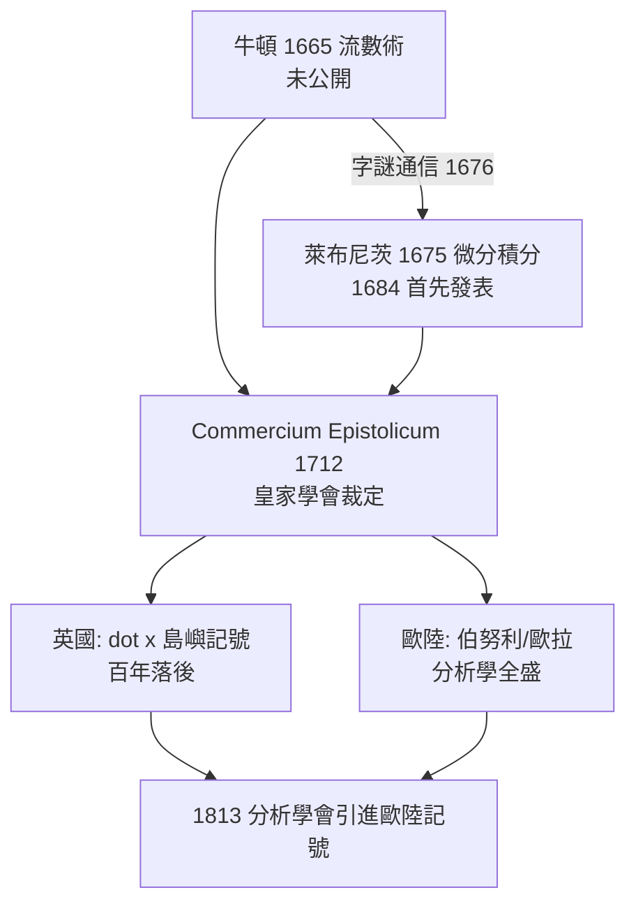

> 第二篇 · 第4章

# 第4.3節 世紀之爭：牛頓與萊布尼茨關於微積分發明權的殘酷優先權之爭（皇家學會 Commercium Epistolicum 1712 委員會、英國島嶼式記號 vs 歐陸萊布尼茨記號、英國數學因此落後百年、伯努利家族的站邊）

## 一、從通信到反目

1676 年，萊布尼茨兩度經倫敦皇家學會秘書奧爾登堡轉信給牛頓，牛頓以字謎（anagram）暗示流數術：「6a cc d æ 13e ff 7i 3l 9n 4o 4q rr 4s 9t 12vx」——把真正的發明鎖進密碼。1684 年萊布尼茨發表《Nova Methodus》，牛頓起初還在《原理》第一版中以善意口吻提及萊布尼茨的書信。但 1690 年代起風雲變色：法奇歐·德·杜利爾（Fatio de Duillier，牛頓的親密門徒）1699 年率先暗示萊布尼茨「從牛頓那裡偷了第二版的發明」；萊布尼茨 1704 年匿名書評反擊，質疑牛頓的流數不過是把他的微分換了記號。1705 年牛頓繼任皇家學會會長，戰爭全面爆發。

## 二、Commercium Epistolicum：既當球員又當裁判

1712 年，皇家學會成立「公正委員會」審查優先權，牛頓親自撰寫委員會報告《Commercium Epistolicum》（書信交流錄）。報告結論毫無懸念：牛頓先發明，萊布尼茨涉嫌抄襲。問題是——**牛頓是學會會長，報告由他主筆，委員名單也經他手**；甚至連「匿名」評論都出自牛頓筆下。1716 年萊布尼茨去世後，牛頓仍對友人說，他對「傷透了萊布尼茨的心」感到「滿足」。這場爭執的真相，今日史家已有共識：**兩人獨立發明**，牛頓早二十年（1665 vs 1675），萊布尼茨早發表（1684 vs 牛頓的正式出版遲至 1693 年通信、1704 年《光學》附錄、1736 年流數術專書）。

## 三、兩個記號，兩個世界

| 項目 | 牛頓（英國） | 萊布尼茨（歐陸） |
|---|---|---|
| 導數記號 | $\dot{x}$（流數） | $\dfrac{dx}{dt}$ |
| 積分記號 | 無固定符號（曲線求積術） | $\displaystyle\int f(x)\,dx$ |
| 二階導數 | $\ddot{x}$ | $\dfrac{d^2x}{dt^2}$ |
| 概念核心 | 時間—流動、運動學 | 無窮小差、形式演算法 |
| 傳播方式 | 少量弟子（如科茨、泰勒） | 期刊＋書信網＋學派 |
| 後世影響 | 英國百年停滯 | 高斯、歐拉、拉格朗日一脈相承 |

萊布尼茨記號的優勢在高階運算中一覽無遺：鏈鎖法則寫成 $\dfrac{dz}{dx}=\dfrac{dz}{dy}\cdot\dfrac{dy}{dx}$，如同分數相消；牛頓的 $\ddot{y}$ 則無此可操作性。

## 四、站邊與斷裂：伯努利家族與英歐分途

瑞士的伯努利家族是風向球。約翰·伯努利（Johann Bernoulli）是萊布尼茨最強的盟友與弟子，公開抨擊牛頓力學（如「最速降線問題」之挑戰，實質是對牛頓的數學叫陣；牛頓匿名一夜解出，約翰一眼認出：「從爪認出獅子」）。哥哥雅各布則留下「伯努利雙紐線」與變分法先聲。整個歐陸——萊布尼茨、伯努利家族、洛必達、後繼的歐拉——站成「萊布尼茨陣營」；英國則以忠誠為榮，**拒用 $\frac{dx}{dt}$ 與 $\int$**，困守 $\dot{x}$ 記號與幾何式《原理》傳統。

後果是殘酷的：整個十八世紀，分析力學、偏微分方程、變分法的中心都在巴黎、巴塞爾、柏林、聖彼得堡；英國數學相對沉寂，直到 1810 年代劍橋的「分析學會」（巴貝奇、皮科克、赫歇爾）以「萊布尼茨原則」反抗 $\dot{x}$ 崇拜、引進歐陸記號，才結束這場百年自我孤立。

## 五、前因後果：國家、宗教與學術共同體的破裂

- **政治**：1704 年英西繼承戰爭局勢下，英法、英歐關係緊張；學術之爭與民族榮譽完全綁架。
- **宗教**：英國國教 vs 天主教/路德宗歐陸，萊布尼茨任漢諾威史官時，英國甚至拒絕承認漢諾威選帝侯的英王繼承權宣傳工作（萊布尼茨正是為此撰史）——1714 年喬治一世即位時，萊布尼茨被留在漢諾威，客死異鄉，葬禮冷清。
- **制度**：此爭凸顯「學術優先權制度」的陰暗面——榮譽經濟學催生了發明，也催生了民族主義科學。皇家學會從國際學術共同體退化為國家榮譽機構，是十八世紀科學史最大的損失之一。

## 六、小結

微積分的世紀之爭留下雙重遺產：數學上，人類得到了一套引擎（兩套記號殊途同歸）；歷史上，它警示我們——**當科學被民族榮譽綁架，最大的輸家是科學本身**。

## 延伸思考

1. 「既當球員又當裁判」的皇家學會審查，說明同行評議制度需要什麼樣的權力制衡？今日的期刊制度防住了這個問題嗎？
2. 若萊布尼茨早死或牛頓早發表，英國數學會不同嗎？記號選擇真的是「偶然」嗎？
3. 優先權之爭刺激了發明也造成了斷裂——現代科學的「論文競賽」（如基因定序、AI 模型發布）是否正在重演同一齣劇？
