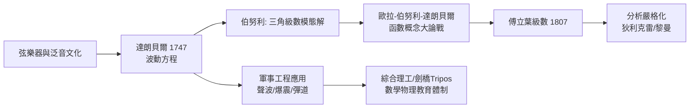

> 第三篇 · 第5章

# 第5.2節 1740–1760 年代：弦振動方程與波動力學的微積分建立

## 一、音樂家的疑問，數學家的方程

18 世紀上半葉，弦樂器主宰了歐洲的沙龍與教堂：小提琴在科雷利與韋瓦第手中臻於成熟，巴赫的弦樂作品席捲德語世界。為何一根撥動的弦發出的是**固定音高**而非噪音？泛音（倍頻音）為何恰好是基音的整數倍？這既是聲學問題，也是樂器製造業（克里蒙納製琴師傅、管風琴工匠）的商業問題。音樂文化，意外地成了偏微分方程的搖籃。

1747 年，讓·勒朗·達朗貝爾（Jean le Rond d'Alembert, 1717–1783）在巴黎科學院發表論文，首次寫下**波動方程**。對於長度為 $L$、兩端固定的弦，其橫向位移 $u(x,t)$ 滿足：

$$\frac{\partial^2 u}{\partial t^2} = c^2 \frac{\partial^2 u}{\partial x^2}, \qquad c = \sqrt{\frac{T}{\mu}}$$

其中 $T$ 為弦的張力，$\mu$ 為線密度。達朗貝爾更給出通解 $u(x,t) = \dfrac{1}{2}\left[\phi(x+ct) + \phi(x-ct)\right]$——波以速度 $c$ 向兩端傳播。這是**史上第一個偏微分方程**的求解，數學從此進入「場」的時代：物理量不再是單點的力，而是佈滿空間與時間的函數。

## 二、三角級數大論戰：一場關於「什麼是函數」的戰爭

解決方案剛一出爐，激烈爭論隨之而來，主角是歐拉與丹尼爾·伯努利（Daniel Bernoulli, 1700–1782）：

| 人物 | 立場 | 函數觀 |
|---|---|---|
| 丹尼爾·伯努利 | 弦的運動是無窮多個**駐波模態**的疊加：$u = \sum_n a_n \sin\frac{n\pi x}{L}\cos\frac{n\pi c t}{L}$ | 任何解都能用三角級數表示 |
| 歐拉 | 三角級數只能表示「足夠光滑」的解析式，無法表示任意初始形狀（如撥弦的三角形） | 函數必須是解析式 |
| 達朗貝爾 | 連續性條件要求更嚴格，反對過度推廣 | 幾何—力學直覺派 |
| 拉格朗日 | 早年試圖以離散質點鏈逼近弦 | 調和派但存疑 |

這場爭論的深層問題是：**什麼才算一個「函數」？**撥弦的初始形狀是一個有折角的圖形，在歐拉的解析式定義下根本「不是函數」。爭論持續了半個多世紀，直到傅立葉 1807 年研究熱傳導時大膽斷言「任意函數皆可展為三角級數」，再到 19 世紀狄利克雷、黎曼重構積分與函數定義，才塵埃落定——並順手催生了現代分析的嚴格化。可以說，**音樂爭出了現代分析學**。

## 三、前因後果

- **文化**：歌劇院與宮廷音樂會是當時重要的都市經濟，音準與泛音理論直接關係樂器製造與調音產業。歐拉本人著有《論音樂的新理論嘗試》，試圖以數學重構音階。
- **制度**：爭論的舞台是巴黎、柏林、聖彼得堡三大科學院的院刊；科學院以懸賞題持續加溫論戰。凱瑟琳大帝治下的聖彼得堡與腓特烈大帝治下的柏林，各自庇護爭論的一方。
- **軍事與工程**：波動理論很快被推廣到聲波、水波、砲口爆震波。各國**軍事工程學院**（如法國梅濟耶爾工程學院）將其納入課程——蒙日、卡諾等革命一代的工程師數學家正出自此類學校。
- **思想**：疊加原理——「複雜運動 = 簡單模態之和」——成為線性科學的世界觀原型，影響光學、電學乃至 20 世紀量子力學的態疊加。
- **教育**：19 世紀初巴黎綜合理工學院把波動方程列為核心課程；英國則透過**劍橋數學榮譽學位考試**（Mathematical Tripos）把流體與波動問題變成競試題目，塑造了斯托克斯、湯姆森（開爾文）一代。

## 四、因果鏈

## 延伸思考

1. 一場關於小提琴音色的爭論，最終改寫了「函數」的數學定義。純粹數學的概念進展，有多少是被應用與文化需求逼出來的？
2. 疊加原理只對線性系統成立。當系統非線性（如大河中的孤立波、湍流）時，18 世紀的分析方法為何失效？
3. 若你是當年科學院的評審，面對「三角級數能否表示折線」這個沒有嚴格收斂定義時代的問題，你會如何裁決？
