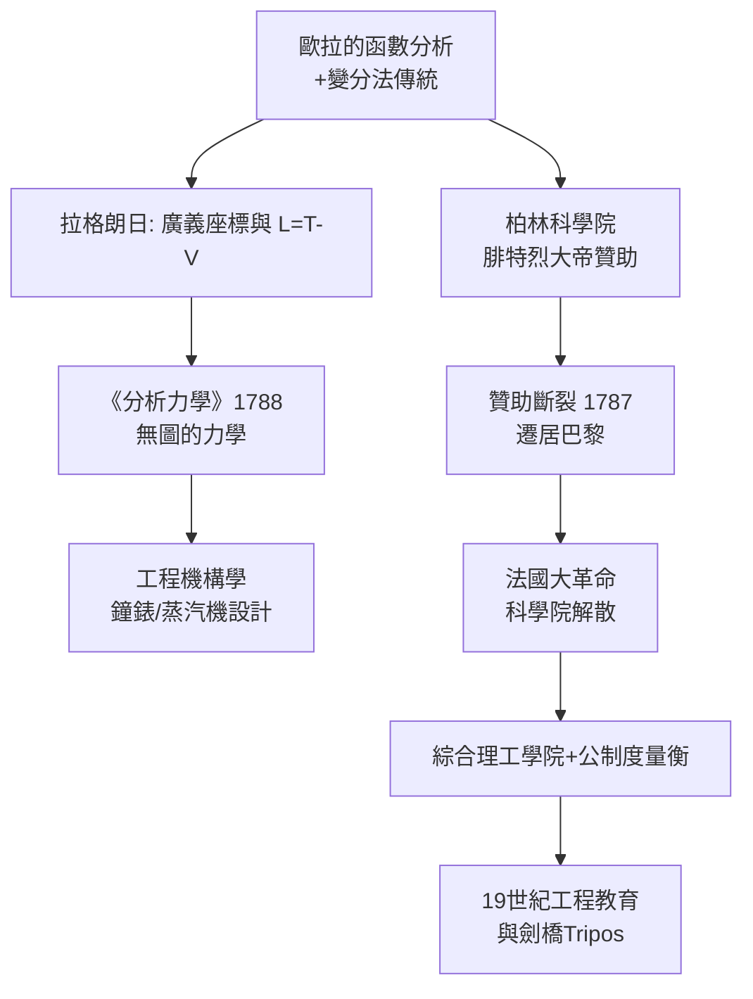

> 第三篇 · 第5章

# 第5.3節 1788 年：拉格朗日《分析力學》——擺脫幾何直覺，用純代數微分方程統領力學

## 一、「這本書裡沒有一張圖」

1788 年，約瑟夫-路易·拉格朗日（Joseph-Louis Lagrange, 1736–1813）在巴黎出版《分析力學》（*Mécanique analytique*）。他在序言中傲然宣告：全書**不包含一張圖**——力學將成為分析的分支，四則運算與微分方程足以推演一切。這是牛頓《原理》以來力學史上最大的範式轉移：牛頓用幾何證明 + 微積分混搭，拉格朗日則徹底代數化。

## 二、廣義座標與拉格朗日方程

拉格朗日的關鍵發明是**廣義座標**（generalized coordinates）$q_1, q_2, \ldots, q_n$：不必描述每個質點的 $x,y,z$，只需選取足以刻畫系統組態的獨立變數——單擺用角度 $\theta$，雙擺用兩個角度，剛體用三個歐拉角。再用拉格朗日量

$$L = T - V$$

（動能減位能），運動方程便機械地由

$$\frac{d}{dt}\frac{\partial L}{\partial \dot{q}_i} - \frac{\partial L}{\partial q_i} = 0 \qquad (i = 1, \ldots, n)$$

產生。約束力自動消失：掛在單擺繩上的張力、軌道給小車的正向力，都不必再算。工程師面對複雜機構（連桿、齒輪、擺鐘擒縱器）時，第一次擁有了「套公式即可」的系統方法。

| 面向 | 牛頓力學 (1687) | 拉格朗日力學 (1788) | 哈密頓力學 (1833) |
|---|---|---|---|
| 基本量 | 力 $\vec{F}$、向量 | 拉格朗日量 $L=T-V$ | 哈密頓量 $H=T+V$、$(q,p)$ |
| 幾何圖像 | 幾何直覺+向量 | 純代數、無圖 | 相空間幾何、辛結構 |
| 約束處理 | 逐一計算約束力 | 廣義座標自動消去 | 同左，另得正則變換 |
| 適合場景 | 少數質點 | 複雜機構、工程 | 天體力學、光學、量子 |

## 三、從都靈到巴黎：一個皮埃蒙特少年的學術流動

拉格朗日生於都靈，有法裔血統，十九歲即任都靈皇家砲兵學校數學教授——教導比他年長的砲兵軍官。他在歐拉鼓勵下投入變分法，1759 年當選柏林科學院通訊院士，1766 年接替歐拉出任柏林科學院數學部主任（由腓特烈大帝親邀：「歐洲最偉大的國王需要歐洲最偉大的數學家」）。他在柏林度過二十年，《分析力學》大部分在此寫成。

1787 年腓特烈大帝去世，贊助斷裂，法國路易十六邀請拉格朗日入巴黎科學院，年俸優渥。法國大革命爆發後，外籍學者反而處境微妙；1793 年恐怖統治時期，外籍人士被勒令離境，但國民公會特別豁免拉格朗日。革命政府重組科學機構：解散舊科學院（1793），另立**法國經度局**（1795）與**巴黎綜合理工學院**（1794）。拉格朗日成為度量衡委員會的靈魂人物，主導**公制**的制定——公尺、公斤、十進制，讓革命「為全人類重新發明度量」。他也在綜合理工學院講授分析，其教材影響了整個 19 世紀的工程教育。

## 四、前因後果

- **經濟**：工業革命的紡織機、蒸汽機、精密鐘錶需要分析複雜機構運動的數學；拉格朗日力學正是機構學（machine kinematics）的理論工具。日內瓦與巴黎的鐘錶精密製造，也以擺與擒縱機構的動力學為核心課題。
- **政治**：法國大革命對科學的重組是把雙刃劍——拉瓦錫上了斷頭臺，但也誕生了公制與新型工程學院。科學從宮廷贊助轉向民族國家的制度性投資。
- **軍事**：綜合理工學院的前身直承梅濟耶爾等**軍事工程學院**；其畢業生（波拿巴麾下的砲兵軍官）把彈道學與分析力學帶上戰場。拿破崙本人是拉格朗日的崇拜者，封他為帝國伯爵與榮譽軍團大十字勳章得主。
- **思想**：力學被還原為一組方程，加強了「機械宇宙可完全計算」的決定論信念，拉普拉斯妖是其極端化表述。
- **教育**：《分析力學》與後續巴黎學派的教材（拉普拉斯《天體力學》、泊松著作）構成 19 世紀「法國分析傳統」，經劍橋數學榮譽學位考試傳入英國。

## 五、因果鏈

## 延伸思考

1. 「一本沒有圖的力學書」是勝利還是損失？幾何直覺的捨棄換來了通用性，代價是什麼？
2. 拉格朗日力學本質上是「配置空間的幾何學」。這與 20 世紀廣義相對論把重力幾何化，是否同一種思想的延續？
3. 法國大革命同時殺死一位科學家（拉瓦錫）並創立公制與工程學院。政治劇變對科學制度的破壞與重建，該如何衡量？
