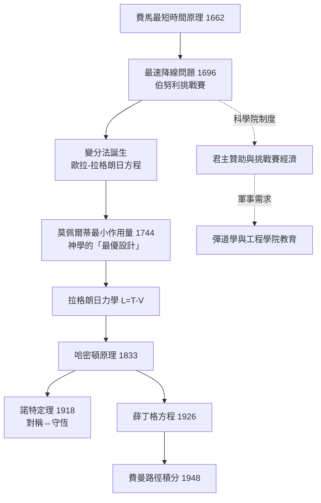

> 第三篇 · 第6章

# 第6.2節 變分法在力學中的勝利：光與質點為何總選擇「最省時或最省力」的路徑？

## 一、1696 年的戰書：最速降線問題

1696 年 6 月，萊布尼茨在《教師學報》上轉載了約翰·伯努利的公開挑戰：給定高低兩點 $A$、$B$，求一條曲線，使質點沿其無摩擦滑下時**耗時最短**。直覺答案是直線，但答案是錯的——先垂直下墜爭取速度、再加速滑行的曲線更快。牛頓在一天之內解出（匿名著文，伯努利一眼認出「獅子的爪印」）；萊布尼茨、洛必達、雅各布·伯努利也交出答案。答案是**擺線**（cycloid）——滾動車輪輪緣上一点畫出的曲線，它同時也是等時擺的軌跡。這場競賽開創了一門新數學：**變分法**——研究的不再是函數的極值，而是「函數的函數」（泛函）的極值。

費時比較（同高差 $h$ 的光滑無摩擦滑降，取直線所需時間為 1）：

| 路徑 | 形狀 | 相對時間 | 特徵 |
|---|---|---|---|
| 直線 | 斜線 | 1.000 | 最短但起始加速慢 |
| 圓弧 | 四分之一圓 | ≈ 1.02 | 略優於直線 |
| 拋物線 | 開口向上 | ≈ 0.99 | 接近最優 |
| **擺線（最速降線）** | 先陡後緩 | **≈ 0.916** | 全局最省時 |

## 二、從費馬到莫佩爾蒂：最優設計的宇宙

更早就埋下的伏筆是光學。1662 年費馬提出**最短時間原理**：光在介質間折射，走的是耗时最少的路徑，由此導出折射定律 $\dfrac{\sin\theta_1}{v_1} = \dfrac{\sin\theta_2}{v_2}$。這在神學上引起譁然——自然怎麼會「預知」哪條路最快？

1744 年，法國數學家莫佩爾蒂（Pierre-Louis Maupertuis, 1698–1759）將這類思想推廣為**最小作用量原理**：質點運動使作用量 $S = \int m v \, ds$ 極小。他明言這是「造物主智慧與能力的證明」——上帝以最經濟的方式設計宇宙。歐拉隨即將其數學化，給出變分法的基本方程，後經拉格朗日完善為**歐拉-拉格朗日方程**：對泛函 $S[q] = \int_{t_1}^{t_2} L(q, \dot{q}, t)\, dt$，其駐定軌道滿足

$$\frac{d}{dt}\frac{\partial L}{\partial \dot{q}} - \frac{\partial L}{\partial q} = 0$$

代入 $L = T - V$，就得到拉格朗日力學；令 $H=\sum p\dot q - L$，則得到哈密頓正則方程。牛頓三定律、折射定律、行星軌道、彈道曲線，全部成為「極值路徑」的推論。變分法因此是 18–19 世紀力學的**最高法院**：所有運動定律都要在此接受「是否可由一個作用量導出」的終審。

## 三、前因後果

- **思想（神學與自然神論）**：萊布尼茨「上帝從所有可能世界中選擇最好的」、牛頓-波義耳傳統的設計論，使「自然遵循最優原理」成為可接受的形上學預設。18 世紀的自然神學（後來的佩利《自然神學》與橋樑設計的「極值工程美學」）與變分法互相滋養。即使 19 世紀科學世俗化，極值原理仍以數學形式存續——希爾伯特在 1915 年用它統一廣義相對論場方程。
- **制度**：挑戰賽本身就是科學院制度的產物；莫佩爾蒂更以最小作用量原理作為柏林科學院的政治資本（腓特烈大帝將其樹為「普魯士科學的旗幟」，甚至引發與伏爾泰的著名交惡與薩米埃尔·柯尼希的剽窃指控風波）。
- **軍事與工程**：變分法直接服務於**彈道學**（最小時間/最小能量彈道）與軍事工程學院的教材；鐘錶業對「等時曲線」的需求（惠更斯擺線擺的延續）也是文化動機之一。
- **教育**：19 世紀劍橋數學榮譽學位考試將變分問題列為高階考題，麥士偉正是在此文化中成長；巴黎綜合理工則把變分法寫進力學講義，培養出柯西、龐加萊一脈。
- **通往 20 世紀**：1918 年諾特定理證明——作用量的每一個連續對稱性對應一個守恆律（時間平移→能量守恆、空間平移→動量守恆、旋轉→角動量守恆），變分原理從此成為守恆律的母體。而量子力學中，費曼路徑積分宣告粒子其實「嘗試」所有路徑，只是非駐定路徑互相抵消——最優設計的宇宙，最終被詮釋為概率幅的干涉。

## 四、因果鏈

## 延伸思考

1. 「上帝以最經濟的方式設計宇宙」如今可換成什麼說法？極值原理是物理事實，還是選擇數學形式時的約定？
2. 費曼路徑積分中，粒子「走遍」所有路徑而非只走極值路徑。古典變分原理與量子描述之間，哪一個更「基本」？
3. 諾特定理把守恆律還原為對稱性。如果自然界的作用量不再對時間平移對稱（如宇宙膨脹），能量守恆還成立嗎？
