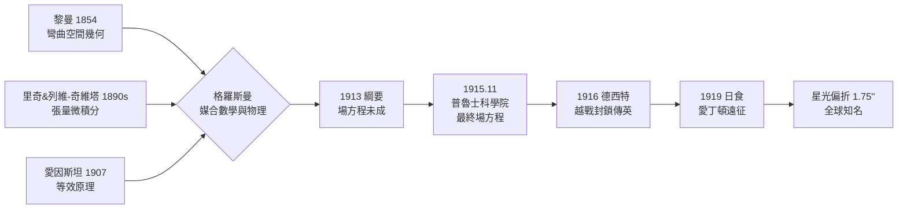

> 第四篇 · 第7章

# 第7.2節 1915 年：廣義相對論中的黎曼幾何與張量微積分——用彎曲時空的幾何微分方程重新定義重力

## 黎曼 1854：為半世紀後的物理備好數學

1854 年，哥廷根的年輕講師黎曼（Bernhard Riemann）發表就職演說〈論作為幾何基礎的假設〉，提出任意維彎曲空間的幾何：空間的性質由度量張量 $g_{\mu\nu}$ 決定，曲率由度量的微分刻畫。這場演說在當時是純數學的思辨，高斯本人（評審之一）深為讚賞。六十年後，這套語言成為重力的母語——數學常常領先物理數十年，等著被「認領」。

## 從等效原理到彎曲時空

1907 年，愛因斯坦在專利局構思出他自稱「一生最快樂的念頭」：自由落體的人感受不到重力——等效原理。重力與加速度局部不可分辨，暗示重力不是力，而是時空彎曲的表現：質量告訴時空如何彎曲，彎曲的時空告訴物質如何運動（惠勒的名言）。物體在彎曲時空中沿測地線（最「直」的路徑）運動，行星橢圓軌道不過是四維彎曲幾何在三維空間的投影。

## 格羅斯曼的協助與張量微積分

問題在數學。愛因斯坦懂的是老式黎曼幾何的皮毛，而描述曲率所需的語言——絕對微分學——由里奇（Gregorio Ricci-Curbastro）與其學生列維-奇維塔（Tullio Levi-Civita）於 1890 年代在帕多瓦大學發展成形。1900 年他們發表〈絕對微分方法及其應用〉，建立協變張量分析：方程在任意座標變換下形式不變（協變性），正是「廣義相對性」所需的數學。

愛因斯坦 1912 年回到蘇黎世時求助於老同學格羅斯曼（Marcel Grossmann），一位幾何學教授。格羅斯曼翻遍文獻，找到里奇-列維-奇維塔的理論，並教會愛因斯坦克里斯托弗符號與協變微分。1913 年兩人合著〈廣義相對論與引力理論綱要〉，可惜場方程尚未正確。愛因斯坦在 1915 年秋天獨自苦戰，於柏林普魯士科學院的四場週四演講中逐步修正（包括處理列維-奇維塔的通信批評），11 月 25 日提交最終方程：

$$G_{\mu\nu}=R_{\mu\nu}-\frac{1}{2}Rg_{\mu\nu}=\frac{8\pi G}{c^4}T_{\mu\nu}$$

左邊是時空的幾何（愛因斯坦張量），右邊是物質能量動量張量——十個耦合的非線性偏微分方程。牛頓重力在弱場慢速極限下被重現：$g_{00}\approx -(1+2\phi/c^2)$，$\phi$ 即牛頓位能。三個立即的勝利：水星近日點每世紀 43 角秒的反常進動、光線經太陽的偏折、重力紅移。

## 1919 年日食與德英科學政治

1915 年正值一戰。德國科學界被協約國封鎖，愛因斯坦 1916 年透過荷蘭中立的德西特（de Sitter）把論文寄到英國。皇家天文學會秘書愛丁頓（Arthur Eddington），一位貴格會教徒、拒服兵役的和平主義者，讀到後深受震撼，推動英國組織 1919 年 5 月 29 日日食遠征：戴森與克羅姆林赴巴西索布拉爾，愛丁頓本人赴西非普林西比島。量得的星光偏折約 1.75 角秒（$1.75''$，恰為牛頓微粒說值 $0.87''$ 的兩倍），與廣義相對論相符。11 月 6 日皇家學會與皇家天文學會聯席會議宣布結果，《倫敦時報》頭版宣告「科學革命」，愛因斯坦一夜之間成為全球第一名星。

這場勝利有深刻的政治紋理：戰後英德敵意仍深，愛丁頓既為科學也為修復英德科學關係而奔走；德國一方，普魯士科學院的建制（愛因斯坦 1913 年入選、1917 年出任威廉皇帝物理研究所所長）提供了研究的制度化保障。相對論的傳播也藉助了戰後大眾對「顛覆常識」的文化熱情——報紙、暢銷書（愛丁頓、保羅・朗之萬的通俗演講）把微分方程式變成了公共知識。

## 兩種重力理論的對比

| 面向 | 牛頓重力（1687） | 愛因斯坦重力（1915） |
|---|---|---|
| 數學工具 | 平面幾何、向量微積分 | 黎曼幾何、張量微積分 |
| 核心方程 | $\nabla^2\phi=4\pi G\rho$（橢圓型） | $G_{\mu\nu}=\dfrac{8\pi G}{c^4}T_{\mu\nu}$（雙曲型） |
| 重力本質 | 超距作用的力 | 時空曲率 |
| 傳播速度 | 瞬時 | 光速 $c$ |
| 預言差異 | 近日點進動 $43''$/世紀無法解釋 | 精確解釋；預言黑洞、重力波、宇宙膨脹 |

## 延伸思考

1. 廣義相對論是「數學牽引物理」還是「物理逼出數學」？若沒有格羅斯曼，愛因斯坦可能走多遠？
2. 1919 年的實驗誤差其實不小，為何科學共同體仍迅速接受？科學的社學與驗證標準該如何權衡？
3. 普魯士科學院、大學講座、研究所——德國的科研制度如何塑造了理論物理的黃金年代？
