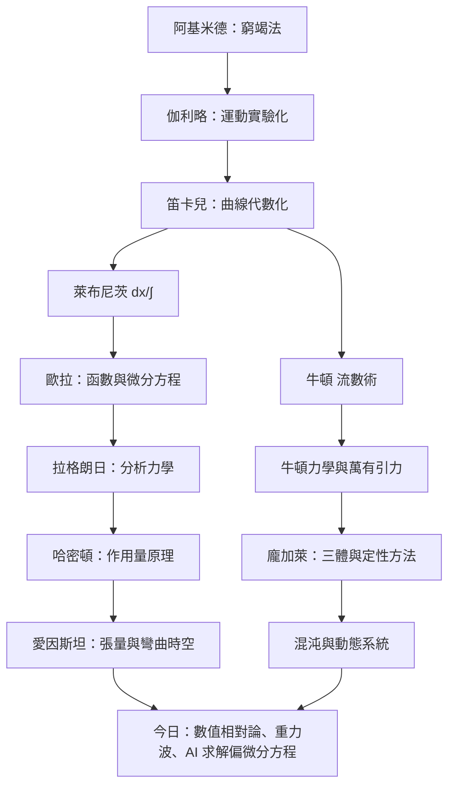

# 結語：從墜落的蘋果到時空的曲率——微積分與力學交織出的理性星空

> 運動的微積分

回望全書，微積分與力學的關係像一段持續三百年的對話：

1. **力學提出問題，微積分提供語言。** 阿基米德用窮竭法逼近面積，是因為想量出拋物線弓形；牛頓發明流數術，是因為開普勒的橢圓需要「連續變化率」才能證明。問題先於方法。
2. **微積分反過來重塑力學的靈魂。** 有了微分方程，牛頓力學成為預測機器；有了變分法，拉格朗日與哈密頓把整個力學壓縮成一個作用量積分 $S=\int L\,dt$；有了張量分析，愛因斯坦讓「重力」從力變成時空的曲率 $G_{\mu\nu}$。
3. **極限的歷史，也是人類思維方式的歷史。** 從希臘人對「無窮」的恐懼（芝諾悖論）、17 世紀對「無窮小」的混戰（貝克萊主教譏其為「消逝量的幽靈」）、到 19 世紀柯西與魏爾斯特拉斯的 $\varepsilon$-$\delta$ 嚴格化，數學的嚴謹是被哲學與神學的攻擊逼出來的。
4. **20 世紀的教訓是謙卑。** 龐加萊與洛倫茲告訴我們：即使方程完全確定，混沌也能讓長期預測失效。微積分沒有失去權威，但它學會了承認自己的邊界——而非線性微分方程的數值試驗，正是靠電腦（微積分的離散化機器）才成為可能。

更深的教訓在**歷史的結構**：科學院制度決定了歐拉的產量，皇家學會的出版經濟決定了《原理》的誕生方式，優先權之爭讓英國數學落後百年，冷戰預算餵養了混沌研究。制度與資本，始終是公式的無形作者。

今天，微積分以兩種形式無處不在：一是晶片裡對微分方程的數值求解（天氣、飛機、動畫、神經網路的梯度下降本身就是微積分），二是腦中那個「瞬時變化率」的直覺。從墜落的蘋果到時空的曲率，人類用極限的概念馴服了無窮——這是理性最壯麗的星空。

而星空仍在延展：量子重力、非平衡統計、以神經網路近似解 PDE——下一章的雙人舞，正在開始。

---

*全書完*
