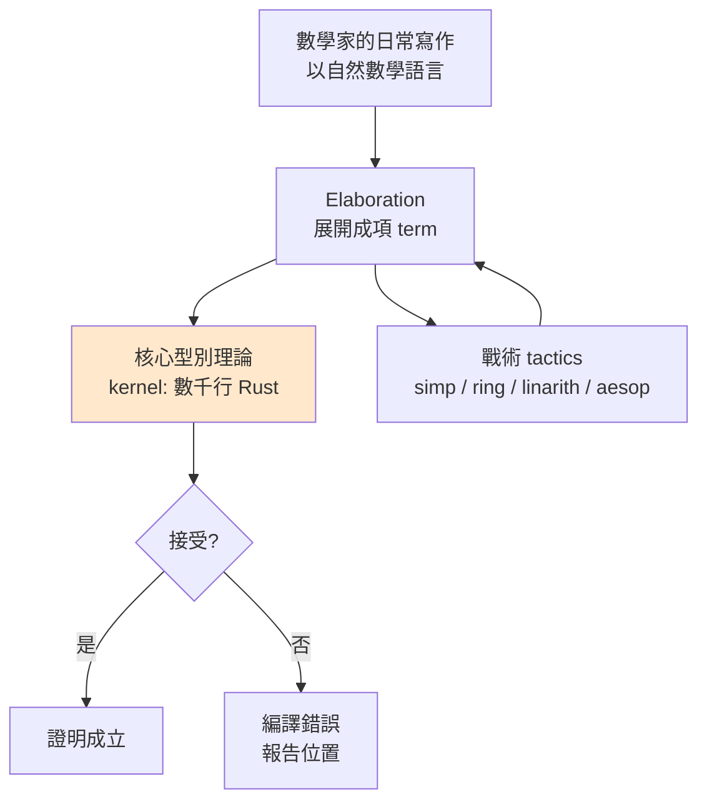

# 9.2 Coq 與 Lean 的誕生

## 從一個錯誤的假設開始

談到 Lean 的歷史，有一件事必須先說清楚：Lean 的設計初衷並不是「把數學證明自動驗證」，而是相反。

Lean 的創建者裡奧納多·德莫拉（Leonardo de Moura, 1964–）在 2008 年左右的目標是：製造一個「專為定理證明而最佳化的程式語言」。他的動機來自一個具體的挫敗：微軟研究院的定理證明器在處理諸如「數學家日常寫的那些中等難度定理」時，經常失敗，因為這些定理的陳述方式不像邏輯學家寫的那樣整潔。

而德莫拉注意到一個關鍵事實：數學家寫的定理，通常是「可讀」的——它們有名字、有明確的主詞與謂詞、有約定俗成的記號。所以，一個能接受「自然數學語言」的證明器，理論上可以涵蓋數學實踐的大部分。

這個洞見，是 Lean 與它的同類（Coq、Isabelle）最重要的差異化所在，也是它後來能長成「數學家的圖書館」的技術前提。

## 兩條血統

讓我們把 1980 年代到 2000 年代的證明助理分成兩條血統。

### 第一條：來自「構造邏輯」的血統——Coq

Coq 的前身是 Coq-logic，源自 1985–1989 年間 INRIA 的研究，最早的形式是 Calculus of Constructions（Coquand 與 Gilbert, 1985）。

它的核心想法是「 propositions as types 」（命題即類型）：每個命題 $P$ 都是一個類型，而證明 $P$ 就是一個該類型的元素。這聽起來很怪，但它產生了巨大的威力——因為它意味著「證明」可以用程式語言裡的函數來組合。

Coq 的另一個關鍵設計是「判定性」（reducibility）的機制：它允許使用者宣告某些運算是「可計算的」，於是像 $1 + 1 = 2$ 這種命題可以被直接算出來，而不需要邏輯推導。

Coq 的繼承者是 Gallina（Metatheory of Coq），以及那些建構在其上的工具：ssreflect、MathComp、以及 Coq 的標準庫。

今天 Coq 生態最重要的使用者之一，是數學界的「受限證明」社群——尤其是 **HoTT（ homotopy type theory）** 社群，以及 2013 年後的 **MathComp** 社群（用於組合數學與有限群理論的證明），和 2020 年代的 **Batteries、Mathematical Components** 等。

Coq 的另一個身分是「軟體驗證語言」：CompCert（空中巴士的 C 編譯器驗證）、F*、Why3 等。

### 第二條：來自「自動定理證明」的血統——Isabelle 與 HOL Light

Isabelle（Makus Wenzel, 1989–）與 HOL Light（John Harrison）走的路徑不同：它們從 LCF（Langlands–Common Framework）與「可信任的微内核」出發。

LCF 的思想是：整個系統只有一個極小的核心（約幾百行）負責檢查推理，其餘所有「高階戰術」都被視為不可信但可驗證的。這個架構後來在 Lean 中被繼承（Lean 有一個極小的內核，約幾千行 Rust）。

Isabelle 的強項是它的「Isar」語言：一種把「結構化的推理步驟」直接寫出來的語法，讓證明腳本讀起來像人寫的數學論文。Isabelle 至今是形式化分析與數學的一級公民。

## Lean 的三個時期

### 2013 年：Lean 1.0

第一版 Lean 的設計目標非常明確，並且在論文〈The Lean Theorem Prover (System Description)〉（de Moura, Avigad, Baillif, Brown, Chandra, Cruz, Innes, et al., 2015, CADE-25）裡明確寫出：

> 「Lean 的核心是一個可擴展的順序型系統（orderable type theory），內建支援諸如決策相等、可判定的算術、以及[歸納]類型……我們設計 Lean 的目標是打造一個『數學家的系統』，讓它同時成為互動式定理證明器、自動定理證明器，以及程式語言。」

Lean 1 的關鍵創新是「決策相等」（decidable equality）：對於所有可以決定相等性的類型，Lean 允許你直接寫 $\{n \mid \text{某個可判定的命題}\}$，並且自動展開它。

### 2014–2017 年：Lean 2 與 Lean 3

Lean 2 與 Lean 3 由德莫拉在微軟研究院與亞利桑那州立大學（ASU）開發，並且在 2017 年 7 月正式釋出 Lean 3.0。

2015 年 1 月，卡內基梅隆大學開了一門課：15-815「互動式定理證明」（Interactive Theorem Proving），由凱文·巴澤（Kevin Buzzard）教授——他後來成為 Lean 社群最重要的推動者之一。這門課每年都有學生，許多後來的 Lean 貢獻者出自這門課。

**Mathlib 的歷史與此重疊**：2017 年 7 月，Mathlib3 建立。它的目標是：把 Lean 社群裡散落各處的數學定理，組織成一個可以互相引用的統一圖書館——這正是「數學家的圖書館」的想法。

### 2021–2023 年：Lean 4

2021 年 7 月，Mathlib4 開始建立；2023 年 9 月，Lean 4.0 正式發布。

Lean 4 是一次徹底的重寫（用 C++ 實作，帶有可編譯的代碼生成），帶來了幾個關鍵變化：

- **更好的並行與快取**：大幅改善編譯速度與增量建置；
- **`macro` 與 `elab` 的現代化**：讓 tactic 的撰寫更容易；
- **術語與文件**：更好的註解支援；
- **效能**：在大型專案上（例如 mathlib 全量建置）大幅縮短。

2024 年 4 月，Lean FRO（Lean Focused Research Organization）成立；2023 年 12 月，費爾馬大定理專案成立；2023 年 11 月，多項式弗雷曼-魯茲薩猜想專案成立——這三個事件標誌著 Lean 從「工具」變成「有組織的科研計畫」。

## 一個關鍵的設計：核心極小，戰術豐富

Lean 的架構可以畫成一張圖：



核心（kernel）只做一件事：檢查一個「項」是否具有某個類型。所有精巧的自動化——`simp`（化簡重寫）、`ring`（多項式環的正規化）、`linarith`（線性算術的決策程序）、`aesop`（一階邏輯的自動搜尋）——都只是產生項的工具，可以被替換，而不會影響可信度。

這是一個深謀遠慮的設計：它的意思是，**你可以信任結果，而不必信任產生結果的工具**。

用今天最流行的一句話說：數學的「形式化」讓「證明」變成了一個可以被第三方獨立重放的產物。

## Lean 的生態與它的社會學

Lean 的成功不只是一個技術事件。

**第一，社群規模。** 到 2026 年，Lean 的 GitHub 儲存庫被 star 超過 7,500 次（2026 年 3 月），Lean 的 VS Code 擴充套件安裝超過 10 萬次（2025 年 8 月），Lean 的 Zulip 頻道成員超過一萬人。對比之下，Coq 的社群規模要小得多，但深度相當。

**第二，教育。** 2025 年 5 月，Lean FRO 統計已有超過 50 門大學層級的課程使用 Lean。基於 Lean 的教材包括：

- 《Mathematics in Lean》（Lean 官方文件，2020 年首次發布，2023 年大修）；
- 《Lean for Mathematicians》（Jesper宣布?）—— 實際是 Tao 的《Mathematics in Lean》? Tao wrote "Mathematics in Lean" is by the Lean project; Tao wrote "The Lean 4 Theorem Prover" ... The Lean book "Mathematics in Lean" is by the Lean community (Robert Hanson et al.).
- 陶哲軒 2025 年 1 月在《美國數學會公報》（Notices of the AMS）發表了〈Machine-Assisted Proof〉一文，把 Lean 定位為「數學家的新工具」，並給出了他自己使用 Lean 的經驗——例如他用 Lean 做了「數學的數學」的工作。
- 2025 年 7 月，DeepMind 的「Formal Conjectures」專案建立，把數學的重要猜想形式化為 Lean 命題，作為 AI 系統的訓練與評測靶場。

**第三，學術界與工業界的合流。** 2024 年 1 月，AWS 發布了 Cedar 政策語言的 Lean 驗證；2025 年，AWS 把 Lean 用於差分隱私保證（SampCert）、用於神經網路晶片編譯（Neuron）與代理安全性（Bedrock AgentCore）。2024 年 6 月，第一家以 Lean 為基礎的新創 Harmonic 上線（《紐約時報》報導）；2025 年 10 月，Harmonic 發布了「Aristotle」——一個以 Lean 為驗證層的「數學超級智能」；2025 年 7 月，Aristotle 在國際奧林匹亞競賽中拿到金牌，ByteDance 的「Seed Prover」拿到銀牌。

2026 年 10 月，Axiom 發布了第一個「有限單群分類」的完整 Lean 形式化；2026 年 7 月，Google DeepMind 發布了「AlphaProof Nexus」與九個 Erdős 問題的自主證明。

**第四，基金會化。** 2025 年 7 月，Lean FRO 宣布 1,000 萬美元新資金（其中 500 萬支持新成立的 Mathlib Initiative，500 萬給 FRO），捐贈者包括 Alex Gerko（Mythic Capital 創辦人，一個業餘數學家出身的加密貨幣億萬富翁）。2026 年 7 月，亞馬遜宣布對 Lean FRO 的「史上最大單筆捐贈」；2026 年 8 月，XTX Markets 也宣布支持。

這一段制度史值得慢慢讀：一位億萬富翁、兩家科技巨頭、一個數學家社群，共同把「形式化數學」變成了一個有資源、有組織、有時程的產業。

## 為什麼 Lean 而不是別的

三個理由。

第一，**可讀性與可修改性**。Lean 的 `theorem` 陳述看起來幾乎和論文的公式一樣：

```lean
theorem sum_range (n : ℕ) : ∑ i in Finset.range n, i = n * (n - 1) / 2 := by
  ...
```

第二，**內建的資料結構**。`Nat`、`Int`、`Rat`、`ℝ`、`ℂ`、`List`、`Finset` 這些都是 mathlib 裡的正式物件，數學家不需要自己從零建立。

第三，**自動化與互動的平衡**。Lean 的 `aesop`、`simp`、`grind` 等戰術能處理相當一部分的瑣碎推理，讓人可以把注意力放在關鍵步驟上。

下一節，我們看 mathlib 這個「圖書館」本身，以及它如何改變了數學家的分工。

---

[下一節：9.3 Mathlib 與數學家的圖書館](09.3-Mathlib與數學家的圖書館.md) ｜ [上一節：9.1 邏輯的機器](09.1-邏輯的機器從弗雷格到四色定理.md) ｜ [回到目錄](README.md)
