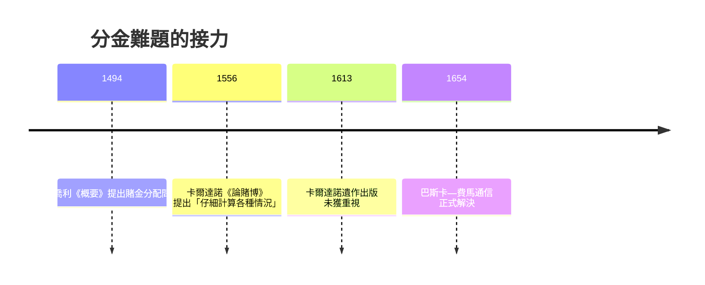

# 1.1 帕喬利的未解之題：賭局中斷，賭金該怎麼分？

## 一個修士的帳簿問題

1494 年，義大利方濟各會修士路卡·帕喬利（Luca Pacioli）在威尼斯出版《算術、幾何、比與比例概要》（Summa de arithmetica）。這本書以「複式簿記」的系統闡述聞名，被稱為現代會計學的奠基之作——達文西還曾與他合作，為他畫插圖。就在這部談「精確記帳」的巨著裡，帕喬利提出了一個他無法解決的問題：

> 甲乙兩人賭球，先得 6 分者勝。賭到甲得 5 分、乙得 3 分時，賭局因故中斷，賭金該如何分配？

這就是著名的「分金難題」（problem of points）。直覺的答案似乎不少：按已得分數比例分（5 比 3）？按誰領先分？還是平分？帕喬利建議按已得分數比例分配，但這顯然有問題——甲只需再得 1 分，乙卻還需 3 分，兩人的「前景」並不等價。

這個問題看似只是賭徒的瑣事，實則觸及一個深刻的觀念缺口：當時的數學能處理「已經發生的事」，卻沒有工具處理「還沒發生的各種可能」。要用數學分金，必須先為未來的每一種可能性賦予一個「權重」——這正是機率的概念。換句話說，這道題目第一次逼著數學家去量化「還沒發生的事」。

## 為什麼是十六世紀的義大利？

分金難題出現在帕喬利筆下並非偶然。文藝復興時期的義大利城邦，商業革命正酣：威尼斯與佛羅倫斯的商人需要複式簿記追蹤風險重重的水上貿易；海上保險合約已經出現；骰子與紙牌賭博在宮廷與市井之間極為盛行。一個社會必須先大量「與偶然打交道」——貿易、賭博、保險——才會認真提出「偶然的數學」這種需求。伽利略晚年也留下一段關於骰子點數的分析：有人問他，擲三顆骰子時，點數和為 10 與 11 的組合數相同（各六種），為何實際上 10 出現得更多？伽利略用排列組合指出：10 可由 6-3-1 等六種有序組合產生，9 卻只有更少的有序方式。這是「等可能基本事件」思想的雛形。

## 卡爾達諾：賭徒數學家的先聲

在帕喬利與巴斯卡之間，還有一位關鍵人物：米蘭的傑羅拉莫·卡爾達諾（Girolamo Cardano）。他是醫生、占星家，也是徹頭徹尾的賭徒——他在自傳裡坦承自己輸掉大筆錢財，甚至抵押家產。或許正因為輸得夠多，他寫下了《論賭博》（Liber de ludo aleae），系統地計算擲骰子的各種情形，提出「公平賭局」的概念，並指出用「有利結果數除以全部可能結果數」來衡量勝算。這本書在他生前未出版，直到 1663 年才問世，錯過了影響時代的機會。但他的核心洞見——把賭局的結果拆成等可能的基本事件來計數——正是後來巴斯卡與費馬重新發明的起點。

## 一道題，撬動一個觀念

從 1494 到 1654，分金難題懸置了整整一百六十年。不是因為題目太難，而是因為缺乏一個觀念工具：人們習慣認為「未來是神意的領域」或「命運的擲骰」，對未來做數學化的期許，在思想上是越界的。當巴斯卡與費馬終於解開它時，他們真正完成的，不是一道習題，而是一次觀念革命：偶然事件雖然個別無法預料，其「可能性的結構」卻可以精確計算。這一步，為保險、統計、乃至今天的人工智慧，開出了第一張通行證。
