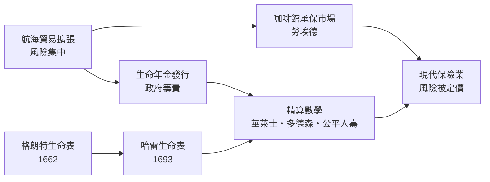

# 2.2 勞埃德咖啡館：為風險定價的保險業

## 從海事貸款到海上保險

在機率論出現之前，人類早就發明了對抗風險的制度雛形。古巴比倫的漢摩拉比法典已有「船貨抵押貸款」：商人借錢置辦船貨，若船沉則免還本息，債主收取遠高於普通貸款的利息——風險溢酬的概念已經存在。中世紀義大利城邦發展出正式的海上保險契約，熱那亞與威尼斯的公證檔案裡保存著十四世紀的保單。值得注意的是：這些保險都是「以經驗定價」，靠商人公會的行規、個案談判與運氣，並沒有任何壽命或沉船機率的數學。

到了十七世紀，世界貿易重心移向英國與荷蘭。東印度公司的遠洋船隊一趟航程兩三年，船貨價值巨大，風險集中——一艘船的沉沒足以讓商人破產。分散風險的迫切需求，催生了現代保險的組織形態。

## 泰迪街的咖啡館

1680 年代的倫敦，咖啡館是資訊的交易所。愛德華·勞埃德（Edward Lloyd）在泰迪街開設的咖啡館，靠近泰晤士河，成了船長、船東、貨主與「承保人」（underwriter，願意把自己的錢「簽在風險之下」的人）聚集之地。勞埃德本人不承保，他做的是更聰明的事：收集航運情報，自 1696 年起發行《勞埃德新聞》，刊載船期、海況、海難與捕獲消息。承保人在這裡傳閱情報、評估風險，在一張契約上依次簽下自己願意承擔的份額——一人承擔 5%，另一人 10%……這就是勞埃德保險社（Lloyd's of London）的起源。今日倫敦金融城的保險業、乃至「underwriter」這個全球通用的職稱，都源自這間咖啡館的長木凳。

## 保險需要數學：生命年金之爭

十八世紀初，英國政府為籌措戰費大量發行「生命年金」：付一筆錢，政府終身每年付你定額。政府該定什麼價？這正是生命表的用武之地。哈雷 1693 年的生命表本就附有年金定價建議，但英國政府長期漠視，仍按「年齡無關、一律七倍年金」的粗糙規則定價——結果年金購買者趨之若鶩，政府數十年間虧損累累。1743 年，蘇格蘭兩位精算先驅華萊士與多德森受蘇格蘭教會寡婦年金基金委託，用生命表計算出合理的保費與準備金，使該基金長期穩健；他們的方法成為正規精算數學的開端。1762 年成立的倫敦公平人壽（Equitable Life）則是第一家以科學保費經營的人壽保險公司。

## 制度與數學的互相成就

這段歷史呈現一個完整的思想—制度共生環：航海貿易與政府財政提出「風險定價」的經濟需求；教區死亡登記提供了原始資料；格朗特與哈雷的數學把資料變成生命表；精算師把生命表變成保費；保險公司再把風險變成可交易的商品。而保險業的壯大又反向驅動數學：年金、聯合生命、準備金等問題不斷湧向數學家——棣美弗終身以精算顧問為業，他的正態曲線研究（下一章）正是在計算年金的實務中磨出來的。

風險一旦可以定價，遠洋冒險、開辦工廠、乃至發展鐵路，都從「賭命」變成「生意」。有史家認為，這是資本主義得以起飛的隱形基礎設施之一。而它的原材料，不過是一張張死亡名單與幾頁機率計算。
