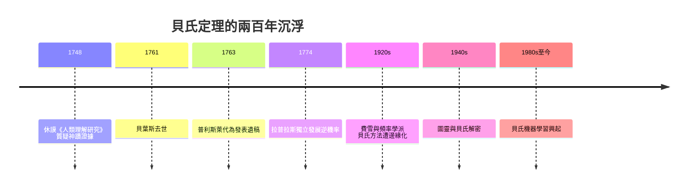

# 4.1 貝葉斯與普利斯萊：逆機率如何從長老教會書房走出

## 一位從不發表的牧師

托馬斯·貝葉斯（Thomas Bayes，約 1701–1761）生前是一位幾乎無名的英格蘭長老教會牧師，在肯特郡坦布里奇韋爾斯牧會終老。他在世時只發表過兩篇作品，其中之一是為牛頓微積分辯護的數學論文（1736 年，匿名出版）。他一生沒有出版過任何機率著作。

然而在他去世後，家人請友人理查德·普利斯萊（Richard Price，1723–1791）整理遺稿。普利斯萊——他本人也是著名的非國教牧師、哲學家、以及保險與年金理論家（公平人壽公司的顧問，並是瑪麗·沃斯通克拉夫特的摯友）——在遺稿中發現一篇論〈機率學說中一個問題的解〉的文章。普利斯萊認為其價值重大，親自補寫引言與附錄，於 1763 年在皇家學會《哲學學報》代為發表，並於次年向學會宣讀。貝葉斯定理就此問世——幾乎完全是普利斯萊的功勞。

## 正機率與逆機率

貝葉斯解決的問題，方向與惠更斯以來的傳統相反。傳統機率是「正向」的：已知袋中黑白球比例，算抽到黑球的機率。貝葉斯問的是「逆向」的：先看到抽球的結果，能否反推袋中黑白球的比例？

用現代符號，貝葉斯定理寫作：

$$P(H \mid E) = \frac{P(E \mid H)\, P(H)}{P(E)}$$

其中 $H$ 是假設，$E$ 是證據。它提供了一個形式化的學習程序：根據新證據，把「先驗信念」更新為「後驗信念」。今天這個公式是垃圾郵件過濾、醫學診斷、雷達追蹤與貝氏機器學習的核心引擎。

但在十八世紀，這個公式最敏感的應用是宗教。貝葉斯的遺稿動機（據普利斯萊的引言）是回應哲學家休謨：休謨在《人類理解研究》（1748）中論證，目睹「神蹟」的證詞永遠不可能足夠，因為神蹟違反自然律的可能性極高。如果機率只能「正向」計算，這個論證幾乎無懈可擊。貝氏定理提供了另一條路：把「自然律恆定」與「神蹟發生」當作兩個假設，用證據（證詞）來更新它們的相對可能性。逆機率在此不僅是數學，更是一場關於信仰與理性之爭的思想武器。

## 長期被冷落，而後改寫世界

弔詭的是，貝葉斯—普利斯萊的論文在十八世紀影響甚微。拉普拉斯在 1770 年代獨立發展出同樣的逆機率方法（他不知道貝葉斯的工作），並用於天文計算；但在二十世紀上半葉，隨著皮爾森與費雪的頻率學派統計學成為主流，貝氏方法被斥為「主觀」而遭邊緣化。它的真正復活要等到二戰與電腦時代——圖靈團隊用貝氏邏輯破解恩尼格瑪，冷戰中美國海軍用貝氏搜尋法找到失踪的氫彈（詳見第 8 章）。

## 數學的身世與思想的身世

貝葉斯定理的身世值得我們細想：它誕生於長老教會牧師的書房，為回應一位懷疑論哲學家，由另一位牧師整理出版，被法國天文學家獨立再造，被英國統計學派埋沒，最後在戰爭與電腦中復活。公式不變，意義卻隨每個時代的問題、信仰與技術而流轉。這正是科學史的常態：觀念的價值不在它誕生的那一刻，而在它被反覆重新發現的漫長歷史中。
