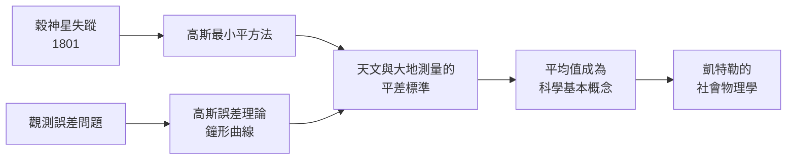

# 5.2 高斯與最小平方法：從小行星穀神星到誤差理論

## 一顆失蹤的行星

1801 年元旦之夜，義大利天文學家皮亞齊在巴勒莫觀測到一顆新的小行星——穀神星（Ceres），這是第一顆被發現的小行星。他追蹤了四十一天，共記下二十四個位置資料，隨後因病中斷。等他恢復觀測，穀神星已移近太陽方向，消失在光芒之中。

問題來了：憑四十一天的弧段觀測（僅佔整個軌道的約 2%），如何推算出它的完整橢圓軌道、預測它何時重新出現？當時的數學家（包括歐拉發展的行星軌道方法）在資料這麼少的情況下都無能為力，因為每一筆觀測都有誤差，資料彼此矛盾——用三筆資料解一個軌道，三組答案各不相同。

## 二十四歲的解法

1801 年秋天，哥廷根大學一位二十四歲的青年高斯（Carl Friedrich Gauss）接下了這個挑戰。他發明（或至少首次實用化）了一種方法：當觀測方程多於未知數時，不是捨棄資料，而是讓所有資料共同發言——尋找一組軌道參數，使每筆觀測的「殘差」平方和最小：

$$\min_{\theta} \sum_{i=1}^{n} \left(y_i - f(x_i; \theta)\right)^2$$

這就是最小平方法。高斯用它算出穀神星軌道，預測它將於 1801 年 12 月 7 日前後出現在室女座附近。天文學家察哈里亞斯於 12 月 7 日夜依據預測重新找到穀神星（首度確認者為 12 月 31 日的奧伯斯）。一顆失蹤的行星被一支鉛筆找了回來，高斯一夜之間名震歐洲。

誰先發明？1805 年，法國的勒壤得（Legendre）率先出版最小平方法；1809 年高斯在《天體運動論》中宣稱自己 1795 年（至少 1801 年前）已在私底下使用，並補上了勒壤得沒有的關鍵：誤差理論證明。兩人為此結怨，這是數學史上著名的優先權之爭之一。

## 誤差的鐘形曲線

高斯的真正貢獻不是「平方和最小」這個技巧，而是它的理論基礎。他證明：若觀測誤差服從某種自然分布（誤差大者比誤差小者罕見得多，且誤差對稱），那麼按機率論，使平方和最小的估計就是最可能的估計——而這個分布正是棣美弗的鐘形曲線：

$$f(\varepsilon) = \frac{1}{\sqrt{2\pi}\sigma} \exp\left(-\frac{\varepsilon^2}{2\sigma^2}\right)$$

從此這條曲線被稱為「高斯分布」，最小平方法獲得了機率論的合法性。它也解釋了為什麼「平均」是有意義的：算術平均正是最小平方法在估計單一位置參數時的特例。天文台開始以平均取代單一觀測，「平均數」從此成為科學的基本語彙。

## 從天文台到普魯士大地測量

理論隨即被制度放大。1818 年起，高斯主持漢諾威王國的大地測量，把誤差理論應用於三角測量網——數十萬筆測量資料的平差計算，催生了近代測量學與製圖學的標準流程。他為此還發明了日光反射儀。測量工作同時引導他研究曲面幾何，產生了微分幾何的「絕妙定理」。科學、國家工程與純數學，在一個人的書桌上互相供養。

## 一條曲線的三重身分

同一條鐘形曲線，在棣美弗那裡是骰子頻率的近似，在高斯這裡是觀測誤差的分布，在下一章的凱特勒那裡將成為人類身體與社會的常態。這條曲線穿越賭桌、天文台與社會普查的三重旅程，正是機率統計從賭博之學成長為「治理與科學的通用語言」的縮影。而高斯的方法還留下了一個更深的遺產：當資料互相矛盾時，不要丟棄資料，要建立一個讓所有資料共同投票的模型——這是今日一切迴歸分析與資料科學的出發點。
